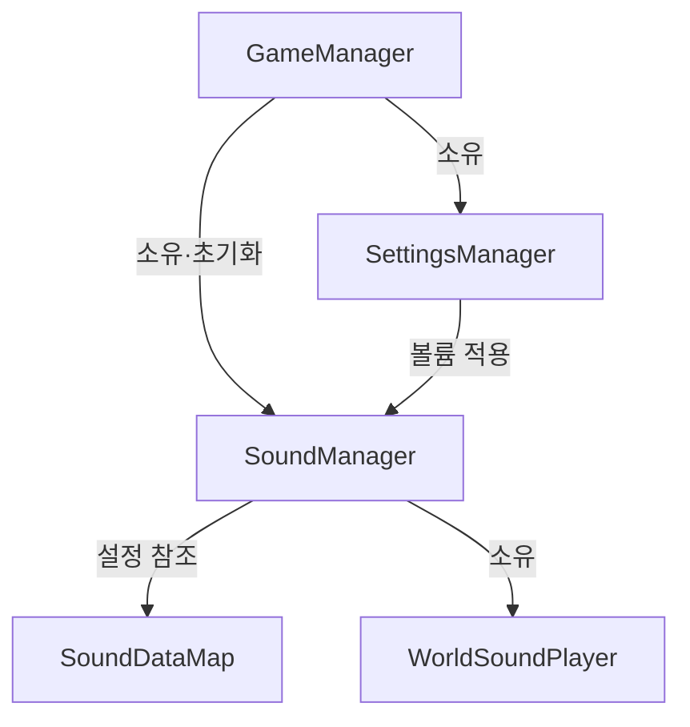
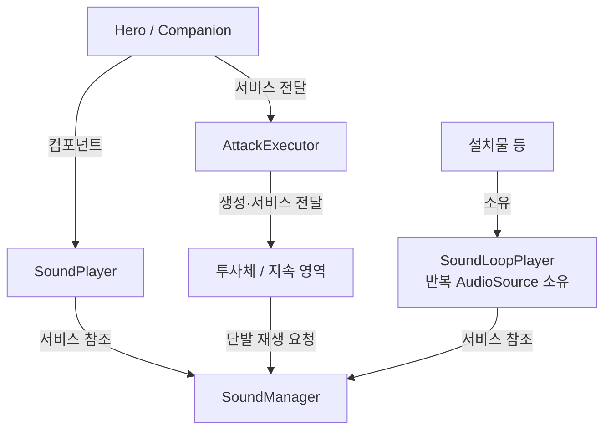
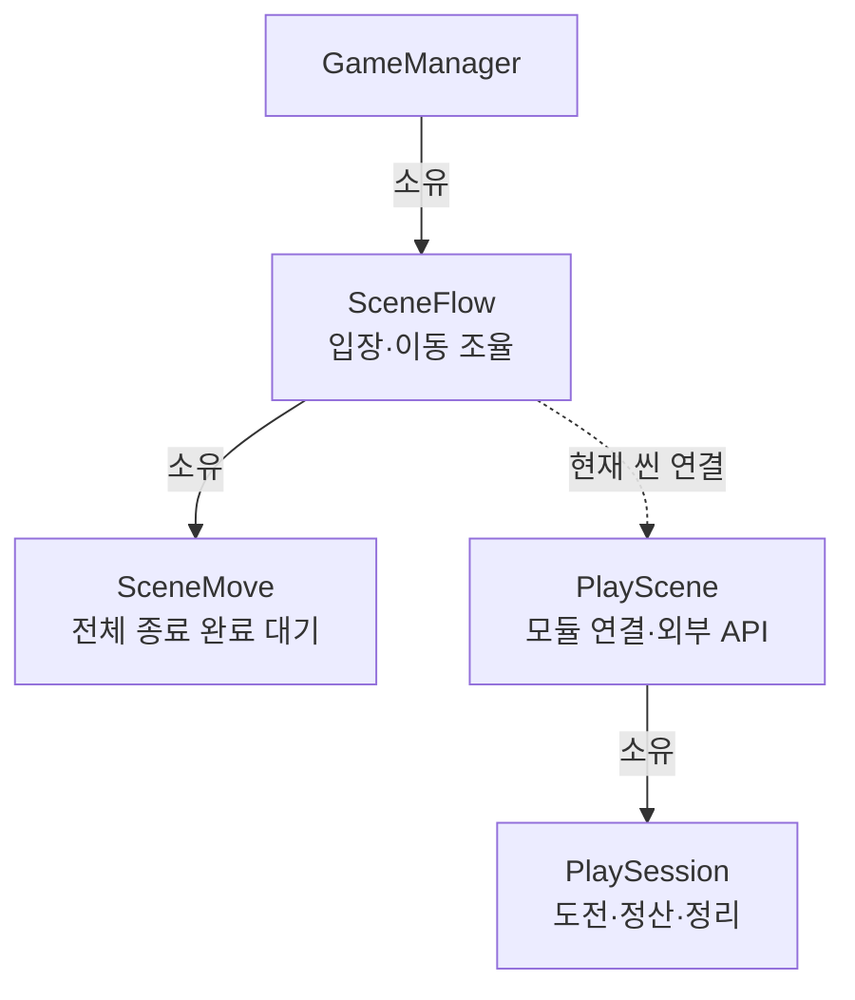
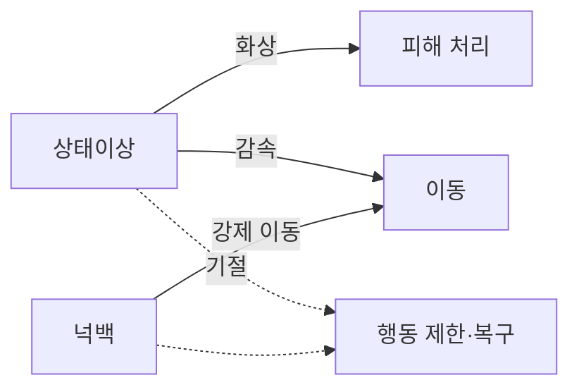
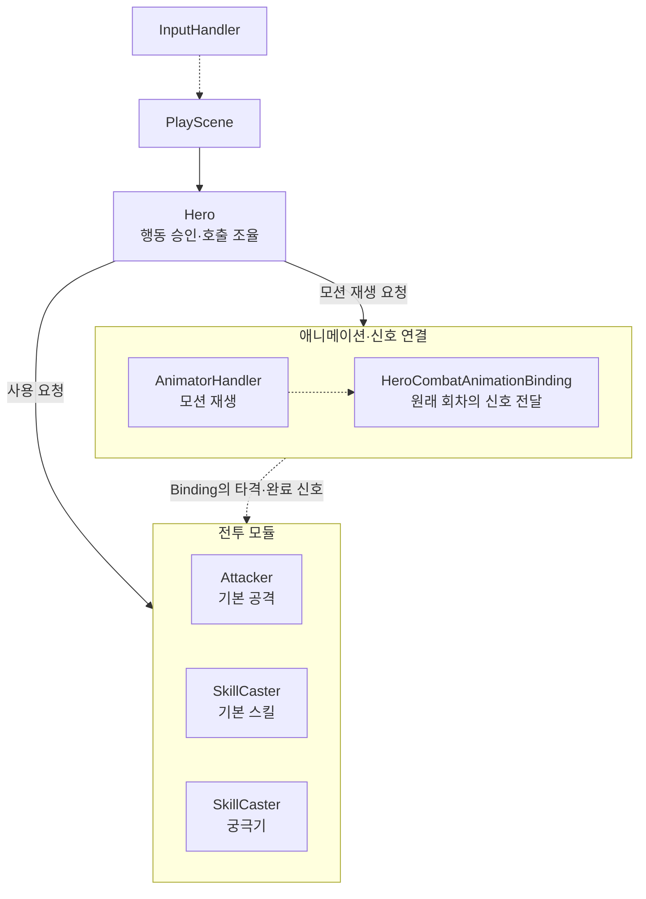
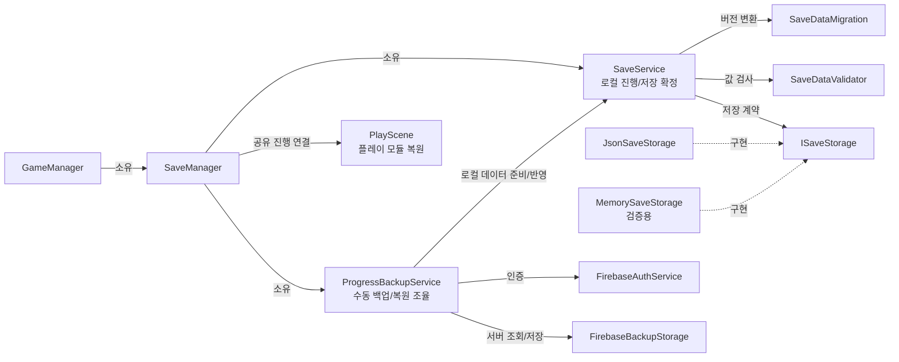

# ARCHITECTURE

## PURPOSE

이 문서는 프로젝트의 시스템 책임, 개발자 담당 범위, 공용 계약과 데이터 흐름을 정리합니다.

게임 규칙과 콘텐츠 범위는 `PROJECT_CONTEXT.md`, 일정은 `ROADMAP.md`, 남은 구현과 합의 항목은 `TODO.md`에서 관리합니다.

## OWNERSHIP

| 담당 | 메인 영역 | 핵심 구현 |
| --- | --- | --- |
| LJ | 플레이어 / 동료 / 공통 전투 / 성장·경제 | 이동·카메라, 무기·공격, 스킬·궁극기·에너지, Damage / Defense / StatusEffect, 동료 AI, 재화, 상점·로비 로직, 강화, 미션·도감 데이터/로직, 세이브 매니저·수동 백업/복원, 씬 로더, 설정·사운드, 공용 VFX 재생·셋업 |
| KMB | 설치 / 설치물 / 적 / 웨이브 / 스테이지 | 설치 모드, Grid/Snap, Preview, 배치 검증, 설치물 동작, 적 AI, 보스, Wave / Spawn, 성공·실패·별 판정 |
| LHJ | UI / 연출 / VFX / 표현 | 로비·HUD·상점·강화·도감·결과 UI, 화면 전환, 파티클·VFX, 웨이브·보스·승패 연출, 3D UI Preview Tool |

각 담당자는 자신의 소유 영역을 수정합니다.

다른 담당 영역은 연동 확인을 위해 읽을 수 있지만 직접 수정하지 않습니다.

## RESPONSIBILITY_BOUNDARIES

| 기능 | 로직 / 판정 | 표현 / 연출 |
| --- | --- | --- |
| 플레이어 공격 / 피격 | LJ | LJ 애니메이션 / LHJ VFX·UI·연출 |
| 적 공격 / 피격 | KMB + LJ 공통 전투 계약 | KMB 애니메이션 / LHJ VFX·UI·연출 |
| 설치물 발동 | KMB | LHJ |
| 동료 공격 / 상태 | LJ | LJ 애니메이션 / LHJ VFX·UI·연출 |
| 상점 구매 | LJ | LHJ |
| 강화 | LJ 데이터 / KMB 설치물 적용 | LHJ |
| 웨이브 진행 | KMB | LHJ |
| 스테이지 결과 / 별 | KMB | LHJ |
| 도감 | LJ 데이터·해금·보상 / KMB 원본 적·승리 대상 전달 | LHJ |
| 재화 / 저장 | LJ | LHJ 표시 |
| 씬 로드 / 입장 / 재도전 / 복귀 | LJ 흐름 / KMB 선택 맵 활성화·맵 관련 준비 | LHJ 화면·로딩 표시·버튼 요청 |
| 설정 / 사운드 | LJ 설정 로직·사운드 재생/볼륨 공통 기반 | LHJ 설정·페이지형 도움말 UI와 표현 연결 |
| 공용 VFX 기반과 LJ 호출부 | LJ 월드·UGUI 재생·수명·셋업과 플레이어·동료·전투·아이템 호출부 | LHJ 리소스·UI·화면 연출, KMB 적·설치물 연결. 실제 적용·통합 검증은 후속 |
| 3D 대표 이미지 | LHJ Preview Tool | LHJ UI |

## 씬·설정·사운드·VFX 공통 기반

기획의 현재 씬 구성 합의는 타이틀/플레이 총 2개이며, 로비는 타이틀 내부 화면이고 맵 3개는 플레이 씬 하나에 둡니다. 이 합의는 실제 씬 이동·전체 맵 연결 완료를 뜻하지 않습니다.

- LJ: 씬 로드, 선택 맵·난이도·무기 전달, 저장 적용, 사운드 초기화, 시작/재도전/복귀 흐름.
- KMB: 플레이 씬의 맵 3개 구성·선택 맵 활성화, 스폰·경로·설치 영역·웨이브 준비와 참조 연결.
- LHJ: 타이틀/로비/플레이 UI·HUD·버튼·로딩 표시, LJ에 시작/복귀 요청 전달.
- 같은 공용 씬은 한 번에 한 명이 수정하고 작업 시작/종료를 공유한 뒤 저장·커밋·푸시 후 인계합니다. 에이전트의 Unity 에셋 변경·커밋/푸시 권한을 뜻하지 않습니다.

LJ 설정 로직의 목표는 모든 플레이 단축키 변경, 화면 모드·해상도, 마스터/BGM/SFX 볼륨과 수동 백업/복원입니다. 설정·페이지형 도움말 UI는 LHJ가 담당하며 단축키 안내는 변경된 배정을 사용합니다. 사운드 재생·볼륨 제어와 공용 VFX 재생·셋업은 LJ 책임이며 LHJ의 리소스·화면 연출 작업은 유지합니다.

### 공통 관리자 수명

| 구성 | 책임 |
| --- | --- |
| GameBootstrap | 첫 씬 로드 전 Resources의 GameManager 프리팹 생성 |
| Singleton / GameManager | 유일한 공통 인스턴스 등록·중복 제거·씬 간 유지, 관리자 초기화/종료 조율 |
| SaveManager | 단일 진행과 저장/백업 서비스 소유 |
| SoundManager | 마스터/BGM/SFX 볼륨, BGM 전환, UI/플레이 효과음과 오디오 일시정지 |
| VfxManager | GameManager가 초기화·종료하는 공용 VFX 서비스. 씬 효과 생성·추적·제거 |
| SoundPlayer / WorldSoundPlayer | 캐릭터에 붙는 로컬 출력 / SoundManager가 소유하는 위치 출력 |
| SoundLoopPlayer | 소유 오브젝트의 반복 출력과 대기 요청 수명 관리 |
| SoundId / SoundDataMap | 공통 식별자 / 음원·출력 설정과 ID 조회 |
| SettingsManager | GameManager가 소유하는 일반 C# 객체. 단축키·화면·볼륨 설정 생성과 복원·수명 조율 |
| KeyBindingSettings / DisplaySettings / VolumeSettings | 단축키 편집·입력 대기·적용 / 화면 모드·해상도 조회·변경 요청 / 볼륨 조회·저장·출력 적용 |

정적 참조 초기화 → Bootstrap의 프리팹 생성 → GameManager.Awake의 저장 기반·VfxManager 준비·SettingsManager 복원 → 씬 입력 연결 순서입니다. GameManager.Start와 첫 타이틀 준비는 [설정 최초 적용 경로](Systems/SETTINGS_SYSTEM.md#초기화와-수명)를 공유합니다. 첫 타이틀은 적용을 시도한 뒤 [영구 진행](Systems/SAVE_SYSTEM.md#초기화)을 준비합니다. GameManager.IsInitialized는 저장 서비스 준비, StartupProgress는 실행 시 진행 준비, SoundManager.IsReady는 사운드 재생 준비를 뜻합니다.

씬 이동에서는 공통 관리자를 유지하고 각 씬의 진행 연결만 반환합니다. 앱 수명 종료 시 씬 흐름·설정 연결을 정리한 뒤 VFX·사운드와 백업 통신을 종료하고 인스턴스 등록을 해제합니다. 도전 정산·저장을 종료 콜백에 맡기지 않습니다.

진행 저장과 환경설정 저장은 분리하며 설정 파일은 LocalSettingsFile·SaveJsonReader를 공유합니다. 기능별 사용 계약과 확인 범위는 [설정](Systems/SETTINGS_SYSTEM.md)·[입력](Systems/INPUT_SYSTEM.md)·[사운드](Systems/SOUND_SYSTEM.md)·[VFX](Systems/VFX_SYSTEM.md), 남은 연결은 [TODO](TODO.md#로비씬설정사운드vfx-공통-기반)에서 관리합니다.

### 사운드 소유와 호출 관계

아래는 소유·참조 관계입니다. 실제 함수 호출과 이벤트의 차이는 [사운드 흐름](Systems/SOUND_SYSTEM.md#재생-요청-흐름)에서 구분합니다.

**공통 관리자 구성**



**캐릭터·전투·반복 출력 연결**



현재 조작하는 플레이어의 영역음 2D 출력과 일반 충돌음의 3D 출력은 사운드 문서의 재생 요청 흐름에서 구분합니다.

SoundLoopPlayer는 전달받은 SoundManager로 음원과 출력 설정을 조회합니다. 전체 플레이 출력 중단 알림에서 재생과 대기 요청을 함께 정리합니다. 재생·대기·중단 순서는 사운드 문서에 둡니다.

현재 플레이 씬은 Stage 1 전투·미션·종료 조율과 기본 HUD 구성이 함께 배치된 상태이며, Stage 2의 방어 목표·피해 이력·승패/별·확정 점수·종료 전달 코드도 반영됐습니다. 전체 진행 검증 완료와 구분합니다. 도전 시작은 명시적 외부 요청을 전제로 하므로 씬 로드 자체를 도전 시작으로 간주하지 않습니다. 타이틀/플레이 2개 씬은 최종 구성 목표이고 현재 빌드 목록에는 UI 테스트 씬도 남아 있습니다. 선택 맵 3개와 정식 씬 흐름 연결은 후속입니다.

### VFX의 서비스·화면 소유와 호출 관계

GameManager가 하위 VfxManager를 Awake에서 초기화하고 앱 종료 시 Shutdown합니다. PlayScene은 GameManager.Vfx를 Hero·고용 관리자와 PlaySession에 전달하며, CompanionTest도 같은 공용 서비스를 사용합니다. 씬·테스트에서 별도 매니저를 생성하거나 초기화하지 않습니다. 캐릭터의 기존 사건 핸들러와 공격 실행자가 직접 재생을 요청하며 별도 중복 이벤트 구독은 추가하지 않습니다. UI 효과는 화면의 UiVfxPlayer가 소유하며 공용 매니저와 독립적으로 생성·정리합니다.

| 구성 | 책임 |
| --- | --- |
| GameManager | 공용 서비스 소유·초기화·종료 |
| PlayScene / PlaySession | 서비스 전달·실행 중단, 도전 시작·종료와 씬 해제에서 전투 범위 효과만 정리 |
| CharacterVfx | 캐릭터 단발 효과와 상태별 유지 효과 연결 |
| AttackExecutor와 투사체·영역 | 실제 실행·발사·충돌·영역 생성 시 요청 |
| VfxManager / VfxEffect | 효과 생성·제거 / 파티클 재생·추적·방출 중단 |
| VfxPlayer / VfxOptions | 월드 연출 요청·자신의 출력 정리 / 시간 기준과 전투·연출 정리 범위 |
| UiVfxPlayer / UiVfxEffect | 화면별 Canvas 출력 소유·정리 / Graphic·Animator 준비와 완료 시간 관리 |
| VFX Setup | 담당 범위별 탐색·검사·참조 배정. 무기는 LJ, 적·보스·설치물은 KMB. 런타임 호출은 담당자가 연결 |

소유 도식과 초기화·호출·종료 흐름, 현재 배정·확인 범위는 [VFX 시스템](Systems/VFX_SYSTEM.md)에 모읍니다. 툴의 화면 필터와 실제 적용 범위는 구분하며, LHJ 화면 연출과 KMB 외부 호출부는 담당별로 연결합니다.

### 로비 구성

LobbyController는 타이틀의 진행 사용권과 로비 기능 연결을 조율합니다. TitleScene은 로비 요청을 전달하고 SceneFlow는 입장·맵 준비·재도전·복귀를 조율하며 SceneMove는 종료 완료 후 로드를 허용합니다. 실제 플레이 구성과 로비 표시 목록은 구분하되 등장 적은 실제 구성 제공자를 조회합니다. 계약은 [로비 시스템](Systems/LOBBY_SYSTEM.md)을 참조합니다.

## ARCHITECTURE_PRINCIPLES

- 소유자가 아닌 시스템의 내부 상태를 직접 수정하지 않습니다.
- 시스템 간 연결은 공용 계약 / 이벤트 / 데이터 전달을 통해 처리합니다.
- 동급 Presenter / Controller 간 직접 상호 의존은 만들지 않습니다.
- 공용 Model / Data를 다른 담당자가 임의 수정하지 않습니다.
- 정적 설정값은 ScriptableObject를 우선합니다.
- 런타임 상태와 정적 설정값을 구분합니다.
- UI는 게임 규칙을 판정하지 않고 전달받은 상태와 결과를 표현합니다.
- VFX / Animation은 판정의 원본이 되지 않습니다.
- 실제 동작 적용 후 상태 반영과 이벤트 알림 순서를 유지합니다.

## 플레이 씬의 책임과 의존 관계

PlayScene은 플레이 진입점이고 TestScene은 이를 상속하는 테스트 진입점입니다. Stage 1 플레이 씬에는 실행 구성과 기본 HUD가 함께 배치돼 있으나 최신 점수 설정 연결·웨이브/판정 데이터 정합성과 정식 PlayScene 적용은 후속입니다. 담당별 참조와 현재 연결 차이는 [플레이 씬 연결](LJ_INTEGRATION_GUIDE.md#플레이-씬-연결)을 참조합니다.

### 현재 책임 경계

| 위치 | 책임 |
| --- | --- |
| PlaySession | 도전 시작·첫 전투·구간·미션 사건·종료·재시도·정리와 관련 상태, 도전별 강화 결과 |
| PlayScene | 공유 진행 연결/모듈 복원, 입력·카메라·커서·플레이어 갱신, 외부 API 전달과 씬 활성 수명 |
| TestScene | PlayScene을 상속한 직접 테스트 초기화·자동 시작 |
| SceneFlow / SceneMove | 로비·입장·맵 준비·종료 후 이동 조율 / 종료 결과 대기 |
| IStageEndLink | 담당자의 종료 접수·마지막 사건 전달 재요청 계약 |
| 테스트 도구 | 자동 시작·Inspector 맵/난이도/무기 설정·디버그 조작 |
| 기존 개별 시스템 | 전투·고용·재화·강화·미션·도감의 실제 규칙 |
| SaveManager / SaveService | 씬을 넘는 단일 진행 소유/준비, 버전 변환과 저장 후보 확정 |

PlaySession은 PlayScene이 초기화한 모듈로 생성하는 일반 C# 객체입니다. 도전 상태는 PlaySession에 두고 외부 API는 같은 인스턴스로 전달합니다.



실선은 소유, 점선은 현재 씬 참조입니다. 입장·도전·종료·재시도·씬 이동과 구독 수명은 [PLAY_FLOW](Systems/PLAY_FLOW.md)에서 관리합니다.

## SHARED_COMBAT_CONTRACT

LJ가 공용 전투 규격의 소유를 담당합니다.

### 구현된 공통 전투 계약

플레이어·동료·적·설치물은 LJ 공통 피해 수신 규격을 사용합니다. 공격 시작/실행, 피해 수신, HP 상태와 애니메이션 신호의 책임을 분리합니다.

```text
Attacker / SkillCaster → AttackExecutor → AttackExecution
공격 판정 → DamageReceiver → Health
실제 적중 결과 → 원래 공격 실행 → Hero 에너지
```

주체별 능력치와 발생 정보는 각 초기화 주체가 전달하고 공통 모듈은 특정 캐릭터를 역참조하지 않습니다. B의 자체 공격도 공통 피해 계약을 사용하며 모든 공격에 같은 탐색 구현을 강제하지 않습니다. 세부 필드·검사·알림 순서는 [COMBAT_SYSTEM.md](Systems/COMBAT_SYSTEM.md), 남은 작업은 [COMBAT_TODO.md](Systems/Todo/COMBAT_TODO.md)를 참조합니다.

### 상태이상과 넉백

감속/기절/화상과 넉백 기반을 구현했습니다. StatusEffectController는 효과 기록/주기 피해/이동 배율, KnockbackController는 강제 이동 진행을 관리합니다. Hero/Companion은 행동 제한·취소를 조율하고 Mover/CompanionMover는 IMoveSpeedModifier/IKnockbackMover를 구현합니다. 상세 계약은 [COMBAT_EFFECT_SYSTEM.md](Systems/COMBAT_EFFECT_SYSTEM.md)를 참조합니다.

피해·이동·행동 제어의 핵심 관계만 표시합니다. 실선은 직접 처리, 점선은 변경 알림에 따른 행동 제어입니다. 초기화·갱신과 테스트 요청 경로는 상세 효과 문서에서 설명합니다.



Enemy/설치물의 이동·저항·효과 요청 연결은 KMB 담당입니다. 캐릭터 애니메이션은 플레이어·동료 LJ, 적·보스 KMB가 연결하며 LHJ는 VFX·UI·연출을 연계합니다. 상세 효과 계약은 [COMBAT_EFFECT_SYSTEM.md](Systems/COMBAT_EFFECT_SYSTEM.md)를 참조합니다.

## PLAYER_SYSTEM

**소유: LJ**

주요 책임:

- 3인칭 이동 / 카메라
- 회피 / 부활
- 무기 장착
- 기본 공격
- 기본 스킬 / 궁극기
- 에너지 충전 / 소비
- 플레이어 Health / Defense
- 사용 아이템
- 무기별 플레이어 스탯 적용

플레이어 공격은 공통 Damage 계약을 사용합니다.

Hero는 입력에 따른 행동 승인과 전투·이동·애니메이션을 조율합니다. WeaponDataMap에서 선택 무기 설정을 받아 HeroWeaponBinding으로 실행자·모델을 연결하며 기본 스킬과 궁극기는 별도 SkillCaster와 같은 Energy를 사용합니다. 상세 계약은 [전투](Systems/COMBAT_SYSTEM.md)·[무기](Systems/WEAPON_SYSTEM.md)·[스킬](Systems/SKILL_SYSTEM.md)·[강화](Systems/UPGRADE_SYSTEM.md) 문서에서 관리합니다.

### 플레이어 전투 모듈 관계

PlayScene은 공유 진행으로 재화/보상/고용/배치 모듈을 초기화하고 도전 요청을 PlaySession으로 전달합니다. PlaySession은 플레이어와 도전을 준비하고, 마지막 사건 전달 완료 후 행동 중단 → 미션 확정·승리 도감과 최고 별·점수 저장 → 재화 정산 → 객체 정리를 조율합니다. CombatDummy는 더미의 초기화와 갱신을 맡고 디버그 요청·로그와 분리합니다.

Hero는 행동 승인과 모듈 간 호출 순서를 중재하며 다음 책임은 일반 C# 클래스에 위임합니다. 이 클래스들은 Hero가 생성하므로 별도 컴포넌트 부착이나 Inspector 연결이 필요하지 않습니다.

| 모듈 | 책임 |
| --- | --- |
| HeroRevive | 사망 정보, 부활 대기·횟수·위치와 연출 완료 상태 관리 |
| HeroCombatAnimationBinding | 공격·스킬·궁극기와 AnimatorHandler의 이벤트 연결·해제 및 원래 회차 신호 전달 |
| HeroWeaponSetup | 무기 구성 조회·검사, 실행자 연결, 모델·이동 설정·Override 적용 |
| HeroDodge | 회피 방향·시간·이동량·무적·쿨타임과 종료 알림 관리 |

입력 전달·Hero의 승인·전투 모듈·애니메이션 신호 연결을 구분합니다. 실선은 요청, 점선은 이벤트 전달이며 개별 복귀·상태 재계산 경로는 생략합니다.



전투 영역으로 향하는 선은 해당 공격 모듈에 대한 요청/신호를 묶어 표시한 것이며 세 모듈을 동시에 실행한다는 뜻이 아닙니다. 세 모듈은 공통 AttackExecutor 계약으로 실행합니다. Hero는 Mover의 이동·회전도 조율하며, 두 SkillCaster는 공용 Energy를 소비하고 기본 공격의 최초 유효 적중에서 에너지를 충전합니다. 실행·복귀 상세는 [COMBAT_SYSTEM.md](Systems/COMBAT_SYSTEM.md), 에너지·스킬/궁극기 사용 순서는 [SKILL_SYSTEM.md](Systems/SKILL_SYSTEM.md)를 참조합니다.

## COMPANION_SYSTEM

**소유: LJ**

| 구성 | 책임 |
| --- | --- |
| CompanionHireController / CompanionHireEntry | 고용 기록·비용·타입 대기와 객체 수명 조율 / 개체 상태 보관 |
| CompanionPlacementController / CompanionSpawnPositionFinder | 포인트 상호작용 / 생성 위치 탐색 |
| Companion | 개체 초기화와 행동 판단·생명주기 조율 |
| CompanionMover / CompanionTargetDetector | 실제 이동·회전 / 공격 대상·위협 탐색 |
| CompanionCombatAnimationBinding | 공격과 애니메이션 신호 연결 |

HP와 공격 회차는 공통 전투 모듈에서 관리하고, 미션 참여는 고용 번호로 상위 도전 조율부에 전달합니다.

동료는 공통 피해·공격 계약을 사용하며 전용 액티브 스킬/궁극기는 두지 않습니다. VFX/UI 표현은 LHJ가 맡고 LJ는 일부 공통 모듈을 제공합니다. 현재 동작과 CSV/임포터 계약은 [COMPANION_SYSTEM.md](Systems/COMPANION_SYSTEM.md), 남은 작업은 [COMPANION_TODO.md](Systems/Todo/COMPANION_TODO.md)에서 관리합니다.

## MOVEMENT_ARCHITECTURE

Mover는 하나의 공용 구현체로 합치지 않습니다.

### Player / Companion Mover

**소유: LJ**

역할:

- 플레이어 직접 이동
- 동료 이동
- 동료의 접근 / 거리 유지 / 지정 위치 복귀
- 이동속도 변경 / 이동 가능 여부 반영

### Enemy Mover

**소유: KMB**

역할:

- 지상 적 NavMeshAgent 이동
- 비행 적 Waypoint 이동
- 방어 목표 이동
- 근접 반격 시 이동 일시 정지 / 복귀
- 보스 이동

### 최소 공용 인터페이스

두 계열의 구현은 분리하되, 상태이상이나 외부 시스템이 공통으로 접근해야 하는 최소 기능만 인터페이스로 공유합니다.

행동 허용을 위한 추가 공용 인터페이스는 미확정이며 [공통 결정](TODO.md#open_decisions)에서 관리합니다. 현재 이동속도 배율은 IMoveSpeedModifier를 구현해 사용합니다.

```csharp
public interface IMoveSpeedModifier
{
    void SetMoveSpeedMultiplier(float multiplier);
}
```

공용 인터페이스는 구현 통합이 아니라 **외부 시스템의 최소 의존 계약**으로만 사용합니다.

## INSTALLATION_SYSTEM

**소유: KMB**

### 현재 구현과 후속 규격

현재 설치 시스템은 **전용 BuildArea + 로컬 Grid** 방식으로 구현되어 있습니다. 코드 반영과 최종 규격 합의·플레이 확인은 구분합니다.

- `BuildArea` 컴포넌트가 설치 영역을 소유
- 전용 LayerMask로 설치 영역 식별
- 카메라 Raycast로 포인터 위치 확인
- BuildArea 로컬 공간을 기준으로 Cell 좌표 계산
- 기본 설치물 점유 크기 1×1 Cell
- 90도 단위 회전
- 경사면 설치 불가
- 설치 금지 Cell 지원 — 계단·구조물 등 제외 구역을 점유·프리뷰 판정에 반영
- 설치 가능 Preview: 초록
- 설치 불가 Preview: 빨강

설치 시스템이 배치·해금을 판정하고 셀 점유·재화 소비·생성을 조율합니다. 실패 복구와 철거 환불의 호출 순서는 [연계 가이드](LJ_INTEGRATION_GUIDE.md#설치철거---재화-연결-kmb-담당)에 둡니다.

설치 수량 제한은 후속입니다. 정상 철거는 실패 복구와 달리 실제 지불 비용에 설정 환불 비율을 적용합니다.

주요 책임:

- 설치 모드
- Raycast
- BuildArea / Surface 판정
- Grid / Snap
- Preview
- 배치 가능 / 불가능 판정
- 설치 거리
- 설치 수량 제한
- 비용 검사
- 철거 / 환불
- 설치물 런타임 등록

BuildArea의 로컬 좌표 변환·Cell 점유/해제 코드는 있으며 최종 맵 적용과 규격 확인은 후속입니다.

웨이브 중 설치 가능 여부 등 규칙은 Stage / Wave 상태를 조회하여 판정합니다.

## TRAP_SYSTEM

**소유: KMB**

초기 설치물:

- 화살 발사기
- 가시 함정
- 화염 장판
- 냉기 장판
- 충격 장치

설치물의 공격 / 상태이상 적용은 공통 Damage / StatusEffect 계약을 사용합니다.

바리케이드와 경로 변경은 후순위입니다.

## ENEMY_SYSTEM

**소유: KMB**

초기 일반 적:

- Basic
- Fast
- Tank
- Flying

주요 책임:

- 이동
- 방어 목표 우선 행동
- 제한적 플레이어 / 동료 반격
- 공격
- Health 연결
- 사망 처리
- 스테이지 목적지 도달 처리

이동:

- 지상 적: NavMeshAgent
- 비행 적: Waypoint 직접 이동 코드 구현

현재 EnemyCombat.OnDied를 받은 WaveController가 원래 도전·생명 번호와 EnemyData로 미션 처치를 전달하고, 재화 보상 조건에 따라 처치 재화·콤보를 처리합니다. 실제 처치 인정 범위와 재사용·중복 처리의 통합 검증은 남아 있습니다.


## ENEMY_PROXIMITY_REACTION

**소유: KMB / 추천안**

일반 적은 플레이어 추적 AI를 가지지 않고 방어 목표를 계속 우선합니다.

추천 흐름:

1. 목적지로 이동
2. 플레이어가 약 2m 이내인지 확인
3. 반격 가능 상태라면 이동을 잠시 중단
4. 제자리에서 1회 공격
5. 반격 재사용 약 3초 적용
6. 즉시 원래 방어 목표 경로 복귀

플레이어의 원거리 공격이나 피격 자체로 어그로를 전환하지 않습니다.

보스는 이 규칙을 공유하지 않고 별도 패턴으로 처리합니다.

## BOSS_SYSTEM

**소유: KMB**

초기 보스 1종을 기준으로 합니다.

주요 책임:

- 등장
- 일반 이동 / 공격
- HP 구간 패턴
- 일반 적 소환
- 상태이상 저항
- 사망 / 결과 전달

보스 UI / 등장·처치 연출은 LHJ가 담당합니다.

## WAVE_AND_STAGE_SYSTEM

**소유: KMB**

### Wave

주요 책임:

- 준비 시간
- 조기 시작
- Spawn 순서
- Spawn 간격
- 활성 적 수 관리
- 웨이브 완료 판정
- 다음 웨이브 전환

### Stage

주요 책임:

- 선택된 StageData 적용
- 난이도 적용
- 실패 조건
- 성공 조건
- 별 판정
- 결과 생성

스테이지별 수치와 조건은 ScriptableObject로 설정합니다.

### 스테이지 구현과 연계 경계

KMB는 일반 적 4종·설치물 5종과 Stage 1 판정, Stage 2 방어목표·전용 데이터·테스트 맵과 Stage 3 판정 기반·테스트 맵을 갖추고 있습니다. 설치 금지 셀과 냉기 감속 강화 적용, 비행 적의 목표 접근 보완, Stage 1·2·3의 제한시간·부활 소진 실패 코드가 반영됐습니다. 현재 Stage 1·2 Normal 데이터는 각 1웨이브의 축소 구성이며 기획 목표 5웨이브·최종 밸런스와 구분합니다. WaveData는 전용 스테이지 데이터에 직렬화되는 일반 클래스입니다.

Stage 1·2의 결과·도감 대상·확정 점수 전달과 Stage 2 방어 피해 이력 연결이 있습니다. Stage 3도 통과 한도 OR 목표 HP 0 실패, 승리·별·도감 대상·확정 점수 전달 기반이 있으며 Stage1Data와 Stage2DefenseGoal을 사용합니다. LJ 점수 보상 설정·정상 지급 확인은 완료했으며 실제 맵의 전체 시작/종료·재시도 검증과 Stage 3 정식 적용·보스·난이도 연계는 후속입니다. 점수 계산·확정은 KMB, 보상 계산·지급·저장은 LJ, 실제 결과 표시는 LHJ 책임입니다. 상세는 [연계 가이드](LJ_INTEGRATION_GUIDE.md#점수와-종료-순서)를 참조합니다.

LHJ의 HUD 구성·웨이브 시작 표시·설치 수량·동료/소모품 퀵슬롯 표시와 도감 화면 프리팹이 반영됐습니다. 기존 상품·스킬·콤보·동적 체력바·결과 표시 코드와 함께 공통 고용 판정 조회·변경 단축키, 정식 PlayScene 적용·공통 입장/종료·점수/보상·미션/도감 데이터 연결은 후속입니다. 현재 담당별 연결은 [연계 가이드](LJ_INTEGRATION_GUIDE.md#lhj-통합-후속), 남은 작업은 [TODO](TODO.md), 기존 연결 계획은 [UI 계획](UI_PLAN/UI_REMAINING_CONNECTION_PLAN_2026-10-19.md)을 참조합니다.

## CURRENCY_SYSTEM

**소유: LJ**

Currency는 영구/스테이지 재화의 잔액·지급·소비를 소유합니다. SaveManager/SaveService는 최초 진행과 영구 잔액 저장을, StageRewardController는 처치·콤보 보상과 도전 종료를 조율합니다. 설치/철거·고용 시스템은 자신의 판정 결과에 따라 소비·복구·환불을 요청하며 UI는 결과를 표시합니다.

수치·API·저장/알림 순서는 [CURRENCY_SYSTEM.md](Systems/CURRENCY_SYSTEM.md), 실제 담당별 연결은 [연계 가이드](LJ_INTEGRATION_GUIDE.md#재화---초기화도전표시)를 참조합니다.

## COMBO_SYSTEM

**소유: LJ**

Combo는 유지시간·처치 수·단계 계산을, StageRewardController는 중복 접수·미지급 요청·Currency 지급을 관리합니다. KMB 사망 전달부가 원래 도전/생명 정보를 제공하고 LHJ가 콤보 상태·지급 결과를 표시합니다.

```text
EnemyCombat → WaveController → StageRewardController
StageRewardController → Combo / Currency → LHJ 표시
```

현재 KMB 경로와 대안 EnemyRewardReceiver는 중복 연결하지 않습니다. 상세 규칙과 지급 수명은 [COMBO_SYSTEM.md](Systems/COMBO_SYSTEM.md), 외부 전달 계약은 [연계 가이드](LJ_INTEGRATION_GUIDE.md#처치콤보---보상-연결부), 검증은 [CURRENCY_TEST.md](Systems/Test/CURRENCY_TEST.md)를 참조합니다.

## UPGRADE_SYSTEM

**소유: LJ**

영구 강화 데이터·진행도·통합 구매 저장과 플레이어/동료 적용을 구현했습니다. 공통 부모에는 ID·단계·가격만 두며 대상별 데이터와 계산을 분리합니다. 입장 시 플레이어 결과와 동료/설치물 스냅샷을 확정하고 도전 중 재계산하지 않습니다. 상세는 [UPGRADE_SYSTEM.md](Systems/UPGRADE_SYSTEM.md)를 참조합니다.

대상:

- Player
- Weapon
- Trap
- Companion

KMB는 LJ가 제공하는 도전별 설치물 강화 결과를 받아 적용합니다. 결과 조회와 외부 연결 계약은 [연계 가이드](LJ_INTEGRATION_GUIDE.md#강화-연결)를 참조합니다.

설치물 지원 정보·효과 반영·검사 책임은 [설치물 강화 계약](Systems/UPGRADE_SYSTEM.md#설치물-강화-계약)을 따릅니다. LJ 계산부는 구체 설치물 타입에 의존하지 않습니다.

KMB가 Upgrade 저장 구조나 영구 데이터를 직접 수정하지 않습니다.

## ITEM_SYSTEM

**소유: LJ**

소모품 사용·수량 저장과 PlayScene의 공용 10칸 슬롯을 구현하고 TestScene의 기본 연결을 사용자 확인했습니다. QuickSlotData 파생 SO와 QuickSlotContext가 설치물 선택 요청·동료 고용·소모품 사용을 연결합니다. LJ는 슬롯 데이터와 선택 요청, KMB는 실제 선택·프리뷰·설치 반영을 담당하며 설치 인터페이스는 사용하지 않습니다. 소모품 계약은 [ITEM_SYSTEM.md](Systems/ITEM_SYSTEM.md), 담당별 연결은 [LJ_INTEGRATION_GUIDE.md](LJ_INTEGRATION_GUIDE.md#아이템공용-슬롯-연결), 남은 작업은 [TODO.md](TODO.md#아이템상점공용-슬롯-후속-계획)를 참조합니다.

## SHOP_SYSTEM

**소유: LJ**

주요 책임:

- 상품 상태
- 구매 조건
- 재화 검사
- 해금
- 아이템 수량
- 구매 결과

LHJ는 상품 UI / 구매 결과 표현을 담당합니다.

IShopProduct와 ShopData가 소모품·무기·설치물을 공통 목록/맵으로 제공하고 ShopPurchase는 조회된 상품을 기존 소모품 또는 EquipmentUnlock 구매로 전달합니다. EquipmentUnlock은 저장 해금·선택 복원과 저장 성공 후 상태 반영을 담당하며 같은 객체를 PlaySession·QuickSlotContext에 전달합니다. 상세 계약은 [SHOP_SYSTEM.md](Systems/SHOP_SYSTEM.md), 남은 작업은 [TODO.md](TODO.md#무기설치물-해금-후속)를 참조합니다.

## SAVE_SYSTEM

**소유: LJ**

GameManager가 SaveManager를 소유하고 SaveManager는 단일 SaveService를 공유합니다. SaveService는 ISaveStorage에 의존하며 SaveManager가 JsonSaveStorage를 생성해 연결합니다. MemorySaveStorage는 검증용 구현입니다. PlayScene은 공유 진행으로 모듈을 복원합니다. 현재 저장 형식과 변환 지원은 [저장 버전 정책](Systems/SAVE_SYSTEM.md#저장-버전-정책)을 따릅니다.



그림은 주요 소유/호출 관계이며 실행 순서가 아닙니다. 영구 진행은 SaveService가 소유하고 PlayScene은 모듈을 복원하며 PlaySession은 도전 종료를 조율합니다. 인증 정보 보관과 서버 통신은 로컬 저장과 분리합니다.

파일 처리·버전·백업·복원 계약은 [SAVE_SYSTEM.md](Systems/SAVE_SYSTEM.md), 검증 결과는 [SAVE_TEST.md](Systems/Test/SAVE_TEST.md), 외부 연결은 [연계 가이드](LJ_INTEGRATION_GUIDE.md#저장-진행-연결)를 참조합니다.

## MISSION_AND_COLLECTION_SYSTEM

**소유: LJ**

| 구성 | 책임 |
| --- | --- |
| SO / DataMap | 미션 조건·보상과 도감 고정 ID/원본 적 참조·표시 설정 |
| MissionProgress / CollectionProgress | 현재 진행과 저장 기록·조회 상태 |
| MissionStageRecord / MissionEvaluator | 이번 도전 이력 / 조건 평가 |
| MissionController / CollectionUnlock | 사건 접수·평가·저장 후 반영과 결과 보관 |
| PlayScene / PlaySession | 외부 요청 진입점 / 도전·구간·종료 조율 |

미션과 도감은 서로 직접 호출하지 않으며 같은 SaveService로 영구 진행을 저장합니다. KMB는 원본 적·처치·방어 이력·최종 결과를 제공하고 LHJ는 미션/도감 UI를 표시합니다. 최고 별·클리어 최고 점수 저장은 미션이 아닌 PlaySession의 종료 조율 책임입니다.

도감 스토리는 SO 콘텐츠이며 해금된 상세 조회에만 공개합니다. 플레이 중 간략 조회는 해금과 독립적인 이름·특징·공격 설명용입니다. LJ 조회 구현과 사용자 기본 확인은 완료했으며 KMB 표시 대상 전달·LHJ 실제 도감/간략/결과 화면 연결은 후속입니다.

상세 계약은 [MISSION_SYSTEM.md](Systems/MISSION_SYSTEM.md)·[COLLECTION_SYSTEM.md](Systems/COLLECTION_SYSTEM.md)·[SAVE_SYSTEM.md](Systems/SAVE_SYSTEM.md), 외부 전달 정보는 [연계 가이드](LJ_INTEGRATION_GUIDE.md), 남은 작업은 [TODO.md](TODO.md)에서 관리합니다.

## PRESENTATION_SYSTEM

**소유: LHJ**

주요 책임:

- Lobby UI
- Stage Select UI
- Difficulty UI
- HUD
- Shop UI
- Upgrade UI
- Collection UI
- Result UI
- Combo UI
- Boss UI
- VFX
- 화면 전환
- UI Animation / Result Presentation

표현 계층은 판정 값을 만들지 않습니다.

LJ / KMB가 전달한 상태 / 이벤트 / 결과만 표현합니다.

## UI_DATA_FLOW

### LJ → LHJ

- Player HP
- Energy
- Currency
- Current Weapon
- Skill / Ultimate
- Companion
- Shop
- Upgrade
- Item
- Mission
- Collection
- 저장·처리 실패 상태와 수동 백업/복원 진행·결과 — 현재 API는 저장 문서 참조
- 변경된 입력 배정 — KeyBindings의 적용/편집 조회와 변경 이벤트 제공, 실제 UI/HUD 연결 후속
- 화면·볼륨 설정 — Settings.Display/Volume의 조회·변경·저장/복원과 알림 제공. 기본 저장/복원·최초 믹서 적용은 사용자 확인, 실제 화면 연결·추가 회귀는 후속. 음원 확인 범위는 사운드 시스템 참조. 계약은 [설정 시스템](Systems/SETTINGS_SYSTEM.md) 참조

### KMB → LHJ

- Wave
- Remaining Enemy
- Boss
- Trap
- Stage Objective
- Stage Result
- Star Result
- Spawn / Wave Event

## UI_PREVIEW_TOOL

**소유: LHJ**

대상:

- 동료
- 적
- 보스
- 무기
- 설치물

프리팹 기준 카메라 / 조명 / 배경을 통일하여 UI용 대표 이미지를 생성합니다.

사용처:

- 도감
- 동료 상세
- 상점
- 강화
- 무기 / 설치물 상세

## SCRIPTABLE_OBJECT_DATA

정적 설정값은 가능한 한 ScriptableObject로 분리합니다.

현재 구현된 SO:

- StageSelectionData
- WeaponData
- SkillData
- CompanionData
- TrapData
- EnemyData
- Stage1Data — Stage 1 전용
- UpgradeData
- ItemData
- MissionData
- SoundDataMap

BossData·범용 StageData·DifficultyData는 후속입니다. WaveData는 Stage1Data에 직렬화되는 일반 클래스이며 독립 SO 목록에 포함하지 않습니다.

ScriptableObject는 설정 원본이며 런타임 상태를 직접 저장하지 않습니다.

## 공용 계약의 소유와 사용

다음 표는 공용 계약의 소유·사용 관계입니다. DamageInfo·피해/체력·상태이상 기반·진영·재화·강화·저장은 현재 구현 계약이며 담당별 전체 연결 완료와 구분합니다. 각 시스템의 현재 API는 상세 문서를 따르고, 남은 연계·합의는 [연계 가이드](LJ_INTEGRATION_GUIDE.md)와 [TODO.md](TODO.md#open_decisions)에서 관리합니다.

| 계약 | 주 소유 | 사용 |
| --- | --- | --- |
| DamageInfo | LJ | LJ / KMB |
| IDamageable / Health | LJ | LJ / KMB |
| StatusEffect | LJ | LJ / KMB |
| Faction / Damage Source | LJ | LJ / KMB |
| EnemyDied Event | KMB + LJ 합의 | LJ / KMB / LHJ |
| Currency API | LJ | LJ / KMB / LHJ |
| Upgrade Result / Data | LJ | LJ / KMB / LHJ |
| Stage Result | KMB | LJ / LHJ |
| Wave State / Event | KMB | LHJ |
| UI Data / Event | 각 로직 담당 + LHJ 합의 | LHJ |
| Save Data (단일 진행 구현) | LJ | 전체 |
| ScriptableObject 구성 | 공통 합의 | 전체 |

## DEPENDENCY_RULES

- LJ → KMB 내부 Enemy AI / EnemyMover 직접 수정 금지
- KMB → LJ 내부 Player / Companion Mover / Currency / Save 직접 수정 금지
- LHJ → LJ / KMB Model 직접 수정 금지
- KMB 설치물은 LJ의 공통 Damage / StatusEffect 계약만 사용
- LJ의 재화 / 강화는 KMB 설치물의 내부 구현을 직접 제어하지 않음
- 결과 / UI는 데이터 또는 이벤트로 전달
- 타 담당 기능 변경이 필요하면 직접 수정하지 않고 TODO에 의존 사항을 기록

## PLAYTEST_TELEMETRY

1~2주차 핵심 루프부터 다음 값을 기록할 수 있는 구조를 검토합니다.

- Stage 시작 / 종료 시간
- Clear / Fail 및 Fail Reason
- Enemy Passed Count
- Defense Target Remaining HP
- 설치물별 설치 수량
- 동료별 고용 수량
- Stage Currency 획득 / 소비 / 종료 잔액
- Skill / Ultimate 사용 횟수

계측은 게임 규칙의 필수 의존성이 되지 않도록 분리합니다.

## TECHNICAL_RISKS

- BuildArea 로컬 Grid / Snap 및 셀 점유 판정
- 적 NavMesh와 스테이지별 경로
- 비행 적 별도 이동
- 상태이상 공통 처리
- 공통 피해 계약은 구현됨. 담당별 초기화·구독 수명과 실제 콘텐츠 연결을 맞춰야 함
- 재화 지급/소비·영구 저장과 Stage 1·2 종료 요청·확정 점수 전달 코드 구현. LJ 점수 보상 설정·정상 지급 확인 완료, Stage 3 결과 전달 기반 반영. 실제 맵/화면 통합·예외 검증과 Stage 3 정식 적용은 후속
- Stage 3은 통과 한도 OR 목표 HP 0 실패로 확정. 판정 기반·테스트 씬은 존재하며 적 타입별 목표 분리와 정식 적용·통합 검증은 후속
- 6주 내 콘텐츠 수량 과다 가능성

바리케이드 / NavMesh 경로 재계산은 후순위로 두어 초기 리스크에서 제외합니다.
