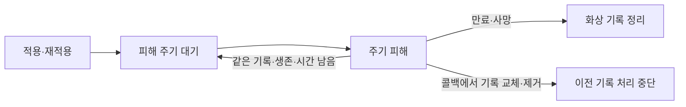
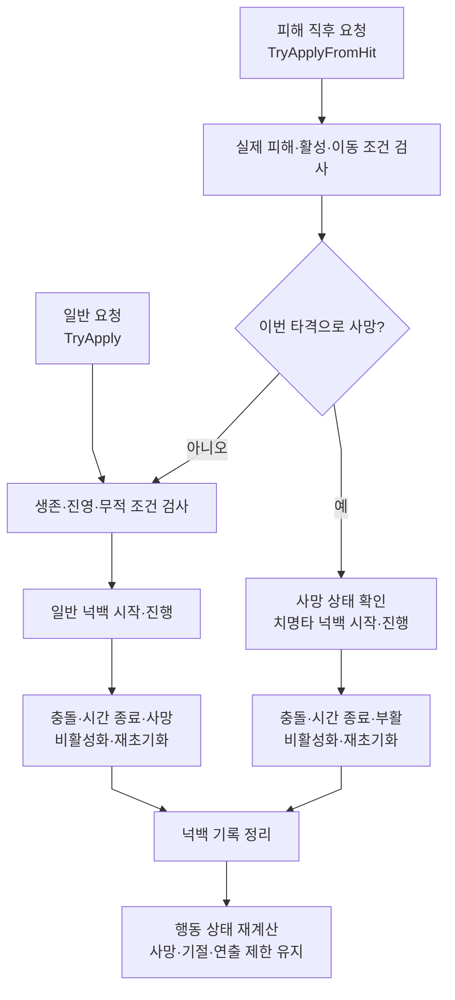

# COMBAT_EFFECT_SYSTEM

## 현재 상태

LJ 담당 감속/기절/화상과 넉백 기반, 플레이어/동료/더미 테스트 연결을 구현했습니다. 검 스킬 발동도 연결했으며 생존·즉사 더미의 넉백을 포함한 기본 동작은 사용자 확인 완료입니다.

LJ는 공통 효과 계약과 플레이어·동료 애니메이션 연결, 플레이어/동료/아이템 일부 VFX 공통 모듈을 담당합니다. Enemy/설치물 구현·연결과 적·보스 애니메이션은 KMB, 리소스·UI·화면 연출은 LHJ 담당입니다. 공용 VFX와 LJ 호출부는 구현했으며 호출·수명 계약은 [VFX 시스템](VFX_SYSTEM.md)에 둡니다. 남은 작업은 [COMBAT_TODO.md](Todo/COMBAT_TODO.md), 테스트 방법은 [COMBAT_TEST.md](Test/COMBAT_TEST.md), 완료 기록은 [DONE.md](../DONE.md)를 참조합니다.

### 콘텐츠 적용 범위

기획상 화상·감속·기절은 일반 적/보스에만 적용하며 현재 이를 부여하는 적은 없습니다. 플레이어·동료의 효과 수신/테스트 구현은 공통 모듈 기능 확인용이며 실제 콘텐츠 적용 범위를 확대하지 않습니다. 기존 피격 피해·넉백·사망 규칙과 컴포넌트/API는 유지합니다. 보스는 화상 정상·감속 효과 50%·기절 면역, 복수 감속은 최대 60% 감소가 기획 기준이며 실제 설정/연결 검증과 구분합니다.

## 구조와 공개 API

| 모듈 | 책임과 주요 API |
| --- | --- |
| StatusEffectData / SlowEffectData / StunEffectData / BurnEffectData | 효과별 설정. 화상은 주기당 원본 피해량과 피해 간격 추가 |
| EffectContext / StatusEffectInfo / SlowEffectInfo / BurnEffectInfo | 요청 당시 발생 정보와 효과별 설정값 보존 |
| StatusEffectController | 효과 기록/갱신/정리. TryApply의 기절/감속/화상 오버로드, UpdateEffects, ClearEffects, HasEffect, OnEffectChanged |
| StatusResistanceData | 기절 면역, 감속 강도 배율과 최대 감소율 |
| KnockbackData / KnockbackInfo | 지속 상태이상과 별개의 넉백 거리/시간 및 요청 방향 |
| KnockbackController | Init, TryApply, TryApplyFromHit(info, appliedDamage, killedTarget), UpdateKnockback, CancelKnockback, IsKnockback, RemainingTime, OnKnockbackChanged(진행 여부) |
| IKnockbackMover | CanKnockback, MoveKnockback(displacement, deltaTime). Mover/CompanionMover가 실제 이동 담당 |

효과 조회는 IsStunned/RemainingStunTime, SlowCount/TryGetSlowState/MoveSpeedMultiplier, IsBurning/TryGetBurnState를 사용합니다. 기존 공개 함수 인자는 유지했으며 정확한 시그니처는 `Assets/02. Scripts/Combat/Effects/`의 코드가 기준입니다.

## 감속과 기절

- `SlowEffectInfo(context, slowData)`는 기존처럼 SO의 기본 감속률을 보존합니다. `SlowEffectInfo(context, slowData, slowRate)`는 강화 등으로 계산한 요청 감속률을 보존하고 효과 식별·지속시간은 같은 SO에서 가져옵니다. 원본 SO는 변경하지 않습니다.
- 강화된 요청 감속률에도 기존 수신 측 저항 배율·최대 감속 상한을 적용합니다. 요청값과 실제 적용 감속률은 구분하며 설치물의 계산·전달 계약은 [강화 시스템](UPGRADE_SYSTEM.md#설치물-강화-계약), KMB 연결 방법은 [연계 가이드](../LJ_INTEGRATION_GUIDE.md#강화-연결)를 참조합니다.
- 공통 수신 조건은 초기화/활성/생존, 자기/진영/무적과 효과별 저항입니다.
- 감속은 같은 설정별 기록, 기절은 하나의 기록을 유지합니다. 재적용 시간은 `max(남은 시간, 새 지속시간)`이며 합산하지 않습니다.
- 복수 감속은 가장 강한 효과만 이동 배율에 적용하고 만료 후 남은 효과 또는 정상 배율로 복구합니다.
- 기절은 행동을 제한한 뒤 진행 공격/스킬을 취소합니다. 기본 공격의 남은 쿨타임은 유지하고, 스킬은 취소부터 쿨타임 시작/에너지 미환불입니다.
- 기록과 이동 배율을 반영한 뒤 변경 이벤트를 발행하며 시간 감소만으로 이벤트를 발행하지 않습니다.

## 화상

정상 진행의 핵심 순서입니다. 주기 피해는 효과 유지 시간 동안 반복합니다.

- 대상당 화상 하나를 유지하며 적용 후 첫 피해 주기부터 기존 DamageReceiver에 피해를 요청합니다.
- 재적용 시 남은 시간은 max, 피해/발생 정보는 최신 요청으로 갱신하고 다음 피해까지의 시간은 유지합니다.
- 주기 피해는 DamageOverTime으로 구분하고 기존 방어/무적/사망 처리를 사용합니다. 기본 공격 에너지를 충전하지 않습니다.
- 갱신은 화상의 유효 시간 안에서 처리하고 피해 콜백에서 정리/교체된 기록은 이어서 처리하지 않습니다.

## 넉백

일반 요청과 피해 직후 요청의 시작/종료 조건을 구분합니다. 검사 실패 시 요청을 거절하며 치명타 넉백에도 활성 상태와 프레임 갱신이 필요합니다.

- 지속 상태이상과 구분한 강제 이동이며 요청 시 수평 방향/거리/시간을 확정합니다. 재적용은 새 요청으로 교체합니다.
- TryApply는 기존 생존/진영/무적 조건을 사용합니다. TryApplyFromHit는 피해 직후 같은 타격의 실제 피해량과 사망 결과를 받아 일반 넉백 또는 이번 치명타의 사망 후 이동을 시작합니다. 결과를 저장했다가 지연 요청하는 API가 아닙니다.
- 치명타 결과는 DamageReceiver.TakeDamage(info, out killedTarget)에서 받습니다. 다른 IDamageable의 기존 피해 API만 사용한 경우 치명타 넉백은 지원하지 않습니다.
- Controller는 진행/종료를, Mover는 실제 이동/충돌을, Hero/Companion은 행동 제한/공격 취소를 담당합니다.
- 플레이어 회피 무적은 DamageReceiver.SetInvulnerable에 반영되어 기존 피해·일반 넉백 수신 조건을 사용합니다. 넉백이 승인되면 Hero는 회피·전투 행동의 취소와 종료 콜백을 먼저 처리한 뒤 PlayKnockbackHit로 피격 표현을 요청합니다. 공중에서도 넉백 피격 표현을 사용하며 사망 표현을 우선합니다.
- 플레이어/더미는 CharacterController로 이동하며 중력을 유지합니다. 동료는 NavMesh 경계 안에서 이동하고 동적 Collider 탐색은 포함하지 않습니다.
- 넉백에는 감속 배율과 일반 회전을 적용하지 않습니다. 동료의 활동 범위 밖 이동은 허용하며 종료 후 기존 복귀 AI를 사용합니다.
- 충돌 또는 시간 종료 시 기록을 정리하고 행동을 재계산합니다. 종료 프레임의 일반 이동/AI는 생략하며 남은 기절/사망/부활 연출 제한을 유지합니다.

## 갱신과 수명

플레이어는 PlayScene에서 Hero.UpdateDodge로 무적 만료를 먼저 반영한 뒤 효과와 전투 쿨타임을 갱신하고 입력을 조회합니다. TestScene도 이 갱신을 상속합니다. Hero.UpdateMove는 넉백 → 회피 → 일반 이동 중 한 분기만 실행합니다. 회피 상세는 [COMBAT_SYSTEM.md](COMBAT_SYSTEM.md)를 참조합니다. 동료는 효과 → 생존 → 공격 쿨타임 → 넉백 또는 일반 AI 순서로 실행합니다. 더미는 CombatDummy가 효과와 이동을 갱신하며 DamageTargetTest는 요청 도구입니다.

사망 시 기존 효과/넉백은 정리하며 피해 반환 후 이번 치명타 넉백을 새로 요청할 수 있습니다. 치명타 넉백은 사망 상태여도 진행하고 부활 시 즉시 정리합니다. 재초기화/비활성화에서도 넉백을 정리하며 재활성화 후 이어서 실행하지 않습니다. 지속 효과는 비활성화 중 시간을 보존합니다.

사망 후 넉백에도 갱신 주체와 이동 모듈이 활성 상태여야 합니다. 더미는 사망 후 갱신을 유지하지만 동료는 사망 시 AI 갱신이 중단됩니다. 실제 Enemy의 갱신/비활성화/풀 반환 시점은 KMB 구현에 맞춰 연결합니다.

## 후속 연결

상태 기록과 VFX 출력의 종료 시점은 [VFX 시스템](VFX_SYSTEM.md#종료와-일시정지)을 따릅니다. 적·보스 연결은 [연계 가이드](../LJ_INTEGRATION_GUIDE.md#공용-vfx-연결), 효과 규칙의 추가 검증은 [COMBAT_TODO](Todo/COMBAT_TODO.md)를 참조합니다.
