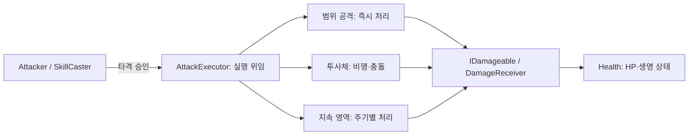
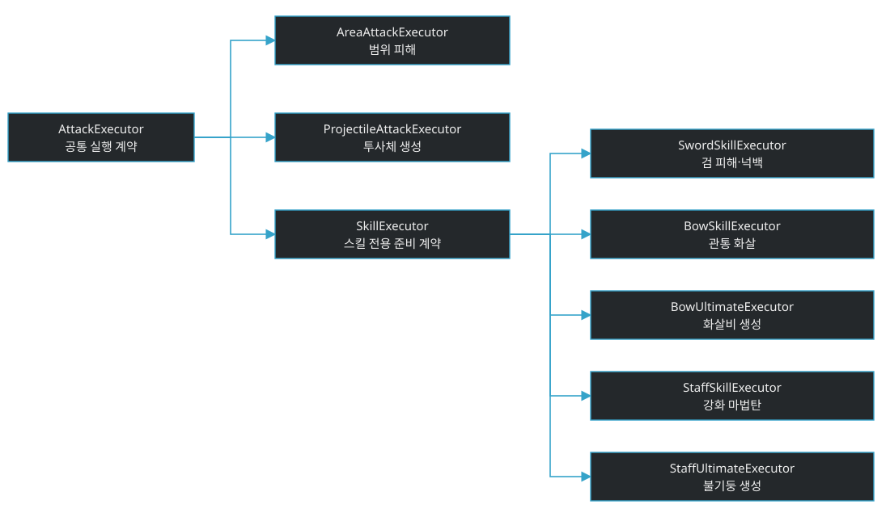
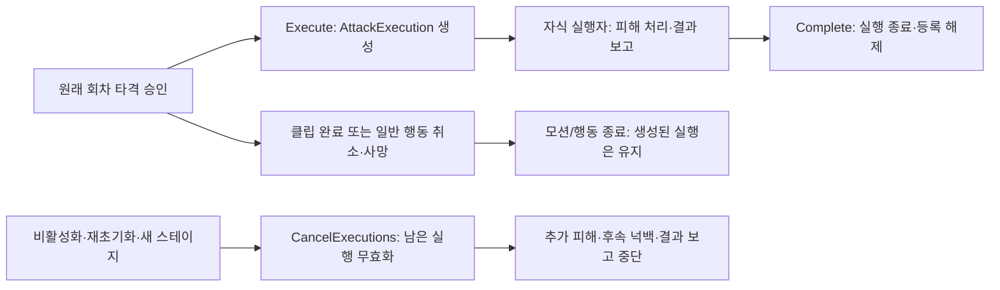
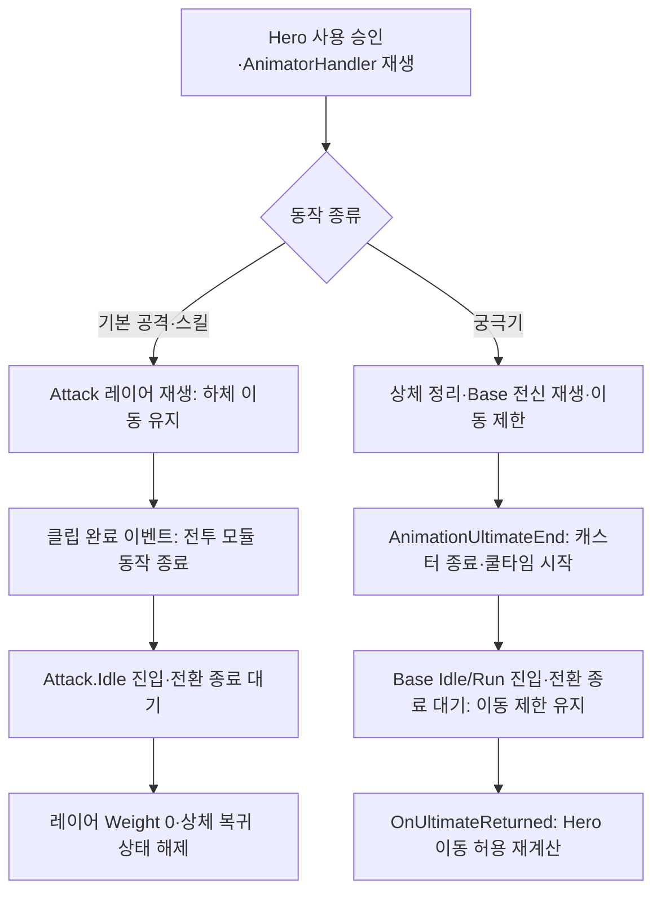
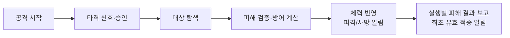
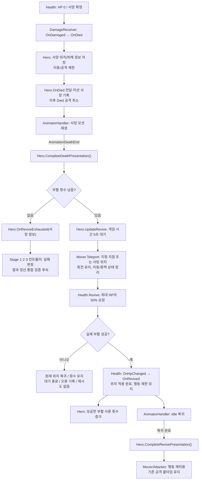

# COMBAT_SYSTEM

## 개요

공격 요청부터 피해 적용, 체력 변화, 사망 알림까지 공통으로 처리하는 시스템입니다. 담당은 LJ(A)이며 공개 API의 최종 기준은 실제 C# 코드입니다.

공통 전투와 검·활·스태프 전투, 무기별 데이터 초기화·Override 적용을 구현했습니다. 플레이어 점프·피격·넉백 표현과 회피 이동·무적·쿨타임도 연결했습니다. 사용자 확인 범위는 [DONE.md](../DONE.md), 남은 표현·검증은 [COMBAT_TODO.md](Todo/COMBAT_TODO.md), 무기·스킬 상세는 [WEAPON_SYSTEM.md](WEAPON_SYSTEM.md), [SKILL_SYSTEM.md](SKILL_SYSTEM.md)를 참조합니다.

## 전투 하위 문서

| 문서 | 책임 |
| --- | --- |
| [WEAPON_SYSTEM.md](WEAPON_SYSTEM.md) | 무기 구성/선택/초기화, 조준/투사체/범위 실행과 지연 결과 설계 |
| [SKILL_SYSTEM.md](SKILL_SYSTEM.md) | 현재 에너지·무기별 스킬/궁극기·지속 공격 계약 |
| [COMBAT_EFFECT_SYSTEM.md](COMBAT_EFFECT_SYSTEM.md) | 구현된 감속/기절/화상과 넉백 계약 |
| [SOUND_SYSTEM.md](SOUND_SYSTEM.md) | 캐릭터·전투 재생 요청과 출력 수명 |
| [VFX_SYSTEM.md](VFX_SYSTEM.md) | 공용 월드·UGUI 재생과 셋업, 캐릭터·전투·아이템 호출·정리 수명 |
| [COMBAT_TODO.md](Todo/COMBAT_TODO.md) | 전투 영역의 구현 순서/연동/남은 검증 |
| [COMBAT_TEST.md](Test/COMBAT_TEST.md) | 실제 존재하는 테스트 연결/실행 방법 |

현재 공개 계약은 이 문서와 실제 코드가 기준이며 하위 문서의 미구현 설계안을 실제 API로 취급하지 않습니다.

## 전체 아키텍처

Attacker와 별도 SkillCaster 두 개가 기본 공격·스킬·궁극기의 사용·회차·쿨타임을 관리합니다. 아래는 타격 승인 이후의 핵심 흐름이며 화살표는 실행·피해 요청 방향입니다. 구체 실행자 상속과 실행 수명은 아래 도식에서 각각 설명합니다.



HitDetector는 범위 대상 탐색·중복 제거만 수행하며 실제 실행 주체가 피해를 요청합니다. 투사체는 자체 물리 충돌 탐색을 사용합니다. 실제 피해 결과는 원래 AttackExecution에 보고하고 효과 종료 시 실행을 완료합니다. 검 넉백은 SwordSkillExecutor의 전용 후속 처리입니다.

DamageReceiver의 실제 적용 피해 반환 계약은 유지합니다. 원거리 상세는 [WEAPON_SYSTEM.md](WEAPON_SYSTEM.md)를 참조합니다.

- 사용 관리와 실제 실행을 분리하며 투사체 비행 시간을 Attacker.IsBusy에 포함하지 않습니다.
- 모션 완료/일반 행동 취소와 실행 무효화는 별개입니다. 비활성화/재초기화/새 스테이지 정리는 남은 실행을 무효화합니다.
- 일반 행동 취소·사망만으로 승인된 실행을 취소하지 않습니다. 실행 자체가 무효화되면 범위 공격의 추가 피해·후속 넉백을 중단합니다.
- 피해 허용·방어 계산은 DamageReceiver, HP 상태는 Health, 행동·모듈 연결은 Hero가 담당합니다.

### 실행자 상속과 실행 정보

아래 화살표는 부모에서 자식으로 향하는 상속 관계입니다. 위의 호출 흐름과 구분합니다. AttackExecution은 상속 계층 밖에서 실행별 정보·결과·수명을 보관합니다.



### 모션과 실행 수명

단발 범위 공격은 즉시 처리하고 투사체·지속 영역은 효과 종료까지 실행을 유지합니다. 모션 종료 이후의 피해도 원래 실행으로 처리하며 실행 무효화 시 다음 갱신에서 제거합니다. 기본 사용자 확인과 추가 수명 검증은 구분합니다.



두 갈래는 별도 수명이며 종료 순서를 강제하지 않습니다. 실행 결과는 원래 AttackContext를 사용하고 현재 공격 회차나 모션 진행 여부로 거절하지 않습니다.

## AnimatorHandler와 캐릭터 애니메이션

AnimatorHandler는 재생과 원래 회차의 Animation Event 전달을 담당합니다. 사용 승인·피해·쿨타임은 전투 모듈이 유지합니다.

사운드는 AnimationFootstep/AnimationSound에서 OnFootstep/OnSound를 전달하고 Hero·Companion이 상태를 확인한 뒤 직접 재생을 요청합니다. 이 신호는 피해·타격 승인 이벤트가 아니며 실제 발사·충돌음은 실행 코드가 요청합니다. 호출과 정리 흐름은 [사운드 시스템](SOUND_SYSTEM.md#재생-요청-흐름)을 참조합니다.

| 표현 | 상태/신호 | 처리 |
| --- | --- | --- |
| 이동 | Base Layer.Idle / Run, MoveSpeed·MoveX·MoveZ | 실제 이동량으로 방향별 모션 갱신. 활의 보행 조준 자세는 UpperStance에서 보간 |
| 점프 | Base Layer.Jump, IsGrounded Bool | 실제 접지 상태 전달. 별도 점프 완료 Animation Event 없음 |
| 일반 피격 | Attack.TakeHit, TakeHit Trigger | 이동 유지, 기존 공격·스킬 우선. Idle 복귀 후 레이어 Weight 해제 |
| 넉백 피격 | Base Layer.TakeHit, IsKnockback Bool | 기존 행동 취소 완료 후 직접 피격 전환 요청. 공중 재생 허용 |
| 회피 | Base Layer.Dodge, IsDodging Bool | 로직 시작·종료에 맞춰 설정. 시간 종료는 HeroDodge가 관리 |
| 기본 공격 | Attack.Attack, Attack Trigger | AnimationAttackHit / AnimationAttackEnd |
| 기본 스킬 | Attack.Skill, Skill Trigger | AnimationSkillHit / AnimationSkillEnd |
| 궁극기 준비 | Attack.UltimateReady, UltimateReady Bool | 활·스태프 범위 조준 중 유지. 확정 시 전신 궁극기로 전환, 취소 시 Idle 복귀 |
| 궁극기 | Base Layer.Ultimate, Ultimate Trigger | AnimationUltimateHit / AnimationUltimateEnd |
| 사망 | Base Layer.Die, Die Bool | AnimationDeathEnd |

Attack 레이어는 상체 마스크를 사용합니다. 기본 공격·스킬은 해당 레이어에서 재생·복귀하고, 빈 Attack.Idle 복귀 후 Weight를 해제합니다. 궁극기·사망은 상체 표현을 정리하고 전신 모션을 사용합니다.

클립 완료는 행동 로직 종료 신호이며 대기 상태 복귀와 다릅니다. CanStartAction은 재생·복귀 중 다음 행동을 제한합니다. 궁극기의 IsUltimatePlaying은 동작과 복귀를 포함하고, OnUltimateReturned 후 Hero가 이동 허용을 재계산합니다. 사망·비활성화에서는 이전 신호를 폐기합니다.

Hero의 사망·부활 흐름은 SetDead → AnimationDeathEnd → 부활 대기 → HP 복구·RestoreAlive → Base 복귀·OnAliveRestored 순서입니다. 실제 연결 대상의 AttackTimingTest/SkillTimingTest는 비활성화하여 단일 신호 경로를 유지합니다.

이동 중 기본 공격·스킬과 궁극기 사용·재생·궁극기 중 이동 차단은 사용자 확인 범위입니다. 플레이어 취소/사망/최종 복귀 경로는 추가 검증으로 구분합니다. 동료 확인 범위는 [동료 테스트](Test/COMPANION_TEST.md)를 참조합니다.

### 레이어별 정상 완료와 복귀

정상 완료 흐름입니다. 취소/사망은 Stop/Reset 경로로 이전 신호를 폐기하며 아래 정상 완료 이벤트를 대신 발생시키지 않습니다.



다음 행동은 CanStartAction과 Hero의 행동 조건을 함께 만족해야 합니다. 궁극기 복귀 알림만으로 사망·기절 등 다른 이동 제한을 해제하지 않습니다.

## 공격 처리 흐름

공격 시작과 실제 타격은 별개입니다. 타격 완료만으로 공격이 종료되지 않으며, 정상 종료는 별도의 `CompleteAttack(attackId)` 신호로 처리합니다.



도식은 정상 처리 흐름입니다. 거절된 요청은 다음 단계로 진행하지 않으며 실제 피해가 없으면 유효 적중 알림이 발생하지 않습니다. 조건과 이벤트 순서는 아래 명세를 참조합니다.

## 스크립트별 책임과 공개 API

외부 시스템 연결 시 확인할 이벤트는 아래 [이벤트 명세](#이벤트-명세)에 별도로 정리하고 **굵게 표시**했습니다. 사용처에 담당자를 명시했으며 필요한 기능에 맞게 구독합니다.

### Attacker — 공격 모듈

공격 시작, 회차, 쿨타임, 종료와 취소를 관리하고 타격 실행을 승인합니다. Inspector에는 AttackExecutor를 연결하며 Health와 공격 설정은 Init으로 받습니다.

| 공개 API | 인자 의미 | 반환값 또는 조회 내용 |
| --- | --- | --- |
| `bool Init(GameObject owner, Health health, GameObject source, ActorType actorType, Faction faction, AttackData attackData, float damageBonus = 0f, float attackSpeedBonus = 0f)` | 실제 공격 주체, 체력 모듈, 피해 발생원, 주체 종류, 진영, 공격 설정, 피해·기본 공격속도 증가율 | 초기화 성공 여부 |
| `bool CanAttack` | 없음 | 현재 공격 시작 가능 여부 |
| `bool IsAttacking` | 없음 | 공격 진행 여부 |
| `bool IsBusy` | 없음 | 시작 알림/공격 진행/타격 결과 처리 중 여부 |
| `int CurrentAttackId` | 없음 | 가장 최근 생성한 회차 |
| `bool TryAttack()` | 없음 | 공격 시작 성공 여부 |
| `void UpdateAttack(float deltaTime)` | 경과 시간 | 쿨타임 갱신 |
| `bool TryCommitHit(int attackId)` | 타격 신호의 원래 회차 | 실행 승인 여부. 빗나가도 승인되었다면 true |
| `void CompleteAttack(int attackId)` | 종료 신호의 원래 회차 | 일치하는 진행 회차 정상 종료 |
| `void CancelAttack(AttackEndReason reason)` | 취소 사유 | 진행 회차 취소 |
| `AttackExecutor Executor` | 없음 | 연결된 기본 공격 실행자 |
| `void CancelExecutions()` | 없음 | 남은 기본 공격 실행 무효화 |
| `void SetAttackEnabled(bool enabled)` | 외부 행동 제한에 따른 허용 여부 | 새 공격/타격 승인 조건에 반영. 쿨타임 초기화나 진행 공격 취소는 하지 않음 |

Init은 공격 처리 중이거나 공격 간격이 음수이면 거절합니다. 성공 시 이전 실행과 쿨타임을 정리하지만 회차 번호는 유지합니다. 프레임마다 UpdateAttack을 한 번 호출합니다.

### AttackExecutor — 공통 공격 실행자

추상 부모입니다. 직접 컴포넌트로 연결하지 않고 AreaAttackExecutor 또는 SwordSkillExecutor 등 자식을 연결합니다.

| API | 역할 |
| --- | --- |
| `void Execute(AttackContext context, Action<AttackContext> onFirstValidHit = null)` | 실행 객체 생성 후 자식에 위임. 즉시 피해량을 반환하지 않음 |
| `protected abstract void ExecuteAttack(AttackExecution execution)` | 자식의 실행 구현 지점 |
| `void CancelExecutions()` | 관리 중인 실행 무효화·목록 해제 |
| `void SetSound(SoundManager sound)` | 생성할 투사체·영역에 전달할 서비스 연결. Execute 전에 호출 |
| `void SetVfx(VfxManager vfx)` | 범위 효과 요청과 생성할 투사체·영역에 전달할 공용 서비스 연결. Execute 전에 호출 |

실행 시작 오류의 등록 정리는 부모에서 한 번 수행하며 오류를 숨기지 않습니다. 실행자 비활성화 시 남은 실행을 정리합니다. Hero 또는 사용 관리 컴포넌트만 비활성화되는 경로에서도 명시적으로 정리합니다.

### AttackExecution — 실행별 정보와 결과

| API/조회 | 역할 |
| --- | --- |
| `AttackContext Context` | 원래 공격 정보 |
| `bool IsActive` | 현재 실행 유효 여부 |
| `void ReportAppliedDamage(float appliedDamage)` | 실제 피해가 양수인 최초 보고에서 한 번 결과 전달 |
| `void Complete()` | 정상 종료와 부모 관리 목록 해제 |
| `void Cancel()` | 부모의 일괄 정리에서 실행 무효화. 목록은 부모가 함께 정리 |

최신 CurrentAttackId나 현재 모션 진행 여부로 지연 결과를 거절하지 않습니다. 기본 공격의 콜백은 Attacker.OnFirstValidHit으로 전달하고 Hero가 플레이어 기본 공격만 에너지로 반영합니다. 스킬·궁극기 실행에는 충전 콜백을 연결하지 않습니다.

### AreaAttackExecutor / SkillExecutor / SwordSkillExecutor

- AreaAttackExecutor: HitDetector/탐색 중심/방향/LayerMask로 범위 탐색·피해를 처리하고 합계를 보고한 뒤 실행 종료.
- SkillExecutor: `TryPrepare(SkillData)`로 설정 준비, `TryPrepareUse(GameObject)`로 소비 전 사용 조건·위치 준비. 기본 사용 준비는 성공을 반환하므로 기존 스킬 동작 유지.
- SwordSkillExecutor: SkillExecutor를 상속해 기존 검 피해·넉백을 실행. 같은 피해의 실제 적용량·사망 결과를 넉백 요청에 사용.
- SkillCaster는 초기화에서 설정만 준비하고, 실제 사용에서는 설정 준비 → 사용 준비 → 회차 생성 → 소비 → 시작 알림 순서로 처리합니다. 화살비는 타격 승인 한 번으로 영역을 생성하고 영역이 반복 피해·종료를 관리합니다.

기본 공격과 궁극기는 설정에 따라 범위 실행자를 연결합니다. 기존 구체 AttackExecutor 컴포넌트는 AreaAttackExecutor로 교체하고 Inspector 참조를 이관해야 합니다. 이전 `ExecuteHit(context)` 호출은 `Execute(context, 결과 전달 함수)`로 변경합니다.

### HitDetector — 타격 탐색 모듈

공간 조건에 맞는 Collider에서 IDamageable을 찾고 동일 수신자의 중복을 제거합니다. 피해 전달과 진영 판단은 수행하지 않습니다.

| 공개 API | 인자 의미 | 출력 |
| --- | --- | --- |
| `void Detect(Vector3 center, float radius, Vector3 forward, float angle, LayerMask layerMask, List<IDamageable> results)` | 월드 중심, 반경, 전방, 전체 각도, 탐색 레이어, 결과 목록 | 기존 목록을 비우고 대상 참조를 채움 |

3D 구형 탐색에 Trigger를 포함하고, Collider 중심의 수평 방향으로 전체 각도의 절반을 검사합니다. 360도는 방향 제한이 없습니다. 자식 Collider는 가장 가까운 부모 IDamageable로 식별합니다. 반경은 유한한 양수, 각도는 유한한 값이어야 하며 각도는 0~360으로 제한합니다. 방향 제한이 있을 때 수평 전방이 0이면 탐색하지 않습니다.

### IDamageable — 피해 수신 계약

| 공개 API | 인자 의미 | 반환값 |
| --- | --- | --- |
| `float TakeDamage(DamageInfo damageInfo)` | 피해와 공격 주체 정보 | 실제 HP 감소량. 거절되거나 감소가 없으면 0 |

계약의 구현체는 DamageReceiver입니다. Hero나 Enemy에서 동일 피해 계산을 다시 구현하지 않습니다.

### DamageReceiver — 피해 수신 모듈

자기 피해, 같은 진영 피해, 무적 및 원본 피해를 검사하고 방어 계산 후 Health에 전달합니다.

CombatTarget은 같은 루트의 DamageReceiver를 통해 진영/생존 상태를 조회하며 별도 초기화나 HP 복사를 하지 않습니다.

| 공개 API | 인자 의미 | 반환값 또는 처리 |
| --- | --- | --- |
| `bool Init(GameObject owner, Health health, Faction faction, float damageReductionRate)` | 피해 대상 오브젝트, 체력 모듈, 진영, 최종 피해 감소율 | 초기화 성공 여부 |
| `Faction Faction`, `bool IsAlive` | 인자 없음 | 설정된 진영과 연결된 활성 Health의 생존 상태. 무적 여부와 구분 |
| `float TakeDamage(DamageInfo damageInfo)` | 피해와 공격 주체 정보 | 실제 HP 감소량 |
| `float TakeDamage(DamageInfo damageInfo, out bool killedTarget)` | 피해 정보, 이번 피해의 사망 결과 | 실제 HP 감소량과 이번 피해로 사망했는지 여부. 기존 피해 API/이벤트 순서는 유지 |
| `void SetInvulnerable(bool isInvulnerable)` | 무적 여부 | 무적 상태 설정 |

피해 감소율은 Init에서 0~1로 제한합니다. NaN 또는 무한대이면 false를 반환하고 이전 설정을 유지합니다. 성공 시 무적은 해제됩니다. 적용할 피해는 `원본 피해 × (1 - 피해 감소율)`이며 무적 시간은 외부에서 관리합니다.

### Health — 체력 모듈

현재·최대 HP, 회복, 생존 상태와 명시적 부활을 관리합니다. 능력치 출처와 진영은 알지 못합니다.

| 공개 API | 인자 의미 | 반환값 또는 처리 |
| --- | --- | --- |
| `float CurrentHp`, `float MaxHp` | 없음 | 현재·최대 HP |
| `bool IsAlive` | 없음 | 현재 HP가 0보다 큰지 여부 |
| `void Init(float maxHp)` | 초기화할 최대 체력 | 최대·현재 HP를 지정 체력으로 초기화 |
| `float TakeHit(float damage, out bool isDead)` | 피해량, 이번 피해로 사망했는지 출력 | 실제 HP 감소량 |
| `float Heal(float amount)` | 회복량 | 실제 HP 증가량 |
| `bool Revive(float hp)` | 적용할 체력 | 사망 상태에서 생존 상태로 전이하면 true, 미적용이면 false. 성공 시 최대 HP 이하로 제한 |

체력 값은 유한한 양수여야 합니다. 잘못된 Init은 오류 로그 후 기존 상태를 유지합니다. 사망 대상에게 TakeHit과 Heal은 적용되지 않습니다. Init과 Revive의 이벤트 차이는 아래 이벤트 표를 참조합니다.

Inspector의 `읽기 전용` 헤더 아래 현재·최대 HP를 표시합니다. 헤더는 확인용 안내이며 편집 잠금 기능은 아닙니다. 체력 변경에는 위 API를 사용합니다.

### DamageInfo와 AttackContext — 전달 데이터

DamageInfo는 변경할 수 없는 readonly struct이며 피해 수신에 필요한 정보를 전달합니다. AttackContext는 공격 시작 시 설정을 보존하는 읽기 프로퍼티 기반 struct입니다.

| 프로퍼티 | 타입 | 의미 |
| --- | --- | --- |
| Attacker | GameObject | 실제 공격 주체 |
| Source | GameObject | 실제 피해 발생원. 예: 발사된 화살 |
| ActorType | ActorType | Player, Companion, Enemy, Installation |
| Faction | Faction | Ally, Enemy |
| AttackType | AttackType | BasicAttack, Skill, Ultimate, DamageOverTime |
| AttackId | int | 공격 주체 내부 회차. 회차 없는 요청은 0 |
| RawDamage | float | 방어 적용 전 피해량 |
| Radius, Angle | float | AttackContext에만 포함. 탐색 반경과 전체 각도 |

```csharp
public DamageInfo (
    GameObject attacker, GameObject source,
    ActorType actorType, Faction faction,
    float rawDamage, AttackType attackType, int attackId )

public AttackContext (
    GameObject attacker, GameObject source,
    ActorType actorType, Faction faction,
    AttackType attackType, int attackId,
    float rawDamage, float radius, float angle )
```

생성자 인자는 표의 의미와 같습니다. Attacker는 설치물 소유자가 아닌 실제 공격 주체이며 AttackId는 전역 고유 ID가 아닙니다. 공격 분류 enum의 선언이 해당 공격 기능의 구현을 뜻하지는 않습니다.

### AttackData와 CombatStatsData — 공통 설정 데이터

| 데이터 | 공개 읽기 프로퍼티 | 생성 메뉴 |
| --- | --- | --- |
| AttackData | `float RawDamage`, `float AttackInterval`, `float Radius`, `float Angle` | Combat/AttackData |
| CombatStatsData | `float MaxHp`, `float DamageReductionRate` | Combat/CombatStatsData |

현재 HP 등 런타임 상태는 SO에 저장하지 않습니다. 설정은 조정 가능한 값이며 추천 초기값을 확정 게임 규칙으로 취급하지 않습니다.

능력치 출처는 주체 초기화 코드가 결정합니다. 플레이어는 WeaponData가 참조하는 공통 데이터, 동료·적은 캐릭터 타입 데이터, 설치물은 종류별 설정을 사용합니다. WeaponData는 HP·방어 수치를 중복 저장하지 않습니다. 플레이어는 HeroUpgradeStats를 받아 HP 추가량·이동·피해·기본 공격속도를 적용하며 SO 원본은 유지합니다. 공격 간격은 기본 간격 ÷ (1 + 공격속도 증가율)입니다. 상세는 [UPGRADE_SYSTEM.md](UPGRADE_SYSTEM.md)를 참조합니다.

무기 초기화에서는 이전 모션 신호·실행을 정리한 뒤 Attacker/SkillCaster.SetExecutor로 참조를 교체합니다. AnimatorHandler.ApplyOverride와 모션 초기화 후 현재 무기 정보를 반영하고 Health를 초기화합니다. 기존 모듈의 일반 Init과 새 스테이지 자원 초기화는 구분합니다.

### Hero, InputHandler — 플레이어 연결

Hero는 하위 모듈의 초기화와 공격 요청, 사망·부활 행동을 중재합니다. InputHandler는 버튼을 누른 순간 OnAttackInput을 발행하며 상위 입력 연결 코드가 Hero에 전달합니다.

InputHandler는 GameManager.KeyBindings를 공유하며 재지정 입력 소비 중 이동값을 0으로 전달하고 나머지 요청을 차단합니다. 기존 입력 처리 순서는 유지하며 설정 적용으로 공용 액션 객체를 교체하지 않습니다. 단축키 계약과 확인 범위는 [INPUT_SYSTEM.md](INPUT_SYSTEM.md)를 참조합니다.

| 공개 API | 인자 의미 | 반환값 또는 처리 |
| --- | --- | --- |
| `bool Hero.Init(WeaponData weaponData)` | 초기화 주체가 선택한 무기 설정 | 초기화 성공 여부 |
| `bool Hero.Init(WeaponData weaponData, HeroUpgradeStats upgrades)` | 입장 시 확정한 강화 결과도 전달. 최종 최대 HP로 Health 초기화 | 초기화 성공 여부 |
| `WeaponData Hero.WeaponData` | 없음 | 현재 적용한 무기 설정 |
| `bool Hero.TryAttack()` | 없음 | 공격 시작 성공 여부 |
| `bool Hero.TryJump()` | 없음 | 공통 행동 조건과 Mover의 점프 조건을 만족하면 실제 점프 후 공중 표현 요청 |
| `bool Hero.TryDodge(Vector3 direction)` | 월드 수평 방향. 입력이 없으면 현재 정면 | 회피 시작 성공 여부 |
| `bool Hero.IsDodging` | 없음 | 회피 로직 진행 여부 |
| `float Hero.RemainingDodgeCooldown` | 없음 | 남은 회피 쿨타임 |
| `void Hero.UpdateDodge(float deltaTime)` | 게임 시간 기준 경과 시간 | 효과 피해와 입력 전에 회피 시간·무적 만료·쿨타임 갱신 |
| `void Hero.UpdateAttack(float deltaTime)` | 경과 시간 | 활성 상태에서 쿨타임 갱신 |
| `void Mover.SetMoveEnabled(bool enabled)` | 수평 이동과 이동 방향 회전 허용 여부 | false이면 수평 속도와 이동 입력을 즉시 해제. 중력은 유지 |
| `void InputHandler.UpdateInput()` | 없음 | 해당 프레임 입력 전달 |

Hero는 이전 모션·실행 정리와 무기 구성 검사 후 `HeroRevive.Init → 실행자 연결 → DamageReceiver.Init → HeroDodge.Init → Attacker.Init → Energy.Init → 기본 스킬 SkillCaster.Init → 궁극기 SkillCaster.Init → StatusEffectController.Init → KnockbackController.Init → 모델·이동·Override 적용 → Health.Init` 순서로 초기화합니다. 앞선 단계 실패 시 중단하며 이전 설정은 롤백하지 않습니다. Health.Init 적용 결과까지 확인한 뒤 행동 허용을 재계산하고 성공을 반환합니다. 상위 초기화 코드는 실패 시 전투 실행을 중단합니다.

Hero의 IsActionBusy와 CanStartNewAction은 점프·회피·전투의 공통 승인 조건을 모읍니다. 개별 모듈은 접지·쿨타임 등 기능별 규칙을 검사하며 AnimatorHandler.CanStartAction은 모션 재생·복귀 제한을 담당합니다. 실제 모듈 분리는 [ARCHITECTURE.md](../ARCHITECTURE.md)의 플레이어 전투 모듈 관계를 참조합니다.

### 플레이어 점프·피격·회피 흐름

- 점프는 공통 승인 → Mover.TryJump의 상승 속도 적용 성공 → AnimatorHandler.PlayJump 순서입니다. 공중에서는 추가 점프와 새 전투 요청을 거절하며 IsGrounded 하나로 점프·접지 전환을 표현합니다. 점프 시작은 남은 TakeHit 트리거를 제거합니다.
- 일반 피격은 실제 피해 후 표현만 요청합니다. 전투·공중 등 허용되지 않는 상태의 요청은 보관하지 않습니다. 넉백 피격은 기존 행동의 취소·종료 처리를 끝낸 뒤 별도로 재생합니다.
- 회피 시작은 Hero 승인 → HeroDodge의 방향·진행 상태·쿨타임 확정 → 무적·방향 적용 → OnStarted → Hero의 행동 제한 재계산·StartDodge 순서입니다. 지상에서 시작하며 진행 중 추가 점프·전투·회피를 제한합니다.
- 회피는 시작 방향을 유지하고 감속 배율 없이 설정 거리·시간으로 이동합니다. 벽 충돌은 이동만 제한하며 회피 시간·무적을 즉시 종료하지 않습니다. UpdateDodge는 프레임마다 한 번, 효과 피해와 입력 전에 호출하고 UpdateMove는 넉백 → 회피 → 일반 이동 중 한 분기만 실행합니다.
- 종료는 진행 상태·무적 해제 → OnEnded → EndDodge·행동 조건 재계산 순서입니다. 정상 종료는 기본 상태 복귀를 기다리며 넉백·사망·비활성화는 해당 처리 경로가 최종 표현을 결정합니다. 일반 이동 속도 계산 기준도 종료 위치로 갱신합니다.
- 쿨타임은 회피 시작부터 감소하며 취소·사망·비활성화·일반 Init으로 초기화하지 않습니다. 비활성화 중 갱신은 멈추고 새 스테이지의 ResetStageResources에서 초기화합니다. 회피 진행과 무적은 취소 시 정리하여 재활성화 후 이어서 실행하지 않습니다.

사망 시 Hero는 수평 이동/회전을 제한하고 Attacker의 공격 허용을 해제한 뒤 진행 중인 공격을 Died로 취소합니다. 사망 중 CharacterController와 Collider를 자동 비활성화하지 않으며 중력/지면 접촉 처리는 계속합니다. HP 복구와 일반 행동 복구는 분리하며 자세한 계약은 다음 섹션을 참조합니다.

## 에너지와 검 기본 스킬

Energy는 자원, SkillCaster는 스킬 진행/회차/타격 승인/종료/쿨타임을 관리하고 Hero가 기본 공격과의 행동을 조율합니다. 실제 스킬 실행은 SkillExecutor에 위임하며 검은 SwordSkillData/SwordSkillExecutor로 즉시 전방 범위 피해와 넉백을 처리합니다.

현재 API/이벤트/에너지/소비·쿨타임/초기화 규칙과 궁극기 설계는 [SKILL_SYSTEM.md](SKILL_SYSTEM.md)로 분리했습니다. 사망 시 공격/스킬을 취소하고 부활 연출 완료까지 행동을 제한하는 계약은 아래 부활 흐름을 유지합니다. 연결과 테스트는 [COMBAT_TEST.md](Test/COMBAT_TEST.md), 남은 작업은 [COMBAT_TODO.md](Todo/COMBAT_TODO.md)를 참조합니다.

## 플레이어 사망/부활 처리

현재 구현 기준은 **사망 연출 완료 후 게임 시간 5초 대기, 부활 시점 최대 HP의 50%, 스테이지당 부활 2회**입니다. Hero에 연결하는 `PlayerReviveData`의 `Delay`/`HpRate`/`MaxCount`로 조정할 수 있습니다. SO 생성 메뉴는 `Hero/PlayerReviveData`이며 런타임 대기/횟수는 HeroRevive에 저장하고 외부에서는 기존 Hero API로 조회·요청합니다.



OnRevived에서 Hero가 AnimatorHandler에 Idle 복귀를 요청한 뒤 부활 VFX를 요청합니다. 이때 위치·HP 복구는 끝났지만 행동 복귀는 대기합니다. 사용 횟수는 Health.Revive가 true를 반환한 뒤 증가하므로 HP/부활 이벤트 안에서 이번 증가분의 즉시 조회를 보장하지 않습니다. 부활 VFX는 배정됐으며 출력 확인과 별도 부활 모션은 후속입니다. 효과 수명은 [VFX 시스템](VFX_SYSTEM.md)을 참조합니다.

| 담당 모듈 | 책임 |
| --- | --- |
| Health | HP/생존 전이 확정, 부활 성공 반환, OnHpChanged → OnRevived 발행. 연출/위치/횟수를 관리하지 않음 |
| Hero | 부활 요청·완료 신호 전달, 모듈 간 이벤트 연결과 행동 허용 중재 |
| HeroRevive | 사망 정보, 연출 완료 대기, 부활 시간·횟수·위치와 실제 부활 처리 |
| Mover | 수평 이동/회전 제한, 중력 유지, 순간 이동과 이전 이동/수직 속도 정리 |
| Attacker | 외부 허용 조건과 생존/쿨타임/공격 회차를 검사하여 시작/타격 승인 |

| 공개 API/이벤트 | 조건과 처리 |
| --- | --- |
| `bool Hero.CanAct` | 초기화 성공·활성·생존이며 부활 연출 대기·기절·넉백·회피 중이 아닐 때 일반 행동 허용. 새 행동은 추가로 전투 진행·접지·모션 조건 검사 |
| `int Hero.UsedReviveCount` | 이번 스테이지에서 성공한 부활 횟수 |
| `void Hero.UpdateRevive(float deltaTime)` | 상위 실행 코드가 프레임마다 게임 시간 기준 경과 시간을 전달. 활성 대기 중에만 시간 감소 |
| `void Hero.CompleteDeathPresentation()` | 현재 사망 연출 완료 대기 중이고 사망 상태일 때 한 번 처리. 대기 상태를 먼저 해제한 뒤 잔여 횟수에 따라 부활 대기 또는 소진 이벤트 |
| `void Hero.CompleteRevivePresentation()` | 현재 부활 연출 완료 대기 중이고 생존 상태일 때 한 번 처리. 이동/공격 허용 복구 |
| `void Hero.ResetReviveCount()` | 새 스테이지 시작 시 호출. 일반 Init/재활성화와 구분 |
| `Hero.OnReviveExhausted` (`Action<DamageInfo>`) | 횟수 소진 후 마지막 사망 연출 완료 시 보존한 사망 정보 전달. 동일 완료 신호 중복 발행 없음 |
| `void Mover.Teleport(Vector3 position)` | 위치 변경 중 CharacterController를 잠시 비활성화하고 원래 활성 상태 복구. 회전 유지 |

`_revivePoint`가 지정되어 있으면 부활 시점의 Transform 위치, 없으면 HeroRevive가 저장한 사망 위치를 사용합니다. Health의 이벤트 전에 위치 이동을 끝내며 Revive가 false이면 원래 위치로 되돌립니다. 실패는 사용 횟수에 포함하지 않고 오류를 한 번 기록한 뒤 대기를 종료합니다.

**OnRevived는 HP/생존 복구이며 연출 완료가 아닙니다.** Hero는 Health 호출 전에 행동을 제한하고, AnimatorHandler의 Idle 복귀 완료 신호로 CompleteRevivePresentation을 처리합니다. 일반 행동은 CanAct를 확인하며 부활은 공격 쿨타임을 초기화하지 않습니다.

비활성화 중에는 남은 시간/연출 대기/횟수를 유지합니다. 재활성화는 새로운 대기를 시작하거나 HP를 채우지 않으며 부활 연출 중이라면 행동 제한도 유지합니다. 게임 시간 배율 0에서는 대기 진행이 멈춥니다. 비활성화 중 유효한 연출 완료 신호를 받으면 완료 상태는 기록하되 시간 진행/행동 복구는 활성화 이후에 반영합니다.

### B/C 연결 계약과 구현 경계

- **Hero.OnReviveExhausted**는 부활 소진 후 마지막 사망 연출 완료 시 실패를 전달하는 진입점입니다. Stage 1·2·3 컨트롤러에 구독·실패 처리 코드가 있으며, 마지막 사망부터 결과 정산까지의 통합 검증은 후속입니다. 종료 순서는 [연계 가이드](../LJ_INTEGRATION_GUIDE.md#스테이지-판정과-화면-전환의-현재-경계)를 참조합니다.
- 플레이어 사망·부활 모션과 완료 신호, 공용 VFX 요청은 LJ가 연결합니다. LHJ는 효과 리소스와 관련 UI·화면 연출을 연계하며 같은 효과를 중복 요청하지 않습니다.
- 완료 API는 현재 단계의 중복 신호를 무시합니다. 이전 연출이 취소되면 해당 완료 신호도 폐기해야 합니다. 다음 생명의 같은 단계까지 늦게 도착한 신호를 식별하는 회차 ID는 현재 추가하지 않았으며 실제 C 연결에서 확인합니다.
- 캐릭터별 Animator 구성·모션·타이밍 연결은 플레이어·동료 LJ, 적·보스 KMB가 담당합니다. 공통 AnimatorHandler와 일부 VFX 실행 모듈은 LJ, 리소스·UI·화면 연출은 LHJ 담당입니다.

구현 기록과 사용자 확인 범위는 [DONE.md](../DONE.md), 남은 Unity 추가 검증/B/C 연동은 [COMBAT_TODO.md](Todo/COMBAT_TODO.md)를 참조합니다.

## 이벤트와 처리 규칙

### 이벤트 명세

굵은 이벤트 이름은 외부 연동 시 확인할 항목이며 모두 필수 구독이라는 뜻은 아닙니다. 아래 사용처는 연결 용도를 나타내며 실제 구현 상태는 담당별 연결 방법을 참조합니다.

| 이벤트 | 발행자 | 인자 타입과 의미 | 발생 조건과 순서 | 담당별 사용처 |
| --- | --- | --- | --- | --- |
| OnAttackInput | InputHandler | `Action`: 없음 | 공격 버튼을 누른 프레임 | 상위 입력 연결 → Hero |
| **OnAttackStarted** | Attacker | `Action<AttackContext>`: 시작 회차 정보 | 시작 상태와 쿨타임 확정 후 | 캐릭터 담당자의 공격 재생·행동 연결 |
| **OnAttackEnded** | Attacker | `Action<int, AttackEndReason>`: 회차, 종료 사유 | 유효한 진행 회차 종료 후 한 번 | 캐릭터 담당자: 재생·행동 정리 / LHJ: 종료·취소 연출 |
| **OnFirstValidHit** | Attacker | `Action<AttackContext>`: 원래 회차 정보 | 해당 AttackExecution에서 양수 피해가 최초 보고될 때 한 번 | A: 에너지 연결 / C: 필요 시 유효 적중 표현 |
| **OnHpChanged** | Health | `Action<float, float>`: 현재 HP, 최대 HP | HP 변화 후. 유효 Init은 같은 값이어도 발행 | C: HP UI |
| **OnDamaged** | DamageReceiver | `Action<DamageInfo, float>`: 피해 정보, 실제 피해량 | HP 감소가 양수일 때 Health 반환 후 | C: 피격 연출 / B: 적 피격 반응 |
| **OnDied** | DamageReceiver | `Action<DamageInfo>`: 피해 정보 | 이번 피해의 사망 전이일 때 OnDamaged 후 한 번 | A: Hero 이동 정지·공격 취소 / B: 적 사망·후속 결과 / C: 사망 연출 |
| **OnRevived** | Health | `Action`: 없음 | 유효 Revive의 OnHpChanged 이후 | A: Hero 사망 대기 정리, 행동은 연출 완료 후 복구 / B: 부활 기능 연결 / C: 부활 연출 |
| **OnReviveExhausted** | Hero | `Action<DamageInfo>`: 보존한 사망 정보 | 부활 횟수 소진 후 마지막 사망 연출 완료 시 한 번 | Stage 1·2·3 컨트롤러의 실패 판정 구독. 통합 검증은 위 구현 경계 참조 |

회복은 OnHpChanged만 발생시키며 피격 이벤트를 발행하지 않습니다. Init은 OnRevived를 발행하지 않습니다. 사망 전이는 Health가 확정하고 공개 사망 알림은 DamageReceiver.OnDied 하나를 사용합니다.

**OnFirstValidHit는 공격 종료 후에도 발생할 수 있는 원래 실행의 결과 알림입니다.** 실행이 유효하면 모션 종료·일반 취소·사망 뒤에도 보고할 수 있으며 소비자는 최신 CurrentAttackId/IsAttacking이 아닌 전달받은 AttackContext를 사용합니다. 투사체도 같은 결과 경로를 사용하며 실행 무효화 후에는 보고하지 않습니다.

### 공격 승인과 중복 방지

- 기본 공격은 누른 순간 한 번 요청합니다. 자동 반복과 입력 버퍼는 없으며 진행 중 입력은 폐기합니다.
- 쿨타임은 시작 승인 시 계산합니다. 진행 상태와 별개이며 종료·취소 후에도 남은 쿨타임을 유지합니다.
- 현재 검은 회차당 단발 타격 한 번입니다. 늦은 신호와 중복 신호는 실행 전에 Attacker가 거절합니다.
- 승인된 광역 타격은 실행 중 공격자가 사망하거나 취소되어도 대상 목록의 처리를 계속합니다. 대상별 피해 허용은 수신 시점의 DamageReceiver 상태로 판단합니다.

| 중복 또는 무효 요청 | 담당 |
| --- | --- |
| 동일 대상의 여러 Collider | HitDetector |
| 동일 회차 반복 타격, 이전 회차 타격·종료 신호 | Attacker |
| 사망 대상 추가 HP 감소와 반복 사망 전이 | Health |

Health는 HP와 사망 상태, 호출 결과를 외부 이벤트 전에 확정합니다. DamageReceiver는 그 결과를 사용하며 이벤트 후 HP를 다시 읽어 결과를 계산하지 않습니다. 피해 이벤트 처리 중 동일 객체를 즉시 풀에 반환해 재초기화하지 않습니다.

### 진영과 초기화

Layer는 물리 탐색, Faction은 전투 관계 판단에 사용합니다. 같은 진영과 자기 피해는 DamageReceiver가 거절합니다. ActorType과 Faction의 원본은 주체 초기화 코드 한 곳에서 정하고 하위 모듈에 전달합니다.

초기화는 전투가 중지된 상태에서 수행하고 실패하면 전투 시작을 중단합니다. 초기 HP 이벤트에 필요한 모듈을 먼저 준비하며 이벤트 구독자는 표시 갱신에 사용합니다. 비활성화 후 재활성화는 Init이나 Revive를 대신하지 않습니다.

## B 담당 연결 방법 — KMB

### 피해 수신 연결

1. 적에 Health와 DamageReceiver를 배치하고 자식 Collider에서도 같은 수신자가 식별되도록 구성합니다.
2. 준비된 Health를 Receiver.Init에 전달하고 성공을 확인한 뒤 Health.Init으로 새 생명을 초기화합니다. Attacker를 사용하는 적은 같은 Health를 전달하여 Health.Init 전에 준비합니다.
3. **DamageReceiver.OnDied**에서 AI 중단, 공격 취소, 적 사망 결과를 연결합니다. 적 타입 및 보상 정보는 이 결과에 결합하고 사망을 다시 판정하지 않습니다.

```csharp
if ( receiver.Init( actorRoot, health, faction, finalDamageReductionRate ) == false )
    return;

health.Init( finalMaxHp );
```

### 적·설치물의 피해 전달

자체 판정으로 확보한 IDamageable에 직접 요청할 수 있습니다. 설치물이 Attacker나 검 실행자를 사용할 필요는 없으며 방어·무적·HP 차감은 공통 수신 계층에 맡깁니다.

```csharp
DamageInfo damageInfo = new DamageInfo(
    installationRoot, arrowObject, ActorType.Installation, Faction.Ally,
    rawDamage, AttackType.BasicAttack, 0 );
float appliedDamage = target.TakeDamage( damageInfo );
```

EnemyCombat은 공통 Health·DamageReceiver를 사용하며 EnemyAttack과 가시 함정의 공통 피해 요청 코드도 연결돼 있습니다. 설치물별·추가 콘텐츠의 실제 적용과 초기화/재사용 수명 검증은 남아 있습니다. 설치물 소유자에게 보상을 귀속하는 규칙은 별도 합의 대상입니다. 활, 스태프, 지속 피해도 이 피해 수신 계약을 재사용할 수 있으며 모든 공격에 HitDetector를 강제하지 않습니다.

## 캐릭터 애니메이션 및 LHJ 연출 연결

캐릭터별 담당자가 애니메이션을 연결합니다. 현재 Hero·Companion에는 AnimatorHandler 연결 코드가 있으며 플레이어 검·활·스태프의 기본 공격·스킬·궁극기와 플레이어 점프·피격·넉백·회피 표현을 연결했습니다. 동료는 CompanionCombatAnimationBinding을 통해 같은 공격 회차의 애니메이션 신호를 전달합니다. 동료별 행동·공격 연결은 [동료 시스템](COMPANION_SYSTEM.md)을 참조합니다. 애니메이션은 원래 회차의 타격·종료를 전달하고 피해 판정은 전투 모듈이 담당합니다. LJ 캐릭터·전투의 공용 VFX 요청은 연결돼 있으며 LHJ는 리소스·UI·화면 연출을 연계합니다. 같은 사건의 중복 재생은 피하며 경계는 [연계 가이드](../LJ_INTEGRATION_GUIDE.md#vfxui---피격상태이상넉백)를 참조합니다. 표현·검증 후속은 [전투 TODO](Todo/COMBAT_TODO.md)·[동료 TODO](Todo/COMPANION_TODO.md)를 참조합니다.

| 연결 지점 | 사용할 방법 |
| --- | --- |
| 공격 시작 | **OnAttackStarted**의 회차를 해당 재생에 보관 |
| 타격 프레임 | `attacker.TryCommitHit(attackId)` |
| 정상 종료 프레임 | `attacker.CompleteAttack(attackId)` |
| 공격 종료 이벤트 | **OnAttackEnded**의 종료 사유에 따라 재생 및 연결 상태 정리 |
| 유효 적중 | **OnFirstValidHit**로 원래 회차의 적중 결과 처리 |
| HP, 피격, 사망, 부활 | **OnHpChanged**, **OnDamaged**, **OnDied**, **OnRevived**로 UI와 연출 연결 |

**타격·종료 신호는 재생을 시작한 원래 공격 회차로 전달합니다.** AnimatorHandler가 회차를 보관하고 취소·종료 후 이벤트 수신을 끊으며 복귀 전 다음 공격을 제한합니다. 실제 모션 연결 대상은 테스트 타이머를 비활성화해 단일 신호 경로를 유지합니다.

호출 예시는 아래와 같습니다. `attackId`는 해당 재생에 보존한 회차이며 두 호출은 각각의 프레임 콜백에서 수행합니다. AnimatorHandler 구현 예시는 아닙니다.

```csharp
//타격 프레임 콜백에서 호출. 승인 여부와 실제 적중 여부는 다름
bool approved = attacker.TryCommitHit( attackId );
```

```csharp
//정상 종료 프레임 콜백에서 같은 재생의 회차로 호출
attacker.CompleteAttack( attackId );
```

| AttackEndReason | 의미와 연결 기준 |
| --- | --- |
| Completed | CompleteAttack으로 정상 종료 |
| Canceled | 일반 취소 |
| Died | 공격자 사망으로 취소 |
| Disabled | 컴포넌트 또는 오브젝트 비활성화. 비활성 Animator에 종료 애니메이션을 재생하지 않고 연결 상태 정리 |

취소는 CancelAttack을 사용하며 Completed를 전달하지 않습니다. OnAttackEnded에서 CompleteAttack을 다시 호출하는 순환 연결을 만들지 않습니다. 이벤트 구독·해제는 OnEnable과 OnDisable에서 명명된 핸들러로 짝을 맞춥니다. HP UI는 구독할 때 CurrentHp와 MaxHp로 초기 표시도 갱신합니다.

## 파일 경로와 관련 문서

공통 전투 파일의 기준 폴더는 `Assets/02. Scripts/Combat/`입니다.

| 분류 | 파일 |
| --- | --- |
| 공격 | Attacker.cs, AttackExecutor.cs, AttackExecution.cs, AreaAttackExecutor.cs, HitDetector.cs, AttackContext.cs, AttackEndReason.cs |
| 피해 수신 | IDamageable.cs, DamageInfo.cs, DamageReceiver.cs, Health.cs |
| 설정 | AttackData.cs, CombatStatsData.cs |
| 구분 값 | ActorType.cs, Faction.cs, AttackType.cs |

| 연결 스크립트 | 파일 경로 |
| --- | --- |
| Hero | `Assets/02. Scripts/Hero/Hero.cs` |
| PlayerReviveData | `Assets/02. Scripts/Hero/PlayerReviveData.cs` |
| InputHandler | `Assets/02. Scripts/InputHandler/InputHandler.cs` |

클래스 summary는 위에서 사용한 통일 명칭과 책임을 `명칭 - 담당 기능` 형식으로 작성합니다.

| 문서 | 역할 |
| --- | --- |
| [ARCHITECTURE.md](../ARCHITECTURE.md) | 전체 구조와 담당 경계 |
| [COMBAT_TEST.md](Test/COMBAT_TEST.md) | 테스트 구성과 실행 방법 |
| [COMBAT_TODO.md](Todo/COMBAT_TODO.md) | 남은 작업과 협의 사항 |
| [TODO.md](../TODO.md), [DONE.md](../DONE.md) | 전체 진행 상태와 완료 기능 |
| [PROJECT_CONTEXT.md](../PROJECT_CONTEXT.md) | 게임 전제와 기획 |
| [AGENT_GUIDE.md](../AGENT_GUIDE.md), [LJ_CODING_STYLE.md](../Coding_Style/LJ_CODING_STYLE.md) | 작업 및 코딩 규칙 |

