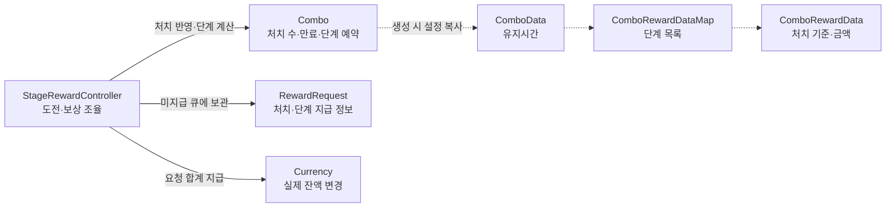
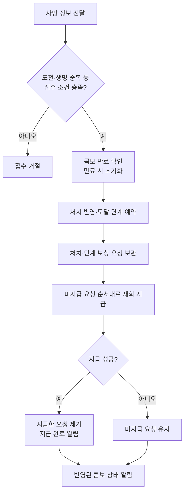

# COMBO_SYSTEM

## 문서 역할과 상태

LJ 담당 팀 처치 콤보의 유지, 단계별 보상과 재화 연동을 정리합니다. Combo/StageRewardController와 KMB 처치 재화 전달·LHJ 콤보 표시 연결 코드가 있습니다. 실제 통합 플레이와 최종 종료 연계는 후속입니다. 잔액/지급 규칙은 [CURRENCY_SYSTEM.md](CURRENCY_SYSTEM.md), 검증 범위는 [CURRENCY_TEST.md](Test/CURRENCY_TEST.md), 담당 경계는 [ARCHITECTURE.md](../ARCHITECTURE.md)를 참조합니다.

## 기획 기준

- 플레이어/동료/설치물 처치를 팀 전체로 합산합니다.
- 이전 처치 이후 4초 안에 다음 처치가 발생하면 콤보를 유지하며, 4초간 처치가 없으면 종료합니다.
- 5킬 도달 시 스테이지 재화 20, 10킬 50, 20킬 100을 즉시 지급합니다.
- 한 콤보의 최대 보상 합계는 170이며 20킬 이후 추가 단계 보상은 없습니다.
- 유지시간과 보상액은 기획 초기값으로 조정할 수 있습니다.

## 확정한 단계별 지급 규칙

- **한 콤보에서 각 단계 보상은 한 번만 지급합니다.** 5킬 보상 수령 이후 같은 콤보에서 다시 지급하지 않습니다.
- 콤보가 종료된 뒤 새 콤보에서는 각 단계 보상을 다시 받을 수 있습니다.
- 단계 보상은 스테이지 재화로 지급하며 영구 재화 최초 지급/별 보상과 별개입니다.

## 모듈과 공개 API — 현재 구현

실선은 실행 호출과 요청 보관, 점선은 설정 참조입니다. Combo는 생성할 때 설정값을 복사합니다. 미지급 큐는 StageRewardController 내부에서 관리합니다.

| 모듈 | 책임 |
| --- | --- |
| ComboData / ComboRewardDataMap / ComboRewardData | 유지시간과 처치 수 오름차순 단계 보상 SO |
| Combo | 설정 복사, 처치 수/만료시간/다음 보상 예약 단계 관리 |
| StageRewardController | 도전 수명, 생명별 중복 접수, 미지급 요청과 Currency 지급 조율 |
| RewardRequest | 원래 도전/생명 식별값, 처치 당시 콤보 수, 처치/단계 보상과 합계 |
| EnemyRewardReceiver | 대안 사망 수신부. 현재 KMB WaveController의 직접 전달과 중복 연결하지 않음 |
| LJTest.EnemyRewardTest | 더미 부활·처치 검증을 위한 선택적 연결 |

Combo 설정/계산은 `Assets/02. Scripts/Combo/`, 보상 연결부/요청은 `Assets/02. Scripts/Currency/`에 있습니다. 실제 C# 코드가 시그니처의 최종 기준입니다.

| StageRewardController API | 기능 |
| --- | --- |
| Init(Currency currency, ComboData data) | 진행 도전이 없는 상태에서 연결 및 콤보 설정 복사 |
| BeginStage(int initialStageCurrencyBalance) | Currency 도전 시작 성공 후 콤보/중복/미지급 기록 초기화 |
| TryIssueLifeId(int stageId, out long lifeId) | 현재 도전 안에서 새 생명 번호 발급 |
| RegisterKill(int stageId, long lifeId, int killAmount, double now) | 사망 한 건 접수. true는 접수 성공이며 지급 성공과 구분 |
| UpdateCombo(double now) / GetComboRemainingTime(double now) | 만료 처리 / 남은 시간 조회 |
| RetryPendingRewards() | 처치를 다시 집계하지 않고 미지급 요청 순서대로 재시도 |
| EndStage(int stageId) | 미지급 처리 완료 후 도전 종료. 지급 실패 시 도전 유지 |
| AbandonStage(int stageId) | 도전 종료 성공 후 미지급 요청 폐기 |
| CurrentStageId / ComboKillCount / NextRewardKillCount | 도전 번호 / 현재 처치 수 / 다음 보상 기준. 모든 단계 예약 후 기준은 0 |
| PendingRewardCount / StageCurrencyBalance | 미지급 요청 수 / 현재 스테이지 재화 잔액 |
| OnComboChanged(int, int) | 반영된 처치 수와 다음 보상 기준 알림 |
| OnRewardPaid(RewardRequest) | 지급 성공 후 해당 요청을 제거하고 지급 완료 알림 |

## 진행과 지급 — 현재 구현

한 처치의 접수와 지급 흐름입니다. 지급 시 기존 미지급 요청부터 순서대로 처리하며, 요청 검사를 통과하지 못하면 상태를 변경하지 않습니다.

- 상위 연결부가 Currency 초기화 후 StageRewardController.Init/BeginStage를 호출합니다. 보상 연결부를 사용하는 도전의 종료도 해당 연결부를 통해 처리합니다.
- RegisterKill은 한 건씩 접수합니다. 원래 도전 번호와 현재 도전에서 유일한 양수 lifeId를 전달하며 같은 생명의 중복과 이전 도전 요청은 거절합니다.
- Combo는 마지막 처치의 게임 시간 + 유지시간을 만료시간으로 보관합니다. `now >= 만료시간`이면 초기화하며 처치 접수에서도 만료를 먼저 검사합니다. now는 상위에서 전달하는 유한하고 역행하지 않는 게임 시간입니다.
- 단계에 도달하면 다음 단계를 예약하고 처치/단계 금액을 합친 RewardRequest를 큐에 보관한 뒤 Currency.TryAddStageReward로 지급합니다. 예약된 단계와 실제 지급 완료는 구분합니다.
- 지급 실패한 요청은 큐에 남고 후속 처치/명시적 재시도/정상 종료에서 다시 지급을 시도합니다. 콤보 만료는 이미 예약한 미지급 요청을 삭제하지 않습니다.
- 상태 변경 처리 중 같은 연결부의 재진입 요청은 거절합니다. Currency 내부를 다른 구독자가 직접 변경하는 동작까지 자동 조율하는 구조는 아닙니다.
- 프레임 갱신에서 시간 감소만으로 콤보 변경 이벤트를 발행하지 않으며, 처치 접수/만료/도전 시작·종료·포기에서 알립니다. Init은 변경 이벤트를 발행하지 않습니다.
- 게임 시간 갱신이 계속되는 동안 자연 만료됩니다. 웨이브 전환 전용 초기화는 없으며 실제 준비 시간/일시정지 연결은 상위 코드 책임입니다.
- 콤보 상태와 현재 도전의 중복/미지급 기록은 영구 저장하지 않습니다.

### 만료와 도전 종료

| 상황 | 처리 |
| --- | --- |
| 콤보 만료 | 처치 수/단계 진행 초기화. 이미 예약한 미지급 요청과 도전의 생명 중복 기록은 유지 |
| 정상 도전 종료 | 미지급 요청 처리 후 Currency 종료. 지급/종료 실패 시 성공으로 처리하지 않음 |
| 도전 포기 | Currency 종료 성공 후 콤보/중복/미지급 기록 폐기 |

정상 종료 또는 포기에 성공하면 도전의 콤보/중복/미지급 기록을 정리합니다. 만료와 도전 종료는 서로 다른 수명입니다.

## 담당별 연결

- KMB: 실제 적의 사망 확정 정보를 전달합니다. 사망 연출/풀 반환을 처치 집계 신호로 사용하지 않습니다.
- LJ: 유효한 처치 집계, 콤보 시간/단계 관리와 스테이지 재화 지급을 처리합니다.
- LHJ: 현재 콤보 상태와 단계 보상 알림을 받아 숫자/보상 팝업을 표시합니다.

더미 연결은 Ally의 Player/Companion/Installation 사망 피해 정보를 인정하며 생명 번호는 StageRewardController가 발급합니다. EnemyRewardReceiver를 사용하는 대안 경로에서는 Health/Receiver 초기화 후 생성·재사용마다 Init을 호출합니다.

KMB 처치 전달 경로와 중복 연결 제한은 [처치·콤보 연계](../LJ_INTEGRATION_GUIDE.md#처치콤보---보상-연결부), 전체 종료는 [공통 플레이 흐름](PLAY_FLOW.md)을 따릅니다.

LHJ 콤보 표시는 변경/지급 이벤트와 잔여 시간 조회를 사용합니다. 실제 연결·추가 검증은 [TODO.md](../TODO.md#재화-상세-작업)에서 관리합니다.
