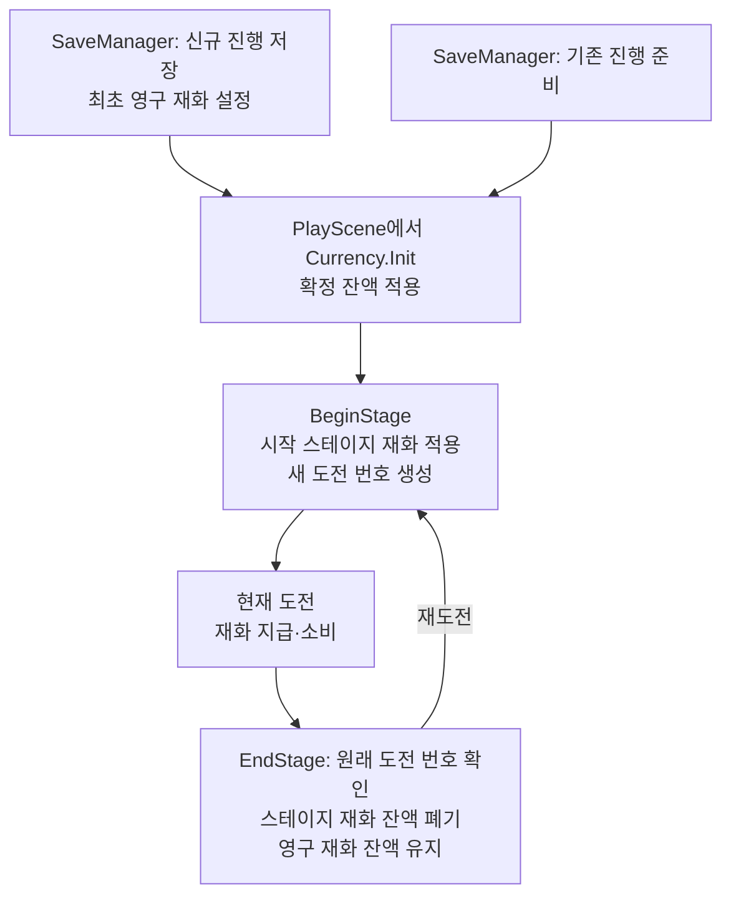

# CURRENCY_SYSTEM

LJ 담당 재화 기본 모듈의 사용 계약과 후속 연결 방향을 정리합니다.

## 1. 현재 구현 상태

| 구분 | 상태 |
| --- | --- |
| CurrencyType / CurrencyData / Currency | 기본 모듈 구현 완료 |
| 재화 잔액 조회 / 지급 / 소비 | 구현 |
| 도전 시작 / 종료 / 이전 도전 번호 검사 | 구현 |
| 점수·최초 별·패배 종료 보상 | 구현. 확인 범위는 [DONE](../DONE.md#2026-11-05-클리어-보상-설정과-정상-지급-확인), 후속은 [TODO](../TODO.md#클리어-점수-보상-연결) |
| 처치 / 콤보 | StageRewardController·더미와 실제 KMB 처치 전달 코드 연결. 통합 플레이 확인 후속 |
| 고용 연결 | 개체별 고용 기록과 타입 공통 대기를 사용하며 최초 고용/재고용 비용 동일. 범위와 검증은 [COMPANION_SYSTEM.md](COMPANION_SYSTEM.md) 참조 |
| 저장 / 설치 / UI 연결 | 영구 재화 저장·재불러오기 사용자 확인. 설치 소비/실패 복구/환불 코드 반영, 실제 플레이·HUD 통합 후속 |
| 씬 진행 / 검증 도구 | 로비는 LobbyController, 플레이 모듈 연결·갱신은 PlayScene, 도전 조율은 PlaySession. TestScene은 직접 테스트 시작, CurrencyTest는 선택적 검증 요청 도구 |
| 사용자 Unity 실행 확인 | 기본 동작 확인. 상세 범위는 테스트 문서 참조 |
| 에이전트 확인 | 정적 확인과 대역을 사용한 독립 검사. Unity 실행·프로젝트 빌드 미수행 |

재화·콤보의 기본 동작은 기존 사용자 확인 범위이며 테스트 의존 분리 후 더미 재연결과 전체 회귀·실제 게임 연계가 남아 있습니다. 보상 연결부 계약은 [COMBO_SYSTEM.md](COMBO_SYSTEM.md), 현재 검증 구성은 [CURRENCY_TEST.md](Test/CURRENCY_TEST.md)를 참조합니다.

로비의 잔액 복원과 저장 연결은 [로비 시스템](LOBBY_SYSTEM.md)을 참조합니다.

| 문서 표기 | 의미 |
| --- | --- |
| 현재 구현 | 실제 코드의 사용 계약 |
| 확정 규칙 | 사용자 합의 기준 |
| 기획 초기값 | 밸런스 조정 가능 수치 |
| 추천안 / 협의 필요 | 후속 설계이며 구현 완료나 최종 합의가 아님 |

## 2. 영구 재화 / 스테이지 재화 비교

| 항목 | 영구 재화 | 스테이지 재화 |
| --- | --- | --- |
| 역할 | 단일 저장의 영구 진행 | 현재 도전의 설치·고용 운용 |
| 획득 | 미션, 도감, 클리어/실패, 별 기록 보상 | 적 처치, 콤보 |
| 소비 | 무기/설치물 해금, 영구 강화, 소모품 구매 | 설치물 설치, 동료 고용/재고용 |
| 시작 기준 | 신규 진행 생성 시 CurrencyData 값, 기획 기본 300/1회 | 난이도별 시작값 전달 |
| 재도전 | 영구 재화 잔액 유지 | 스테이지 재화 잔액을 새 시작값으로 설정 |
| 종료 | 영구 재화 잔액 유지 | 스테이지 재화 잔액 폐기 |
| 저장 방향 | 단일 진행 영구 저장 | 중간 저장 제외 |

영구 재화와 구매·미션·도감·해금의 통합 저장, 최고 별·점수와 종료 보상 코드를 구현했습니다. KMB의 Stage 1·2 점수 계산·확정·전달과 Stage 3 전달 기반이 있으며 LJ는 전달된 점수로 보상을 처리합니다. 실제 맵 통합 검증은 후속이며 처치·콤보 재화로 점수를 대체하지 않습니다. 문서와 논의에서는 **영구 재화 / 스테이지 재화**로 부릅니다.

### 최초 지급 — 확정 규칙

| 조건 | 처리 |
| --- | --- |
| 파일이 없는 단일 진행 생성 | CurrencyData의 최초 영구 재화를 한 번 설정, 기획 기본 300 |
| 기존 저장 불러오기 | 저장된 영구 재화 잔액 적용 |
| 게임 재실행 / 로비 복귀 / 스테이지 재도전 | 최초 영구 재화 재지급 없음 |

파일 없음 판정과 단일 진행 생성은 SaveManager/SaveService 책임입니다. 최초 값은 SaveManager에 연결한 CurrencyData를 사용하고 Currency.Init은 전달받은 저장 잔액만 적용합니다. 단일 저장과 공용 슬롯은 구분하며 실제 타이틀 UI 연결은 후속입니다.

### 기획 초기값

| 지급 항목 | 재화 종류 | 값 / 상태 |
| --- | --- | --- |
| 신규 단일 진행의 최초 지급 | 영구 재화 | 300 — 사용자 합의 기준 |
| 난이도별 도전 시작 | 스테이지 재화 | 쉬움 700 / 보통 500 / 어려움 400 |
| 종료 보상 | 영구 재화 | [채택한 보상 정책과 초기값](../PROJECT_CONTEXT.md#영구-재화) 참조 |
| 적 처치 | 스테이지 재화 | 기본형 20 / 빠른 적 15 / 탱커 50 / 비행형 25 / 보스 300 |

최초 지급을 제외한 수치는 기획 초기값으로 조정할 수 있습니다. 종료 보상 설정과 사용 계약은 아래 항목을 따릅니다.

### 종료 보상 계약

| 구성 | 책임 |
| --- | --- |
| ClearRewardData / ClearScoreTarget | 금액·정수 백분율 배율·기존 별 정책과 맵/난이도별 기준 점수 SO 설정 |
| ClearRewardCalculator / ClearRewardInput | 검사를 마친 도전 입력으로 decimal 계산, 마지막에 버림. 저장·재화 변경 없음 |
| ClearRewardAmounts / ClearRewardPlan | 클리어·별·실패 금액과 재시도에서 유지할 정산 계획 |
| ClearRewardResult / ClearRewardState | 원래 도전의 확정 점수·계산액·실제 지급액·처리 상태 조회 |
| ClearRewardCommit | 저장한 지급 내역과 확정 영구 잔액 전달 |

PlayScene의 Clear Reward Data에 `Currency/ClearRewardData` 메뉴로 생성한 SO를 연결합니다. SO 미연결 또는 설정 구조 오류는 씬 초기화 실패입니다. 기준 점수는 사용할 맵/난이도별로 배정하며 선택한 기준 누락은 플레이어·재화 변경 전 도전 시작을 거절합니다. 기존 별 정책의 선택 의미와 저장 처리는 [저장 계약](SAVE_SYSTEM.md#종료-보상-통합-저장)을 따릅니다.

런타임 스크립트는 `Assets/02. Scripts/Currency/ClearReward`, CSV·SO는 `Assets/03. Configs/Currency`에 둡니다. 현재 ClearRewardData는 PlayerTest에 연결돼 있습니다.

설정 구조 검사는 초기화, 해당 도전의 기준 점수·기존 지급 단계 확보는 시작, 승패·별 검사는 종료 예약, 점수 검사는 마지막 사건 완료 접수에서 맡습니다. 계산기는 이를 반복하지 않으며 금액의 정수 변환 범위만 확인합니다. 전체 호출 순서와 결과 수명은 [PLAY_FLOW](PLAY_FLOW.md#최종-종료와-완료-통지), UI가 사용할 조회 접점은 [연계 가이드](../LJ_INTEGRATION_GUIDE.md#점수와-종료-순서)를 참조합니다.

#### 기준 점수 CSV

`ClearRewardTargets.csv`의 헤더는 `MapId,EasyScore,NormalScore,HardScore`입니다. `Tools/Clear Reward CSV Importer`에서 CSV·대상 SO·StageSelectionData를 선택하고 미리보기 후 적용합니다. 등록 맵의 누락/중복과 양수 정수 점수를 검사하며 SO의 기준 점수 목록만 교체합니다.

| MapId | Easy | Normal | Hard |
| --- | ---: | ---: | ---: |
| stage_1 | 4300 | 5100 | 5900 |
| stage_2 | 6800 | 8000 | 9200 |
| stage_3 | 8500 | 10100 | 11700 |

점수는 보상용 초기값이며 조정할 수 있습니다. 도구 사용과 기대 지급액은 [종료 보상 검증](Test/CURRENCY_TEST.md#종료-보상)을 참조합니다.

## 3. 모듈과 공개 API — 현재 구현

스크립트 위치: `Assets/02. Scripts/Currency/`

| 모듈 | 역할 |
| --- | --- |
| CurrencyType | Permanent(영구 재화) / Stage(스테이지 재화) 구분 |
| CurrencyData | InitialPermanentCurrency 설정, 기본 300. 생성 메뉴 Currency/CurrencyData. 자동 지급 없음 |
| Currency | MonoBehaviour. 상위 코드가 초기화/도전 시작/종료 호출 |

자체 생명주기 초기화는 없습니다. 영구 재화 변경은 저장 요청 성공 후 반영하며, Init은 저장 없이 전달받은 잔액을 적용합니다. 저장 계약은 [SAVE_SYSTEM.md](SAVE_SYSTEM.md)를 참조합니다.

### 초기화와 조회

| API | 기능 |
| --- | --- |
| `bool Init(int permanentCurrencyBalance)` | 저장 데이터의 영구 재화 잔액 적용, 스테이지 재화 잔액 0 |
| `int GetBalance(CurrencyType type)` | 현재 재화 잔액 조회 |
| `bool CanSpend(CurrencyType type, int amount)` | 초기화/활성/재화 종류/진행 상태/금액/충분한 재화 잔액 검사 |
| `int CurrentStageId` | 현재 또는 마지막 도전 번호 |
| `bool IsStageActive` | 도전 진행 여부 |

### 지급과 소비

| API | 기능 |
| --- | --- |
| `bool TryAdd(CurrencyType type, int amount)` | 지급. 영구 재화는 저장 성공 후 반영 |
| `bool TrySpend(CurrencyType type, int amount)` | 전액 소비. 영구 재화는 저장 성공 후 반영 |
| `bool TryAddStageReward(int stageId, int amount)` | 현재 진행 도전과 원래 번호가 일치할 때 스테이지 재화 지급 |

### 도전 관리와 이벤트

| API | 기능 |
| --- | --- |
| `bool BeginStage(int initialStageCurrencyBalance)` | 시작 스테이지 재화 적용, 새 도전 번호·진행 상태 설정 |
| `bool EndStage(int stageId)` | 현재 도전 번호 확인 후 지급 차단, 스테이지 재화 잔액 폐기 |
| `OnBalanceChanged(CurrencyType type, int currencyBalance)` | 재화 종류·변경 후 재화 잔액 알림 |
| `OnPermanentSaveRequested(int balance) → bool` | 변경 후 영구 잔액 저장 요청. SaveService 하나만 구독 |

## 4. Currency 기본 모듈의 초기화와 도전 수명

아래 도식은 Currency 자체의 API 수명입니다. 진행 생성·불러오기는 SaveManager/SaveService, 공유 진행으로 모듈 복원은 PlayScene이 처리합니다. PlaySession은 도전 시작·종료를 조율하며 TestScene은 이 기능을 상속한 테스트 진입점입니다.

### 보상 연결부를 사용하는 도전

처치·콤보가 포함된 도전은 StageRewardController를 통해 Currency의 도전 시작·보상 지급·종료를 조율합니다. 설치·고용 소비는 Currency API를 사용합니다. 보상 지급·미지급 처리는 [콤보 시스템](COMBO_SYSTEM.md#진행과-지급--현재-구현), 전체 도전 준비·종료는 [공통 플레이 흐름](PLAY_FLOW.md)을 따릅니다.

### 현재 KMB 처치 재화 경로

WaveController가 발급한 생명 번호·원래 도전 번호를 EnemyCombat.TryInitializeReward에 보관하고, EnemyCombat.OnDied를 받아 팀 처치 판정 후 RegisterKill에 전달하는 코드가 있습니다. EnemyRewardReceiver를 같은 경로에 추가 연결하거나 번호를 다시 발급하지 않습니다. 실제 도전 초기화·웨이브 시작·마지막 사건 전달·미션/도감/재화 종료 순서 통합은 후속이며 [담당별 연계](../LJ_INTEGRATION_GUIDE.md)를 참조합니다.

### 도전 번호

**CurrentStageId는 맵 번호가 아니라 같은 맵의 재도전을 구분하는 번호입니다.**

| 상황 | 처리 |
| --- | --- |
| 새 도전 시작 | 번호 증가 |
| Init / 공유 진행 재연결 | 번호 유지 |
| 이전 도전 번호로 TryAddStageReward / EndStage 호출 | 거절 |
| TryAdd(Stage, amount) 호출 | 현재 도전에 직접 지급. 이전 도전 번호 검사는 하지 않음 |

지연 보상은 **발생 당시 도전 번호**를 보관해 TryAddStageReward에 전달합니다. 늦은 알림에 최신 번호를 붙이지 않습니다.

## 5. 요청 처리와 이벤트 규칙 — 현재 구현

### 조건별 결과

| 요청 / 조건 | 결과 |
| --- | --- |
| Init: 비활성 / 도전 중 / 음수 영구 재화 잔액 | false, 상태 유지 |
| BeginStage: 비활성 / 미초기화 / 이미 진행 중 / 음수 시작값 / 번호 소진 | false, 상태 유지 |
| 지급·소비: 비활성 / 미초기화 / 미지원 종류 | false, 재화 잔액 유지 |
| 스테이지 재화 지급·소비: 진행 도전 없음 | false, 재화 잔액 유지 |
| 음수 지급·소비 | false, 재화 잔액 유지 |
| 소비액이 재화 잔액보다 큼 | false, 부분 차감 없음 |
| 지급 후 int 범위 초과 | false, 재화 잔액 유지 |
| 영구 재화 저장 연결 누락 / 최종 저장 실패 | false, 잔액 유지와 오류 로그 |
| 0원 지급·소비 | 사용 조건 충족 시 true, 저장 요청·변경 알림 없음 |
| GetBalance: 미지원 종류 | ArgumentOutOfRangeException |
| EndStage: 미초기화 / 진행 도전 없음 / 번호 불일치 | false, 상태 유지 |
| EndStage: 비활성이지만 현재 도전 번호 일치 | 명시적 종료 가능 |

재화 잔액은 0 이상의 정수로 관리합니다. 별도 게임 규칙상의 보유 상한은 우선 두지 않으며 구현 자료형의 범위를 검사합니다.

### 알림과 비활성화

| 상황 | 규칙 |
| --- | --- |
| Init 성공 | 모든 상태 적용 후 영구 재화/스테이지 재화 두 알림 발행 |
| 일반 재화 변경 | 실제 재화 잔액이 달라질 때 반영 후 알림 |
| BeginStage / EndStage | 진행 상태를 먼저 반영. 금액이 같으면 재화 잔액 알림 없음 |
| UI 최초 연결 | 변경 이벤트 구독 후 GetBalance로 현재값 최초 표시 |
| 비활성화 / 재활성화 | 재화 잔액·도전 상태를 자동 초기화하지 않음 |

OnBalanceChanged를 도전 시작/종료 신호로 사용하지 않습니다. UI와 다른 시스템은 재화 잔액 필드를 직접 수정하지 않습니다.

## 6. 설치·소비·환불 연동

기존 KMB 머지 코드에 설치 소비·실패 전액 복구·실제 지불 기록·철거 환불이 반영됐습니다. 기본 환불 설정 70%와 주요 플레이·테스트 씬의 연결이 있으며 실제 소비·환불 검증은 후속입니다. 호출 순서는 [LJ_INTEGRATION_GUIDE.md](../LJ_INTEGRATION_GUIDE.md)의 설치·철거 항목을 참조합니다.

| 상황 | 처리 기준 | 상태 |
| --- | --- | --- |
| 소모품 구매 | 잔액·수량 통합 저장 후 반영 | 구현, [SHOP_SYSTEM.md](SHOP_SYSTEM.md) 참조 |
| 설치/고용 | 실행 가능 여부·재화 잔액 확인 후 실제 소비 시도 | 고용/설치 코드 반영, 실제 수명 확인 후속 |
| 차감 후 실행 실패 | 실제 차감액 전액 복구 | KMB 설치 실패 복구 코드 반영, 플레이 확인 후속 |
| 정상 철거 | 실제 지불 비용과 RefundPercent로 계산, 소수점 버림. 기본 설정 70% | 코드·설정 연결 반영, 실제 환불 검증 후속 |
| 환불 비율 설정 | KMB 경제 설정 SO의 RefundPercent 사용 | InstallationEconomy_Default의 70%와 주요 플레이·테스트 씬 연결 반영 |

설치 실패의 전액 복구와 정상 철거의 비율 환불은 별개입니다.

| 담당 | 소유 책임 |
| --- | --- |
| KMB 설치 시스템 | 배치/철거 판정, 실제 지불 비용 기록, 환불 비율과 금액 계산 |
| LJ Currency | 전달받은 금액의 소비·지급 |
| 연결 코드 | 소비 결과와 실제 실행 결과 연결, 실패 복구 |

Currency는 배치 가능 여부를 판정하지 않으며 설치 거래의 자동 복구를 제공하지 않습니다.

## 7. 후속 설계와 협의

아래는 현재 연결과 후속 협의 항목입니다. 코드 연결·저장 에셋 참조·실제 플레이 확인을 구분합니다.

### 스테이지 진행과 보상

| 항목 | 추천 방향 / 상태 |
| --- | --- |
| 새 도전 | 난이도별 시작 스테이지 재화 설정 + 콤보 초기화 |
| 웨이브 전환 / 사망 / 부활 | 재화 잔액 초기화 없음 |
| 마지막 적 처치 | 처치 재화·콤보 단계 보상 처리 후 결과 확정 |
| 결과 확정 후 | 이전 도전의 늦은 보상 거절, 종료 시 스테이지 재화 잔액·콤보 폐기 |
| 중도 포기 | 스테이지 재화 잔액·콤보 폐기. 영구 종료 보상은 채택 정책 참조 |
| 인정할 처치 | 플레이어/동료/설치물 및 해당 주체의 화상, 맵 기믹 처치 |
| 제외할 처치 | 적 통과 / 정리용 강제 제거 |
| 처치 중복 방지 | 한 적의 한 생명에 대한 사망 확정을 1회 전달. 사망 연출/비활성화/풀 반환에서 재지급하지 않음 |

콤보 유지·단계별 보상은 [COMBO_SYSTEM](COMBO_SYSTEM.md), 종료 보상 정책은 [프로젝트 기획](../PROJECT_CONTEXT.md#영구-재화), 남은 작업은 [점수 보상 TODO](../TODO.md#클리어-점수-보상-연결)를 참조합니다.

### 저장

영구 잔액의 일반 변경은 저장 성공 후 반영합니다. 다른 진행 기록과 함께 저장하는 구매·보상·복원은 저장과 관련 상태 확정 후 ApplySavedPermanentBalance로 잔액과 알림을 갱신합니다. 스테이지 잔액과 현재 콤보는 도전 단위입니다. 저장 대상·버전·통합 확정 순서는 [SAVE_SYSTEM](SAVE_SYSTEM.md)을 참조합니다.

전체 종료와 재시도는 [공통 플레이 흐름](PLAY_FLOW.md#최종-종료와-완료-통지)을 따릅니다. 재화 정산이 성공한 뒤 객체 정리만 실패한 경우 재화 정산을 반복하지 않습니다.

### 담당별 계약

| 담당 | 책임 |
| --- | --- |
| LJ | 재화 잔액/지급/소비, 콤보 보상, 영구 진행과 저장 연결 |
| KMB | 사망 확정 정보, 스테이지 시작/종료/결과, 설치 비용 기록·철거 판정 |
| LHJ | 재화 아이콘/재화 잔액/보상 표시, 최초 조회와 이벤트 구독 |

| 협의 항목 | 확인할 내용 |
| --- | --- |
| 적 사망 전달 | 적 종류/보상 기준/최종 피해 또는 처치 원인, 적별 보상값 원본 소유 |
| 사망 이벤트 | Stage 1 처치 재화·미션 전달 코드는 연결됨. 확정 인정 규칙에 따른 기믹·소환·재사용 적 전달과 통합 검증 후속 |
| 도전 연결 순서 | 시작 초기화 호출 주체, 마지막 처치→결과 확정 순서, 이전 도전 알림 식별 |
| 설치 연결 순서 | KMB 실행/철거와 LJ 소비/실패 복구/환불 호출 순서 |
| 저장 후속 | 설정 저장·로컬 변환/삭제/실패 복구·실제 UI 이동. 익명 인증 수동 백업 기본 검증은 완료이며 계정 기반 다른 PC 복원은 보류. 현재 계약은 SAVE_SYSTEM, 확인 범위는 SAVE_TEST 참조 |

전체 담당 경계는 [ARCHITECTURE.md](../ARCHITECTURE.md)를 참조합니다.
