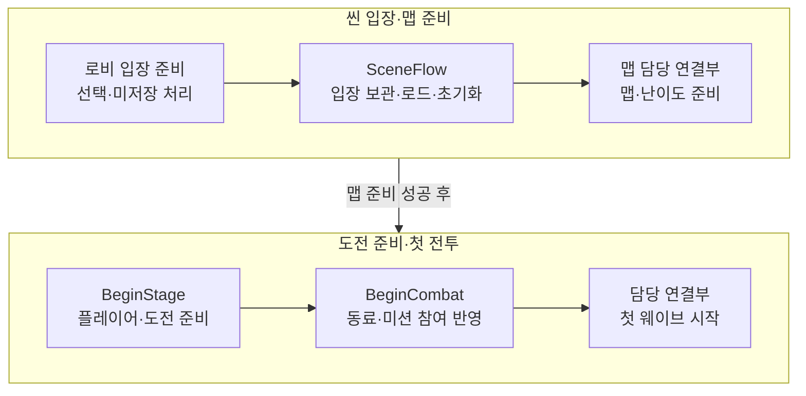
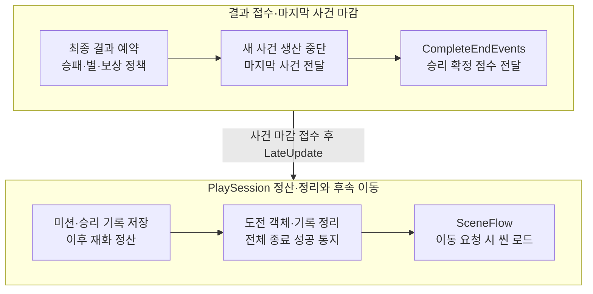

# PLAY_FLOW

입장·도전·첫 전투·최종 종료·재시도·씬 이동의 공통 계약입니다. 각 시스템의 규칙·데이터·계산은 해당 시스템 문서에 두고, 이 문서는 시스템 사이의 호출 순서와 완료 경계를 관리합니다. 담당별 연결 상태와 남은 작업은 [연계 가이드](../LJ_INTEGRATION_GUIDE.md)·[TODO](../TODO.md)를 참조합니다.

## 소유와 진입 경로

| 주체 | 책임 |
| --- | --- |
| GameManager | 씬 간 유지되는 공통 서비스와 SceneFlow 소유 |
| LobbyController / TitleScene | 로비 진행 연결·선택 준비 / 입장 요청 전달 |
| SceneFlow / SceneMove | 입장·맵 준비·재도전·복귀 조율 / 전체 종료 완료 후 이동 허용 |
| PlayScene | 공유 진행으로 모듈 연결, 외부 API와 입력·씬 활성 수명 |
| PlaySession | 도전 시작·구간·사건 연결·종료 정산·정리 |
| KMB 연결부 | 실제 맵·웨이브 준비, 결과·마지막 사건·확정 점수 전달 |

정식 입장은 SceneFlow를 사용합니다. TestScene은 PlayScene을 상속해 직접 초기화하고 설정에 따라 자동 도전을 시작하는 별도 진입점입니다. 두 시작 경로를 중복 실행하지 않습니다. 공통 관리자 생성·앱 종료는 [구조 문서](../ARCHITECTURE.md#공통-관리자-수명), 로비 내부 수명은 [로비 시스템](LOBBY_SYSTEM.md#초기화와-해제)을 따릅니다.

## 플레이 준비와 입장

차트는 각 행을 왼쪽부터 읽고 위 행을 마친 뒤 아래 행으로 이어집니다. 입장 준비 성공 후 로비 진행 사용권을 반환합니다. 맵 준비 성공 후 BeginStage, 별도의 첫 전투 요청에서 BeginCombat을 진행합니다. 씬 로드나 도전 준비만으로 전투를 시작하지 않습니다. 차트 화살표는 주요 처리 순서이며 실제 호출 API는 본문을 따릅니다.

TitleScene.TryEnterStage는 SceneFlow.TryEnterStage로 전달합니다. 성공은 이동 요청 접수이며 도전 시작 완료가 아닙니다. 맵 담당자는 PendingEntry·MapRequestId와 일치하는 준비 결과를 전달하고, 성공하면 TryBeginPreparedStage를 호출합니다. 실패는 ReportMapFailure로 전달하며 이전 요청의 늦은 결과를 재사용하지 않습니다. 맵 준비 취소·부분 정리 계약은 미구현입니다.

### 진행 연결과 씬 초기화

정식 경로에서는 첫 타이틀에서 진행을 준비하고 로비와 PlayScene이 차례로 연결합니다. TestScene 직접 시작은 진행이 없을 때 기존 준비 분기를 사용합니다. 진행 준비와 BeginStage는 별도 단계입니다.

기존 도전·종료·미저장 상태를 확인한 뒤 이전 연결을 해제합니다. 조회 객체와 실행 모듈을 준비하는 동안 요청을 차단하고, 최초 상태 알림까지 전달한 뒤 차단 해제와 OnInitialized를 순서대로 처리합니다.

설정·입력을 확인한 뒤 공유 진행과 서비스를 연결합니다. 강화·미션·도감·해금 조회 객체를 먼저 준비하고 인벤토리·재화·보상·고용·배치와 실행 객체를 연결합니다. 최초 재화 알림 전에 진행 조회 객체를 준비합니다. 초기화 실패는 생성 중인 연결을 해제하고 확정 저장 진행을 유지합니다. 늦게 열린 화면은 OnInitialized 구독 후 IsInitialized를 확인해 현재 객체를 조회하며 재초기화 후에는 이전 참조를 다시 연결합니다. 파일 준비·신규 진행 생성과 실패 처리는 [저장 시스템](SAVE_SYSTEM.md#초기화)을 따릅니다.

## 도전 시작과 전투 구간

BeginStage는 선택 무기·강화 결과·플레이어를 준비하고 재화 도전 번호를 발급한 뒤 고용·미션 도전과 자원 기록을 연결합니다. 전체 성공 후 도전 준비 상태를 확정하며, 실패한 시작으로 이전 결과를 지우지 않습니다.

각 단계는 앞 단계 성공 후 담당 연결부가 요청합니다. BeginStage와 BeginCombat은 별도 요청이며 이후 웨이브는 SetPlayPhase로 구간을 반영합니다.

| 요청 | 계약 |
| --- | --- |
| BeginStage(initialStageCurrency) | 저장된 선택 무기와 씬의 맵·난이도·방어 설정 사용 |
| BeginStage(initialStageCurrency, mapId, difficulty, defenseRule) | 저장된 선택 무기와 전달한 도전 설정 사용 |
| BeginStage(weaponType, initialStageCurrency, mapId, difficulty, defenseRule, companionPriorityPosition = null) | 보유 무기를 해당 도전에 적용. 저장된 선택은 변경하지 않음 |
| BeginCombat(out result) | 첫 전투의 전체 동료 준비·행동 허용과 미션 플레이 구간 반영. 도전당 한 번 |
| SetPlayPhase(stageId, isPlaying) | 이후 웨이브의 준비·플레이 구간 전환 |

무기 해금은 Hero·재화 준비 전에 확인합니다. 동료 준비 실패 시 이번 자동 생성분을 복구하고 실제 웨이브를 시작하지 않습니다. 첫 전투는 참여 번호 확정 → 행동 허용 → 미션 플레이·참여 반영 → 표시 알림 후 실제 웨이브를 진행합니다. 이후 플레이 구간에서는 생존 동료 번호를 참여 집합에 합치며 같은 고용 번호를 중복 집계하지 않습니다.

도전 번호는 맵 번호가 아닙니다. 지연 사건·결과에는 발생 당시 번호를 사용합니다. 동료 준비·미션 사건·강화 적용의 세부 규칙은 [동료](COMPANION_SYSTEM.md)·[미션](MISSION_SYSTEM.md)·[강화](UPGRADE_SYSTEM.md) 문서에 둡니다.

## 최종 종료와 완료 통지

CompleteEndEvents가 접수되면 LJ 행동·이후 사건을 차단하고 다음 LateUpdate에서 정산을 처리합니다. 이동은 종료 알림 호출 스택 밖에서 시작합니다. 실패 시 돌아갈 위치는 아래 재시도 표에 구분하며 전체 종료를 처음부터 반복하지 않습니다.

1. 담당자는 RequestEndStage(result, discardPendingCurrency, collectionEnemies)로 결과를 예약합니다. 승리는 별 1~3과 실제 스테이지 구성의 원본 적 목록을 명시합니다. 대상이 없으면 빈 목록을 전달하고, 패배·포기는 별 0을 사용합니다.
2. 종료 예약 뒤 KMB 연결부는 새 전투·입력·스폰을 막고 이미 발생한 마지막 사건을 전달합니다. 예약 시점이나 LateUpdate 순서만으로 전달 완료를 추정하지 않습니다.
3. 클리어는 CompleteEndEvents(stageId, score), 패배·포기는 CompleteEndEvents(stageId)를 호출합니다. 클리어는 0 이상의 확정 점수가 필수이며 미준비 점수를 0으로 대체하지 않습니다. 성공 반환은 정산 예약 접수입니다.
4. PlaySession은 행동·실행과 전투 범위의 반복 VFX 방출을 중단하고 PlayScene.LateUpdate의 ProcessPendingEnd에서 저장·정산·정리를 진행합니다. 마지막 단발 출력은 자연 종료하며 완료 전에는 플레이나 고용을 재허용하지 않습니다.
5. 원래 도전 번호의 OnStageEndProcessed(stageId, abandon, success)가 성공한 뒤 이동합니다. 실패 통지도 같은 이벤트를 사용하므로 이벤트 발생만으로 완료를 판정하지 않습니다.

게임 승패와 미지급 스테이지 보상 폐기 정책은 별개입니다. 기존 RequestEndStage(stageId, abandon)는 디버그 호환 경로로, false도 승리를 뜻하지 않으며 마지막 사건 전달 완료까지 함께 요청합니다. 실제 승리·마지막 사건 조율에는 명시적 결과 API를 사용합니다.

결과 화면 활성화는 전체 종료 성공을 뜻하지 않습니다. 승리 연출은 해당 도전의 승리 결과와 종료 성공을 함께 확인한 뒤 요청합니다. 효과의 시간·정리 범위와 화면 소유 수명은 [VFX 시스템](VFX_SYSTEM.md#종료와-일시정지)을 따릅니다.

저장·보상 확정의 기능별 계약은 [미션](MISSION_SYSTEM.md#처치평가저장-순서)·[도감](COLLECTION_SYSTEM.md#해금신규-확인)·[최고 기록](SAVE_SYSTEM.md#클리어-최고-기록-저장)·[재화/콤보](COMBO_SYSTEM.md#진행과-지급--현재-구현)를 따릅니다. 성공한 단계를 재시도로 중복 지급하거나 정리만 실패한 도전을 재정산하지 않습니다.

정산은 미션 → 도감 → 최고 기록/종료 보상 저장·잔액 적용 → 스테이지 재화 정산 → 객체 정리 순서입니다. 보상별 지급 조건·계산은 [종료 보상 계약](CURRENCY_SYSTEM.md#종료-보상-계약), 통합 저장 항목은 [저장 계약](SAVE_SYSTEM.md#종료-보상-통합-저장)을 참조합니다.

### 결과와 실패 상태 조회

| 조회 | 의미 |
| --- | --- |
| CurrentStageId | 종료 예약 → 정리 대기 → 준비 완료 도전 순으로 조회. 전체 정리 후 0 |
| TryGetEndResult(stageId, out result) | 접수 결과 조회. 전체 종료 성공과 별개 |
| IsEndingStage / IsAwaitingEndEvents / IsStageCleanupPending | 종료 처리 / 마지막 사건 대기 / 정산 후 정리 대기 |
| LastEndFailure | Mission / Collection / StageRecord / Currency / CompanionCleanup / MissionCleanup. 실패 통지 전에 기록 |

접수 결과와 도전별 결과는 전체 종료 뒤에도 다음 도전 시작 준비 성공 전까지 보관합니다. 시작 실패는 이전 결과를 유지하고 씬 재초기화로 세션을 교체하면 별도 보존하지 않습니다. 실패 위치는 실제 정산·정리 실행 시 초기화하며 예약·요청 거절만으로 지우지 않습니다. None은 종료 성공 판정이 아닙니다.

## 재시도와 씬 이동

재도전·복귀 요청은 SceneFlow.TryRetryStage / TryReturnToLobby를 사용합니다. 도전이 없으면 미저장 진행 처리 후 이동하고, 진행 중이면 IStageEndLink를 통해 종료를 접수합니다. 자연 클리어·패배는 이동 요청 없이 결과 예약부터 시작할 수 있습니다.

TryRetryStage는 대기 선택이 있으면 그 선택으로 플레이 씬을 다시 엽니다. 첫 입장이나 다음 스테이지의 초기화·맵 준비·도전 시작에 실패해도 대기 중인 맵·난이도·무기를 유지합니다. 대기 선택이 없으면 시작한 도전의 확정 선택을 사용합니다. 실패 단계만 재시도하려면 아래 표의 요청을 사용합니다.

현재 LJ의 공통 요청·정산/정리 대기·비동기 이동 기반은 구현됐습니다. LHJ의 PauseMenuController에는 직접 씬을 로드하는 경로가 남아 있어 재도전·복귀 버튼의 SceneFlow 연결은 LHJ 후속입니다. KMB의 선택 맵 준비·종료 제공 연계와 구분합니다.

종료 연결은 TryBindEndLink(owner, link)로 해당 PlayScene에 등록하고 같은 대상으로 UnbindEndLink를 호출해 해제합니다. SceneFlow는 이동 정보·종료 구독을 먼저 준비하고 TryEndStage를 호출합니다. 거절 시 이동 예약과 구독을 정리하고 이전 상태로 복원합니다. 접수 성공과 전체 종료 완료는 구분합니다.

IStageEndLink.TryEndStage·TryCompleteEndEvents의 true는 절차 접수이며 거절 사유는 Error로 제공합니다. 접수한 뒤 후속 처리가 남았다는 이유로 false를 반환하지 않고, 호출 중 전달된 종료 실패를 접수 성공으로 덮지 않습니다.

| 중단 단계 | 재시도 경로 |
| --- | --- |
| 플레이 초기화 / 맵 준비 / 도전 시작 | RetryInitPlay / RetryMapPreparation / RetryStageStart. 시작은 필요한 정리 완료 후 재시도 |
| 최초 종료 요청 거절 | 원인 해결 후 최초 요청부터 재접수 |
| 마지막 사건·점수 전달 대기 | 담당 연결부가 원래 결과·점수를 유지해 완료 전달 재시도 |
| 사건 완료 후 저장·정산 실패 | PlayScene.RetryEndStage로 다음 LateUpdate 처리 예약 |
| 정산 후 객체 정리 실패 | PlayScene.TryCompleteStageCleanup으로 정리만 재시도 |
| 씬 로드 실패 | SceneFlow.RetryLoad. 이미 성공한 종료·정산은 반복하지 않음 |

이동 대기 중에는 SceneFlow.RetryStageEnd가 상태에 따라 IStageEndLink.TryCompleteEndEvents, 종료 정산 또는 정리 경로를 선택합니다. 이동 예약 없는 자연 종료는 담당 연결부가 PlayScene의 해당 API를 사용합니다. UI와 담당 연결부가 같은 단계를 동시에 재시도하지 않게 실행 주체를 정합니다. 로드 실패 후 기존 로비 복구는 TryRestoreLobby를 사용합니다.

실제 로드는 종료 알림 호출 스택 밖에서 시작합니다. SceneFlow는 오디오 정지를 복구하고 플레이 출력을 정리한 뒤 로드하며, 직접 씬 로드로 정산·정리 대기를 우회하지 않습니다. 공통 관리자 Shutdown은 일반 씬 이동에 사용하지 않습니다.

### 결과 화면 버튼

씬 이동은 정산·정리 완료 후 허용합니다. `SceneFlow.TryGetNextStage(out entry, out reason)`는 승리한 도전의 정리 완료를 확인한 뒤 로비 목록의 바로 다음 맵을 조회합니다. 같은 난이도가 목록과 실제 맵 준비 양쪽에서 지원되고 플레이 씬을 로드할 수 있어야 합니다.

`SceneFlow.TryGoToNextStage(out reason)`는 같은 조건을 확인한 뒤 다음 맵을 기존 난이도·무기와 함께 PendingEntry에 보관합니다. 이후 씬 로드 → 플레이 초기화 → 맵 준비 → 도전 시작 순서로 진행하고, 시작 성공 시 새 선택을 확정합니다. 맵 지원 조회와 결과 버튼 연결은 [담당별 연계](../LJ_INTEGRATION_GUIDE.md#로비-담당별-후속-연결)를 따릅니다.

| 버튼 | 동작 |
| --- | --- |
| 다음 스테이지 | 클리어 시 같은 난이도·무기로 다음 스테이지에 바로 입장. 패배·마지막 맵·미지원 난이도 등 입장 가능한 다음 스테이지가 없으면 비활성화 |
| 재도전 | 같은 스테이지를 같은 난이도·무기로 다시 시작 |
| 설정 | 기존 설정창을 열고 닫으면 결과로 복귀. 불러오기 성공 시 타이틀로 이동 |
| 로비 | 로비로 복귀. 무기 변경은 로비에서 진행 |

결과 설정의 백업·복원은 정산·정리 완료 후 접수합니다. 요청 처리와 백업 교체 확인 대기 중에는 재도전·다음 스테이지·로비 이동을 차단합니다. 요청 실패 시 기존 결과를 유지하며, 진행 사용권 재연결 조건은 [저장 계약](SAVE_SYSTEM.md#firebase-수동-백업복원)을 따릅니다.

복원 성공 → 교체 전 진행과 결과 세션 해제 → 타이틀 로드 예약 순서로 처리합니다. 타이틀 로드 실패 시 `RetryLoad()`는 씬 로드만 다시 요청합니다. 복원 안내는 타이틀 연결과 로드 완료 후 [한 번 소비](../LJ_INTEGRATION_GUIDE.md#수동-백업복원-연결)합니다.

정산·정리 후 우하단 강화 버튼으로 구매할 수 있습니다. 구매한 강화는 새 도전에 적용합니다.

## 비활성화·재초기화·파괴

| 상황 | 유지·해제 범위 |
| --- | --- |
| PlayScene만 비활성화 | 입력·표시·기존 저장 연결 해제. 세션·도전 상태와 미션 사건 구독은 유지하나 LateUpdate 종료 처리는 멈춤 |
| PlayScene 재활성화 | 활성 수명 구독 복구. 파일 복원·Init·새 도전 시작을 반복하지 않음 |
| 재초기화·파괴 | PlaySession.Dispose와 이전 연결 해제, 실제 연결했던 SaveManager에 씬 사용권 반환 |
| 씬 전체 또는 고용·웨이브 객체 비활성화 | 개별 시스템의 기록 정리·코루틴 중단이 있으므로 상태 보존 자동 재개를 보장하지 않음 |
| 앱 종료 | 공통 관리자와 서비스 정리. 새 정산·필수 저장을 파괴 콜백에서 시작하지 않음 |

화면이 닫히거나 로드된 사실만으로 정상 종료를 간주하지 않습니다. 미저장 상태의 영구 보존은 실제 저장 성공을 기준으로 하며, 프로그램 종료까지 저장에 실패한 메모리 변경은 보존을 보장할 수 없습니다.
