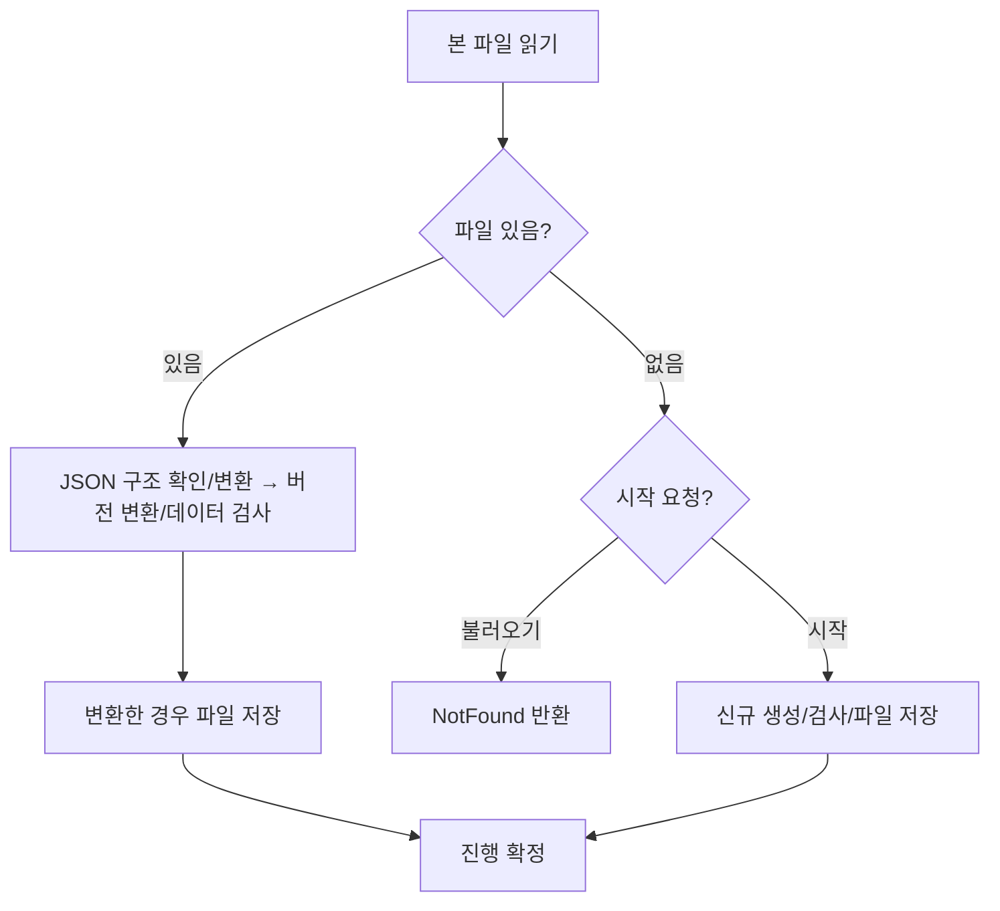
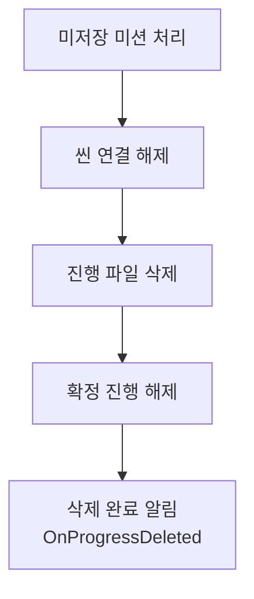
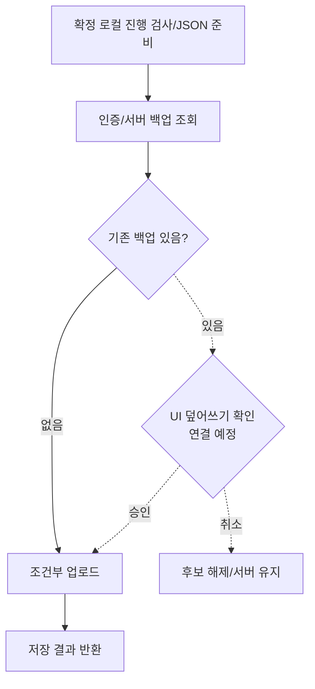
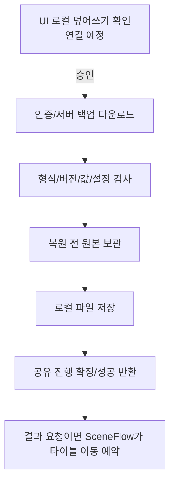

# SAVE_SYSTEM

LJ 담당 단일 로컬 저장과 Firebase 수동 백업의 현재 계약입니다. SaveManager가 단일 진행과 공유 서비스를 소유합니다. 버전 9는 기존 영구 진행에 별 지급 이력·최근 종료 지급 기록을 추가합니다. 저장소·백업 개편 당시 확인은 [SAVE_TEST.md](Test/SAVE_TEST.md#2026-10-30-저장소-분리-확인), 이번 종료 보상 후속은 [TODO](../TODO.md#클리어-점수-보상-연결)에서 구분합니다.

## 구성

| 모듈 | 책임 |
| --- | --- |
| SaveManager | 단일 SaveService와 백업 서비스 소유, 진행 준비/연결/삭제와 백업 요청 진입점 |
| SaveData / ItemSaveData / UpgradeSaveData | 버전·영구 잔액·아이템 수량·강화 단계와 저장 후보 복사 |
| MissionKillCountSaveData / MissionSaveData | 난이도별 처치 집계·최초 완료/지급 기록 |
| StageClearRecord | 맵 ID/난이도별 최고 별·클리어 최고 점수와 점수 기록 여부. 이번 도전 이력인 MissionStageRecord와 구분 |
| StarRewardRecord / ClearRewardRecord | 맵/난이도별 별 지급 단계·기존 정책 대기 / 최근 정산 식별자·결과·점수·지급 금액 |
| SaveDataMigration | 지원하는 이전 형식의 추가 항목 보완 |
| ISaveStorage | 동기 읽기/저장/삭제, 복원 전 보관과 보관본 읽기 계약 |
| JsonSaveStorage | ISaveStorage 구현, JSON 읽기, 임시 파일 작성/본 파일 교체/이전 파일 보관, 진행 파일 삭제 |
| MemorySaveStorage | Editor 검증용 ISaveStorage 구현, 진행과 복원 전 보관본을 복사해 유지 |
| SaveJsonReader | 단축키/진행 JSON 원문 필수 배열 확인과 기존 직렬화 데이터 변환 |
| SaveService | 불러오기/신규 생성, 검사 호출과 원본 보존/저장/복원 확정 조율 |
| SaveDataValidator | 저장 값·중복·기록 간 관계 검사. 파일/게임 상태 변경 없음 |
| ProgressBackupService | 수동 백업/복원/로컬 복구 순서, 확인 후보와 요청 수명 관리 |
| FirebaseAuthService / FirebaseAuthSessionStorage | 익명 인증·토큰 갱신 / Windows 자격 증명 보관 |
| FirebaseBackupStorage / FirebaseRestClient | Firestore 문서 조회·조건부 쓰기 / 비동기 HTTP 전송·자원 해제 |
| PlayScene | 공유 진행으로 모듈 복원, 저장 요청/씬 연결 수명 관리 |
| TestScene | PlayScene을 상속한 직접 테스트 초기화·자동 시작 |
| LobbyController | 로비 진행 복원·기능별 저장 연결과 씬 사용권 반환 |
| PlaySession | 마지막 사건 이후 미션/도감/최고 별·점수/재화/객체 정리 조율 |

신규 데이터는 SaveManager에 연결한 CurrencyData의 최초 영구 재화, 빈 기록 목록과 무기 미선택 상태로 시작합니다. JSON은 비공개 SerializeField를 사용하며 기존 미션 필드명 `_missionCounters`/`_counterId`는 유지합니다. 저장 진행은 단일이며 공용 10칸 슬롯과는 다른 개념입니다. 하위 저장소의 슬롯 번호 인수는 유지합니다.

저장 후보는 목록을 분리하고 불변 기록을 교체합니다. SaveService가 버전 변환 후 SaveDataValidator를 호출합니다. 검사 순서는 재화/아이템/강화 → 미션 → 도감 → 해금/선택 → 최고 기록 → 종료 보상 이력입니다. 강화/미션 설정과의 호환은 해당 진행 모듈이 담당합니다.

## 저장소 연결 계약

SaveManager.Init에서 JsonSaveStorage를 생성해 SaveService 생성자로 전달하고, 같은 서비스로 백업 모듈을 연결합니다. SaveService는 ISaveStorage에 의존하며 직접 파일 저장소를 생성하지 않습니다. 씬 이동마다 저장소를 재생성하지 않습니다. 생성 시 자동 불러오기/저장을 수행하지 않으며 기존 진행 준비 요청을 사용합니다.

- 모든 저장소 작업은 반환 전에 완료합니다. TrySave의 Success는 저장 완료이며 실패 시 이전 저장값을 유지합니다. 진행 확정과 호출부 상태 반영은 저장 성공 이후입니다.
- 전달받은 진행을 수정하거나 변경 가능한 참조로 보관하지 않습니다. 읽기 결과도 내부 저장값과 분리합니다. MemorySaveStorage는 SaveData.Copy를 사용하며 현재 기록의 교체 방식을 따릅니다.
- 복원은 검사 → 원본 보관 → 저장/재시도 → 확정 순서입니다. 원본이 없으면 이전 보관본을 정리하고 NotFound를 반환합니다. 복구는 보관본을 다시 만들지 않습니다. 삭제는 현재 진행과 보관본을 정리합니다.
- 파일 예외 처리는 JsonSaveStorage, 쓰기 실패 시 동일 후보의 한 번 재시도는 SaveService가 담당합니다. 저장소에 중복 데이터 검사나 예외 처리를 추가하지 않습니다.
- 저장소는 열린 파일이나 통신 수명을 소유하지 않아 별도 종료 함수가 없습니다. SaveManager.Shutdown의 요청 차단과 백업 통신 종료를 유지하며 종료 시 자동 저장을 추가하지 않습니다.
- FirebaseBackupStorage는 기존 비동기 수동 백업 경로를 유지합니다. 클라우드 자동 저장은 제공하지 않습니다.
- Firestore 규칙은 saveVersion이 양의 정수인지 확인하며 특정 진행 버전을 고정하지 않습니다. 기존 문서 교체는 진행/포장 버전을 낮출 수 없습니다. 기존 버전 필드 누락은 0을 기준으로 비교하고, 잘못된 타입은 거절합니다. 지원 버전과 내부 JSON 일치는 클라이언트 복원 경로에서 검사하므로 진행 버전 증가마다 서버 규칙을 변경하지 않습니다. 소유자 인증, 백업 필드/크기와 현재 포장 구조 검사는 유지합니다.
- 백업 준비는 서버 조회와 종료 여부 확인 후 현재 앱보다 높은 진행/포장 버전을 거절합니다. 거절 시 확인 후보를 만들지 않고 요청 잠금을 해제합니다. 현재 앱보다 높지 않은 버전의 손상된 내부 JSON은 기존처럼 사용자 확인 후 교체할 수 있습니다. 확인한 문서의 updateTime을 사용하는 조건부 쓰기도 유지합니다.
- Firestore 오류 문구는 백업 조회와 백업 저장을 구분합니다. 조회 403은 쓰기 버전 조건의 실패로 단정하지 않으며 실제 배포 규칙과 인증/소유자 조건을 별도로 확인합니다. 포장 버전 1 고정은 현재 서버 문서 구조의 계약이며 진행 버전 고정과 구분합니다.

## JSON 읽기

SaveJsonReader는 `com.unity.nuget.newtonsoft-json` 3.2.2의 JObject로 원문 구조를 해석합니다. 단축키·진행 기록은 루트 객체와 필수 배열의 존재·타입을 확인한 뒤 JsonUtility.FromJsonOverwrite로 기존 비공개 SerializeField 데이터에 변환합니다. 누락/null/다른 타입은 거절하고 정상 빈 배열은 허용합니다. JsonUtility의 누락 목록 보완 동작에 손상 판정을 맡기지 않습니다.

- 단축키는 `_bindings`, 지원 진행 버전은 공통 8개 목록을 요구합니다. 버전 7 이상은 `_stageRecords`도 필수이며 버전 6의 해당 목록 누락은 변환에서 보완합니다.
- 버전 9는 `_starRewards`·`_hasClearReward`·`_lastClearReward`를 요구합니다. 별 이력의 맵/난이도/지급 단계/정책 대기 필드와 존재 플래그가 켜진 최근 지급 기록의 필수 필드 타입을 확인합니다. 누락을 미지급 기본값으로 보완하지 않습니다.
- 화면 설정도 같은 JSON 객체 해석을 사용하며 필수 정수 필드 `mode`·`width`·`height`를 읽습니다. 지원 모드·해상도 검사는 DisplaySettings가 담당합니다.
- 진행 `_version`은 정수여야 합니다. 명시적인 미지원 버전 판정은 기존 SaveDataMigration에 맡겨 UnsupportedVersion을 유지합니다.
- 로컬 진행·복원 전 보관본·클라우드 내부 진행 JSON이 같은 읽기 경로를 사용합니다. 구조 확인 → 데이터 변환 → 기존 버전 변환/값 검사 순서이며, 원문 확인 성공만으로 진행을 확정하지 않습니다.
- 클라우드 복원은 구조/변환 → 메타데이터 버전 대조 → 버전 변환/값 검사 → 설정 호환 검사 → 기존 원본 보존 → 파일 저장 → 메모리 진행 확정 순서입니다. 읽기 도구에는 파일 I/O·상태·초기화/종료 책임이 없습니다.

## 초기화

GameBootstrap이 생성한 GameManager의 Awake에서 SaveManager.Init을 호출합니다. 서비스만 준비하며 파일을 자동으로 읽거나 신규 진행을 생성하지 않습니다. 접근은 초기화된 GameManager.Instance.Save를 사용합니다. 공통 관리자 수명은 [ARCHITECTURE.md](../ARCHITECTURE.md#공통-관리자-수명)를 참조합니다.

정식 실행에서는 첫 TitleScene.Start → GameManager.PrepareForTitle → SaveManager.TryStartProgress 순서로 진행을 준비합니다. 로비는 확정 진행을 연결하며, 타이틀 복귀와 로비 재진입에서 파일을 다시 읽지 않습니다. GameManager.IsInitialized는 저장 서비스 준비 상태이며 영구 진행 준비 결과는 StartupProgress로 조회합니다. 실패는 타이틀 연결과 분리하고 TryRetryStartupProgress로 진행만 다시 준비합니다.

TestScene 직접 시작은 기존 진행 준비 분기를 사용합니다. BackupTest 직접 실행에서는 Inspector가 진행 준비를 요청합니다. 정식 실행의 [Unity 플레이 검증](Test/SAVE_TEST.md#첫-타이틀-진행-준비)은 후속입니다.

이미 확정 진행이 있으면 파일 읽기를 생략합니다. 아래는 메모리에 진행이 없을 때 TryLoadProgress/TryStartProgress가 파일로 진행을 준비하는 정상 분기입니다.



각 단계는 성공한 경우에만 다음으로 진행합니다. 버전 변환은 SaveDataMigration, 값 검사는 SaveDataValidator가 담당합니다. 파일 없음만 신규 생성 대상으로 구분합니다.

| 실패 위치 | 처리 |
| --- | --- |
| 읽기·지원 버전·데이터 검사 | 실패 반환. 기존 파일을 신규 진행으로 덮어쓰지 않음 |
| 변환 데이터 저장·신규 저장 | 실패 반환. 메모리 진행을 확정하지 않음 |

TryStartProgress는 씬 사용자가 연결된 동안 거절합니다. 진행 준비 성공은 씬 초기화나 도전 시작 완료가 아닙니다. 모듈 연결·재초기화·씬 사용권 반환은 [공통 플레이 수명](PLAY_FLOW.md#진행-연결과-씬-초기화)을 따릅니다.

SaveManager.Shutdown은 진행 변경을 차단하고 백업 통신과 확인 후보를 정리합니다. 종료한 서비스를 같은 객체에서 다시 생성하지 않으며 정상 씬 이동에서는 호출하지 않습니다. 저장소 분리 당시의 버전 8 확인 이력을 이번 형식 변경의 재검증으로 취급하지 않습니다.

## 공개 요청과 조회

로비의 진행 연결·미저장 처리·사용권 반환은 [로비 시스템](LOBBY_SYSTEM.md)을 따릅니다.

| 진입점 | 계약 |
| --- | --- |
| SaveManager.TryLoadProgress() | 확정 진행이 있으면 파일을 읽지 않고 Success. 없을 때 기존 파일 준비, 파일 없음은 NotFound. 변환이 필요하면 변환 저장 수행 |
| SaveManager.TryStartProgress() | 기존 진행 사용 또는 파일이 없을 때 신규 생성 |
| SaveManager.HasProgress | 메모리에 확정 진행이 준비됐는지 여부. 파일 존재 검사 아님 |
| SaveManager.TryGetBestStars(mapId, difficulty, out bestStars) | 준비 전 false, 준비 후 미클리어는 true/0 |
| SaveManager.TryGetBestScore(mapId, difficulty, out hasScore, out score) | 조회 성공과 점수 기록 여부 구분. 정상 0점 허용 |
| PlayScene.TrySaveProgress() | 미저장 미션 우선 저장. 없으면 확정 진행을 명시 저장 |
| PlayScene.TrySaveWave(stageId, waveNumber) | 현재 도전의 일반 웨이브 완료 저장. 실패 후 같은 번호로 재시도하며, 이미 저장한 번호는 다시 쓰지 않음 |
| PlayScene.PendingWave | 저장 재시도를 기다리는 일반 웨이브 번호. 없으면 0 |
| PlayScene.TrySavePendingProgress() | 도전 밖 이동 준비. 미저장 미션만 저장하고 변경이 없으면 쓰기 생략 |
| PlayScene.TryDeleteProgress() | 도전 밖에서 미저장 처리/씬 연결 해제 후 삭제 |
| SaveManager.TryDeleteProgress() | 씬 사용자가 없을 때 삭제. 연결된 씬에서는 PlayScene 경로 사용 |
| PlayScene.OnProgressDeleted | 삭제 완료. 타이틀 이동 자체는 외부 연결 필요 |

미션 저장은 최신 확정 진행을 포함하므로 성공 후 같은 내용을 다시 전체 저장하지 않습니다. 요청/처리 중 저장과 종료 중 수동 저장은 거절합니다. `GetDebugSnapshot()`은 에디터 전용 복사본 조회이며 파일 읽기/쓰기 없이 사용합니다.

일반 웨이브는 마지막 사건을 반영하고 준비 구간으로 전환한 뒤 TrySaveWave로 영구 진행을 저장합니다. 마지막 웨이브는 [최종 종료](PLAY_FLOW.md#최종-종료와-완료-통지)의 저장·정산 경로를 사용합니다. KMB의 [웨이브 완료 호출 연결](../LJ_INTEGRATION_GUIDE.md#kmb-일반-웨이브-저장-연결--2026-11-09)과 Unity 검증은 후속입니다.

## 저장 계약

진행 저장에는 환경설정이 포함되지 않습니다. 단축키는 keybindings.json, 화면 모드·해상도는 displaysettings.json, 볼륨은 volumesettings.json으로 분리하며 LocalSettingsFile의 임시 파일 교체를 공유합니다. 진행 삭제/Firebase 백업·복원 대상에 포함하지 않고 종료 시 자동 저장하지 않습니다. 설정 저장 계약은 [설정 시스템](SETTINGS_SYSTEM.md), 단축키 편집·적용 계약은 [입력 시스템](INPUT_SYSTEM.md)을 참조합니다.

단축키의 기존 저장·실패 처리, 화면 기본 저장·Play 재실행 복원과 볼륨 저장·Play 재실행 복원·최초 믹서 적용은 사용자 확인했습니다. 공통화 이후 입력 회귀·설정 실패/수명 검증은 후속이며 음원 출력 확인 범위는 [사운드 시스템](SOUND_SYSTEM.md#확인-범위와-후속)에 둡니다. 수동 백업/복원은 아래 현재 API를 사용하고 진행 중 스테이지 중간 저장으로 확대하지 않습니다. 백업 정책의 남은 결정은 [TODO](../TODO.md#open_decisions)에서 관리합니다.

- 일반 영구 재화 변경: Currency.OnPermanentSaveRequested → TrySavePermanentBalance.
- 아이템 사용: HeroItemUse → TrySaveItemCount. 성공 후 사용 상태·사용 확정 알림·효과 적용.
- 소모품 구매: TrySaveItemPurchase로 잔액/수량 통합 저장. 상세는 [SHOP_SYSTEM.md](SHOP_SYSTEM.md).
- 강화 구매: TrySaveUpgradePurchase로 잔액/단계 통합 저장. 상세는 [UPGRADE_SYSTEM.md](UPGRADE_SYSTEM.md).
- 무기·설치물 해금과 무기 선택: EquipmentUnlock이 아래 저장 함수를 사용하고 성공 후 보유/선택 → 잔액 → 변경 알림 순서로 반영합니다.
- 각 경로는 최신 확정 데이터의 대상 값만 바꾸므로 다른 시스템의 미션/아이템/강화/도감/해금/선택/최고 별 기록을 보존합니다.
- 쓰기 실패 시 같은 후보로 한 번 파일 재시도합니다. 성공한 후보만 서비스의 확정 데이터로 교체합니다.
- 스테이지 재화·콤보·쿨타임·도전별 사용/사망 횟수·참여 번호·적 생명 중복 집합·진행 중 도전은 영구 저장하지 않습니다.

## 미션 통합 저장

| 기록 | 기준 |
| --- | --- |
| MissionKillCountSaveData | KillCountId + 난이도, 목표에서 자르지 않은 처치 수 |
| MissionSaveData | MissionId + 난이도, 최초 완료·보상 지급 여부 |
| 미션 표시 진행·탐험 레벨 | 처치 집계 참조와 저장 완료 기록에서 복원. 별도 가변 레벨 저장 없음 |

```text
최신 현재 진행으로 처치/완료 후보와 미지급 최초 보상 계산
→ 최신 SaveData.Copy에 집계·완료·지급·최신 확정 잔액+보상 반영
→ TrySaveMissionProgress → TryCommit/파일 재시도
→ MissionProgress.ApplySaved·이번 판 보상 목록 반영
→ Currency.ApplySavedPermanentBalance
→ 신규 보상 배치 알림·상태 변경 알림
```

Currency.TryAdd로 보상을 다시 지급하지 않습니다. 미션 보상은 클리어/별 보상과 지급 원인이 다릅니다. 저장 실패 시 현재 진행과 적 생명 중복 기록은 유지하며 저장값·표시 완료·지급은 바꾸지 않습니다. 29 → 30 저장 실패 → 31 접수 후 재시도는 31과 최초 보상 한 번을 저장합니다.

현재 데이터 맵에서 빠진 지급 완료 기록은 보존합니다. 설정이 없는 미지급 완료 기록은 보상을 계산할 수 없으므로 복원에 실패합니다.

## 저장 버전 정책

현재 버전은 9입니다. 버전 6은 누락된 클리어 목록을 준비하고, 6/7/8은 별 정책 대기 이력과 최근 지급 기록 없음 상태를 준비한 뒤 검사/저장합니다. 기존 최고 별·점수는 유지하고 점수 필드가 없던 기록은 미기록으로 읽습니다. 버전 5 이하와 9보다 높은 버전은 UnsupportedVersion으로 거절합니다. 해당 버전의 필수 목록 누락은 InvalidData이며 임의 보완하지 않습니다.

현재 형식에서도 필수 목록 누락·음수 값·중복 기록·미완료인데 지급 완료인 미션은 거절합니다. 도감은 빈/중복 해금 ID와 해금 목록에 포함되지 않은 신규 ID를 거절합니다. 현재 맵에서 빠진 도감 ID는 저장에 보존하고 표시에서만 제외합니다.

파일은 `.tmp` 작성 완료 후 본 파일로 교체하며 이전 본 파일은 `.bak`으로 보관합니다. 쓰기 실패는 동일 후보로 한 번 재시도합니다. `.bak` 자동 복구나 앱 재실행 후 미완료 종료 절차 재개는 구현하지 않았습니다. 재실행에서는 저장 성공한 영구 진행만 복원합니다.

## 종료와 재시도

종료의 호출·재시도 순서는 [공통 플레이 흐름](PLAY_FLOW.md#최종-종료와-완료-통지)을 따릅니다. 각 저장은 별도 확정이며 전체 종료를 하나의 파일 트랜잭션으로 보장하지 않습니다. 재실행은 저장 성공한 영구 진행을 복원하며 미완료 종료 절차를 자동 재개하지 않습니다.

## 도감 통합 저장

도감 해금/신규 두 목록을 현재 버전 9에서도 보존합니다. 자체 규칙과 조회 계약은 [COLLECTION_SYSTEM.md](COLLECTION_SYSTEM.md)를 참조합니다.

배경 스토리는 도감 SO 콘텐츠이며 진행 파일에 복사하지 않습니다. 스토리·간략 조회 보완으로 저장 형식·버전과 백업 범위는 변경하지 않았습니다.

| 기록 | 저장 기준 |
| --- | --- |
| 해금된 적 ID 목록 | 도감 SO의 고정 ID, 단일 진행·난이도 공통 |
| 미확인 신규 ID 목록 | 해금 ID의 부분집합, 정상적인 확인 저장 성공 후 제거 |
| 최초 해금 영구 보상 | 항목별 SO 보상 합산, 해금/신규 기록과 최신 잔액을 함께 저장 |

CreateNew는 빈 두 목록을 생성하고 Copy는 미션 처치/완료와 도감 목록을 모두 보존합니다. 도감 저장은 최신 SaveData.Copy에서 대상 값만 바꾸며 기존 TryCommit·파일 재시도를 사용합니다. 미션 저장도 같은 복사 경로로 도감 기록을 보존합니다. 이번 도전 해금/보상 결과와 종료 재시도 상태는 런타임 기록이며 영구 저장하지 않습니다.

TrySaveCollectionUnlocks는 준비된 최초 해금 ID·SO 보상 합계를 최신 후보에 반영하고 저장 잔액을 반환합니다. 저장 잔액의 int 범위를 넘는 합산은 거절합니다. 저장 성공 → 도감 진행·이번 결과·처리 완료 상태 반영 → 저장 잔액 적용 → 해금 알림·변경 알림 순서이며 Currency.TryAdd로 재지급하지 않습니다.

TrySaveCollectionSeen은 확인한 신규 ID만 제거해 저장합니다. 성공 후 런타임 신규 표시를 해제하며 실패 시 기존 상태를 유지합니다. 해금/신규 확인 저장과 기존 미션·아이템·강화 저장은 같은 최신 후보 복사 경로를 사용합니다.

## 무기·설치물 해금과 선택 저장

| 함수 | 저장 내용 |
| --- | --- |
| TrySaveWeaponUnlock(balance, weaponType, selectWeapon) | 무기 해금·잔액. 최초 무료 선택은 현재 잔액과 selectWeapon=true로 해금·선택을 함께 저장 |
| TrySaveInstallationUnlock(balance, installationId) | 설치물 구매 해금 ID·잔액 |
| TrySaveSelectedWeapon(weaponType) | 보유 무기 선택 변경. 잔액과 해금 기록 유지 |

각 함수는 최신 SaveData.Copy → 해당 값 변경 → 기존 TryCommit·파일 재시도 순서입니다. 저장 성공 후에만 서비스의 확정 데이터를 교체하며 재화·화면 알림은 발행하지 않습니다. 호출부는 상품·보유·가격·지불 가능 여부를 확인한 뒤 호출하고, 성공 반환 후 실행 중 보유·선택 → 저장 잔액 → 변경 알림 순서로 반영해야 합니다. 최초 무료 선택과 일반 구매의 판단, 중복 구매 차단은 구매 쪽 책임이며 저장 함수에 반복하지 않습니다.

SaveData.Copy는 신규 두 목록을 각각 복사하고 선택 여부·선택 무기를 보존합니다. 소모품·강화·미션·도감 등의 기존 저장 함수도 이 경로를 사용하므로 새 기록을 잃지 않습니다. 기본 설치물은 상품 설정에서 제공하며 신규 진행 생성 시 구매 기록에 넣지 않습니다. 현재 상품에서 빠진 구매 ID도 삭제하지 않습니다.

불러오기에서는 필수 목록·무기 값·중복·빈 설치물 ID와 선택/보유 관계를 검사합니다. 선택 무기는 해금 목록에 있어야 하며, 최초 해금과 선택을 함께 저장하고 선택 해제를 제공하지 않으므로 해금 기록이 있으면 선택 기록도 있어야 합니다. 무기 미선택일 때 SelectedWeapon의 기본값은 사용하지 않습니다. 상품·에셋 호환 검사는 저장 서비스에서 하지 않습니다.

## 클리어 최고 기록 저장

StageClearRecord는 맵 ID/난이도별 최고 별과 클리어 최고 점수를 보관합니다. 입장 때 확정한 StageContext와 접수 결과·점수를 저장 재시도에서도 유지합니다. 결과·점수 전달 조건과 종료 순서는 [공통 종료 계약](PLAY_FLOW.md#최종-종료와-완료-통지)을 따릅니다.

SaveService.TrySaveStageClear는 별과 점수의 최고값을 각각 갱신하고 둘 다 변경이 없으면 쓰기를 생략합니다. 두 최고값은 서로 다른 클리어에서 얻을 수 있습니다. 패배·포기는 기존 기록을 유지합니다. 최고 기록 저장과 별 보상 지급은 별개입니다.

실제 승리 종료는 아래 통합 저장을 사용합니다. 최고값이 갱신되지 않아도 이번 지급 기록과 잔액은 저장하므로 위 호환 API의 쓰기 생략과 구분합니다.

HasScore로 점수 미기록과 정상 0점을 구분합니다. 점수 필드가 없던 기록은 미기록으로 읽고 첫 클리어에서 점수를 추가합니다. 점수 필드 일부 누락·타입 오류는 거절합니다.

## 종료 보상 통합 저장

| 항목 | 저장 계약 |
| --- | --- |
| StarRewardRecord | 맵/난이도별 PaidStars(0/2/3)와 LegacyPending. 최고 별과 분리한 지급 이력 |
| ClearRewardRecord | 최근 정산 ID, 맵/난이도, 승패·별·점수, 클리어/별/실패 지급 금액. 전체 도전 이력 목록 아님 |
| GetPaidStars | 기존 지급 단계 조회. 정책 대기 기록에만 선택한 LegacyStarPolicy를 적용하며 조회로 저장하지 않음 |
| TrySaveClearReward | 최신 후보에 승리 최고 기록·별 지급 단계와 지급 내역·영구 잔액을 함께 저장. 패배는 최고 기록을 변경하지 않음 |

이전 형식의 별 기록에는 LegacyPending을 남깁니다. 채택한 AlreadyPaid는 기존 최고 별까지 지급한 것으로 계산하며, 승리 저장 시 정책 적용 결과와 이번 달성 단계를 이력에 확정합니다. 설정에 남은 GrantOnClear는 다시 달성한 단계를 지급하는 대안이며 미결정 선택지는 없습니다. 정책 조회만으로 저장하지 않습니다.

정산 ID는 도전 시작 성공 때 발급하며 재시도에서 유지합니다. 최근 저장 ID와 같으면 기존 기록과 최신 확정 잔액을 반환하고 추가 쓰기·지급을 하지 않습니다. 저장 후보는 계산 계획의 금액을 사용하되 직전 미션·도감 저장을 포함한 최신 잔액에 합산합니다. 잔액 범위 초과와 쓰기 실패는 기존 확정 데이터를 유지합니다. SaveData.Copy는 별 목록을 분리하고 교체 방식의 최근 기록을 보존합니다.

저장 성공 반환 뒤 호출부가 지급 결과를 확정하고 반환 잔액을 ApplySavedPermanentBalance로 적용합니다. Currency.TryAdd로 다시 지급하지 않습니다. 저장소는 UI 알림을 발행하지 않으며 전체 종료 순서는 [PLAY_FLOW](PLAY_FLOW.md#최종-종료와-완료-통지)를 따릅니다. 파일 복원은 최근 지급 기록을 포함한 영구 진행만 복원하며 런타임 stageId·종료 대기·재시도 절차를 재개하지 않습니다.

## 진행 삭제

PlayScene.TryDeleteProgress는 도전 밖에서 다른 요청을 처리 중이지 않을 때 사용합니다. 미저장 미션이 없으면 첫 단계의 파일 쓰기는 생략합니다.



각 단계는 성공한 경우에만 다음으로 진행합니다.

| 실패 위치 | 처리 |
| --- | --- |
| 요청 조건 불충족 | 거절. 기존 진행 유지 |
| 미저장 미션 저장 | 연결을 해제하지 않고 기존 진행 유지 |
| 파일 삭제 | 삭제 실패 반환. 기존 확정 진행으로 Init 재연결 |
| 재연결 | 삭제 실패 상태를 유지하고 재연결 오류 보고 |

파일은 복원 전 보관본/임시 파일/일반 백업/본 파일 순서로 삭제합니다. Windows 인증 정보와 서버 백업은 삭제하지 않습니다. 삭제 성공 후에만 확정 데이터와 마지막 사용 기록을 해제합니다. 삭제 직후 자동 생성하지 않으며 다음 TryStartProgress에서 신규 생성합니다. 실제 삭제와 실패 후 재연결은 추가 플레이 검증 대상입니다.

## Firebase 수동 백업/복원

1차는 같은 Windows PC의 익명 인증을 사용합니다. Firebase Unity SDK 없이 Authentication/Firestore REST를 호출하며 자동 백업·자동 동기화는 없습니다. 시작 시 모듈만 구성하고 수동 요청 때 인증/통신하므로 일반 로컬 플레이는 네트워크에 의존하지 않습니다.

SaveManagerEditor는 기존 백업 API의 검증 도구이며 실제 설정 UI 연결과 구분합니다.

타이틀은 `SaveManager`의 직접 요청을, 정산·정리가 끝난 결과 화면은 `SceneFlow`의 결과 요청을 사용합니다. 결과 요청은 미저장 진행을 먼저 저장하고 `SaveManager`에 해당 씬의 사용권을 맡깁니다. 요청 처리와 백업 교체 확인 대기 중에는 해당 씬의 요청만 이어받으며 일반 진행 변경과 다른 씬의 연결을 차단합니다.

백업 완료·취소 또는 요청 실패 시 기존 결과 화면에 사용권을 반환합니다. 재연결에 실패하면 `SceneFlow.TryResumeResultProgress()`로 재연결만 재시도합니다. 복원 성공 시 교체 전 진행을 다시 연결할 수 없으며, 이후 타이틀 이동은 [플레이 흐름](PLAY_FLOW.md#결과-화면-버튼)을 따릅니다.

| 항목 | 현재 계약 |
| --- | --- |
| 서버 문서 | `users/{uid}/saves/0`. 백업 형식 1, 저장 버전, 기존 SaveData JSON 보관 |
| 인증 보관 | 프로젝트별 Windows 자격 증명에 UID/갱신 토큰 보관. 읽기/갱신 실패를 새 사용자 생성으로 대체하지 않음 |
| 용량/시각 | JSON UTF-8 512 KiB 상한. 서버 `updateTime`을 백업 시각과 조건부 교체에 사용 |
| 실행 조건 | SaveManager 활성, 플레이 씬의 일반 진행 사용 해제 상태. 결과 요청은 사용권을 맡긴 씬과 일치해야 접수 |
| 보안 규칙 | 프로젝트 루트의 `Firebase/firestore.rules`. 자기 UID의 슬롯 0 조회/작성과 형식/크기만 허용. 사용자 적용 보고와 정상 접근 확인, 거절 경로/Emulator는 미검증 |

**수동 백업**



PrepareBackupAsync는 최초 백업을 바로 전송하고, 기존 백업이면 ConfirmationRequired와 후보를 유지합니다. UI 승인/취소는 ConfirmBackupAsync/CancelPreparedBackup으로 연결합니다. 점선은 아직 연결하지 않은 UI 경계입니다.

준비/조회 실패는 반환하며 서버 문서 없음만 최초 저장으로 처리합니다. 승인 시 인증을 준비하고 조회한 문서가 그대로일 때만 교체합니다. 승인 단계의 인증 실패는 후보를 유지하며, 업로드 응답 유실은 UploadUnconfirmed로 반환하고 자동 재전송하지 않습니다.

**수동 복원**



UI 취소 시 복원 API를 호출하지 않습니다. 승인 후 화면별 [연계 진입점](../LJ_INTEGRATION_GUIDE.md#수동-백업복원-연결)을 호출합니다. 다운로드 후 버전 대조/변환과 값/강화·미션 설정 호환 검사를 마쳐야 원본을 보관합니다.

검사/원본 보존/쓰기 실패 시 기존 진행을 유지하며 원본 파일이 없는 경우는 보존 없이 복원합니다. 파일 저장 성공 후에만 공유 진행을 확정하므로 다운로드 성공은 복원 성공이 아닙니다. `.before_restore`는 복원 전 원본이며 일반 저장의 `.bak`과 구분합니다.

**수동 복구:** RecoverPreviousProgress → 보관본 읽기 → 버전 변환/값/설정 검사 → 파일 저장 → 공유 진행 확정. 서버 통신과 새 원본 보관은 생략하며 실패 시 자동 실행하지 않습니다. 자동 복구·백업 이력 관리는 제공하지 않습니다.

| SaveManager API | 호출/결과 |
| --- | --- |
| PrepareBackupAsync / ConfirmBackupAsync / CancelPreparedBackup | 준비 → 필요 시 승인/취소. 백업 전 TryLoadProgress로 기존 진행 준비 |
| RestoreProgressAsync / RecoverPreviousProgress | 사용자 확인 후 서버 복원 / 복원 전 로컬 보관본 복구 |
| BackupPhase / IsBackupPending | 처리 단계 / 처리 또는 확인 대기 여부 조회 |

요청 종료 시 잠금을 해제하되 확인 후보가 남으면 진행 변경 차단을 유지합니다. 서비스 종료 시 통신을 중단하고 로컬 교체를 막습니다. 서버가 거절한 ID 토큰은 다음 수동 요청에서 갱신합니다. 응답 `Detail`은 개발자 확인용이며 사용자 안내는 결과 코드로 구성합니다.

Windows 보관 정보가 유실되면 기존 익명 UID의 백업에 접근하지 못할 수 있습니다. 이메일/비밀번호·익명 계정 연결·다른 PC 복원은 2차이며 미구현입니다. 설정/검증 절차는 [SAVE_TEST](Test/SAVE_TEST.md#firebase-설정과-화면-연결), 잔여 작업은 [TODO](../TODO.md#firebase-수동-백업복원)에 둡니다.

## 확인 범위와 후속

단일 로컬 저장과 Firebase Inspector 기본 검증은 사용자 확인 범위입니다. 확인 날짜·항목별 결과와 미수행 예외는 [SAVE_TEST.md](Test/SAVE_TEST.md#확인-범위)에서, 당시 코드 변경·정적/격리 검사 이력은 [DONE.md](../DONE.md)에서 관리합니다.

저장소 개편과 백업 API 기본 검증은 완료했습니다. 첫 타이틀 진행 준비는 코드 반영·정적 확인을 마쳤습니다. 실행 초기화·웨이브 저장의 후속은 [단일 로컬 저장 TODO](../TODO.md#단일-로컬-저장), 백업 화면 연결과 통합 검증은 [수동 백업/복원 TODO](../TODO.md#firebase-수동-백업복원)를 따릅니다.
