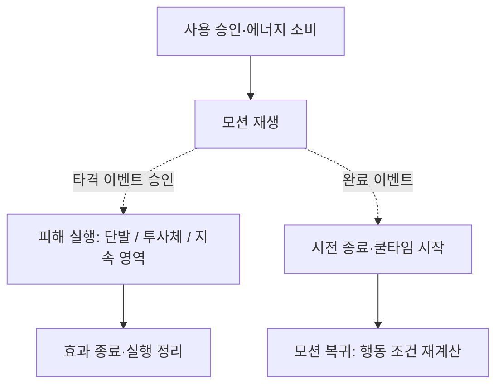
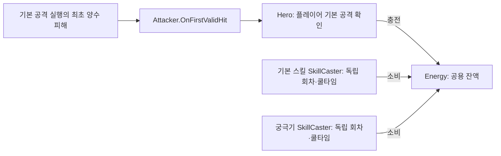

# SKILL_SYSTEM

## 문서 역할과 상태

에너지와 스킬/궁극기의 사용·회차·타격 승인·종료를 관리합니다. 공통 실행 API는 [COMBAT_SYSTEM.md](COMBAT_SYSTEM.md), 무기·원거리 기반은 [WEAPON_SYSTEM.md](WEAPON_SYSTEM.md), 효과 계약은 [COMBAT_EFFECT_SYSTEM.md](COMBAT_EFFECT_SYSTEM.md)를 참조합니다. 작업은 [COMBAT_TODO.md](Todo/COMBAT_TODO.md), 실제 확인 범위는 [DONE.md](../DONE.md)에서 관리합니다.

검·활·스태프의 스킬/궁극기 로직과 모션 연결을 구현했습니다. 사용자 확인 이력은 [DONE.md](../DONE.md), 남은 표현·연계·검증은 [COMBAT_TODO.md](Todo/COMBAT_TODO.md)에서 관리합니다.

## 현재 모듈과 공개 API

Hero는 입장 시 확정한 무기 피해 증가율을 스킬·궁극기 캐스터에 전달합니다. 직접 피해는 기본값 대비 적용하며 기본 공격속도 강화로 스킬 쿨타임·에너지 비용을 바꾸지 않습니다. 강화 계약은 [UPGRADE_SYSTEM.md](UPGRADE_SYSTEM.md)를 참조합니다.

| 모듈 | API/책임 |
| --- | --- |
| EnergyData | MaxEnergy, BasicAttackGain |
| Energy | Init(EnergyData), ResetEnergy, Add, CanSpend, TrySpend(amount, out consumed), CurrentEnergy, MaxEnergy |
| Energy 이벤트 | OnEnergyChanged(현재, 최대) |
| SkillData | AttackData 참조, EnergyCost, Cooldown. AttackInterval은 스킬/궁극기 쿨타임으로 사용하지 않음 |
| SwordSkillData | SkillData 상속, 검 넉백 설정 |
| AttackExecutor | Execute(context, onFirstValidHit = null), CancelExecutions. 실행별 결과 계약의 공통 부모 |
| SkillExecutor | AttackExecutor 상속, TryPrepare(SkillData) 설정 준비와 TryPrepareUse(GameObject) 소비 전 사용 준비 |
| BowSkillData / BowSkillExecutor | 관통 설정 보존과 조준·발사 |
| PiercingProjectile | 수신자별 중복 제거와 관통 수 관리 |
| BowUltimateData / BowUltimateExecutor | 화살비 설정 보존, 소비 전 지면·거리 검사와 영역 생성 |
| CameraGroundAimProvider / ArrowRainArea | 지면·벽 조준과 고정 영역의 반복 피해·수명 관리 |
| SwordSkillExecutor | 검 설정 준비와 전방 피해·넉백 실행 |
| StaffSkillData / StaffSkillExecutor | 폭발 투사체 설정 참조 준비와 타격 시점 조준·발사 |
| StaffUltimateData / StaffUltimateExecutor | 불기둥 설정 보존, 소비 전 지면·거리 확인과 영역 생성 |
| FirePillarArea | 고정 구형 범위의 총 피해 분할·주기별 재탐색과 실행 수명 관리 |
| AreaAttackExecutor | 기본 공격과 검 궁극기에 사용하는 범위 피해 실행 |
| SkillCaster | Init(owner, health, energy, source, actorType, faction, skillData, attackType = AttackType.Skill, damageBonus = 0f), TryUse, TryCommitHit(id), CompleteSkill(id), CancelSkill(reason), UpdateSkill, SetSkillEnabled, ResetCooldown, CancelExecutions |
| SkillCaster 조회 | CanUse, IsCasting, IsBusy, CurrentSkillId, EnergyCost, RemainingCooldown |
| SkillCaster 이벤트 | OnSkillStarted(AttackContext), OnSkillEnded(회차, 종료 사유) |
| Hero | CanUseSkill/TryUseSkill, CanUseUltimate/TryUseUltimate, SkillCaster/UltimateCaster 조회, UpdateSkill, ResetStageResources |
| AnimatorHandler | PlaySkill/StopSkill, PlayUltimate/StopUltimate, IsUltimatePlaying, 스킬/궁극기 타격·완료 이벤트와 OnUltimateReturned |

기본 스킬과 궁극기는 별도 SkillCaster 컴포넌트를 사용하고 같은 Energy를 공유합니다. 기본 분류는 Skill, 궁극기 초기화는 Ultimate를 전달합니다. 각 캐스터의 회차·진행·쿨타임은 독립적입니다. Hero와 테스트 연결은 GetComponent로 임의의 캐스터를 선택하지 않고 명시적 참조를 사용합니다.

SkillCaster는 AttackExecutor를 참조합니다. SkillExecutor이면 초기화·사용 직전에 TryPrepare를 호출하고, 실제 사용 요청에서만 TryPrepareUse를 추가 호출합니다. 두 준비가 성공한 뒤 회차 생성·에너지 소비·시작 알림을 처리합니다. 기본 TryPrepareUse는 성공을 반환하며 화살비와 불기둥은 지면·거리 검사와 위치 보존을 수행합니다.

## 현재 실행 흐름

실선은 처리 순서, 점선은 모션 이벤트입니다. 타격과 완료를 두 갈래로 나누며 효과 종료와 모션 종료의 선후 관계를 강제하지 않습니다.

설정·사용 조건 검사는 에너지 소비 전에 수행합니다. 소비 후 타격 전에 취소되면 실행을 생성하지 않으며 환불 없이 쿨타임을 시작합니다. 생성 후 일반 취소·사망은 효과를 유지하고, 비활성화·재초기화·새 스테이지의 실행 무효화는 후속 피해를 중단합니다.

궁극기는 완료 이벤트 이후에도 최종 복귀까지 이동 제한을 유지합니다. 상세 복귀 흐름은 [공통 전투 도식](COMBAT_SYSTEM.md)을 참조합니다.

### 공용 에너지와 독립 캐스터

스킬/궁극기와 화상에는 기본 공격 충전 경로를 연결하지 않습니다. 광역 기본 공격도 실행당 한 번 충전하며 실제 피해가 없으면 충전하지 않습니다.

SkillTimingTest는 단독 검증용입니다. 실제 플레이어는 Animation Event를 사용하며 타이머와 동시에 연결하지 않습니다. 타격 승인과 모션 완료, 생성된 효과의 실행 종료는 서로 다릅니다.

## 에너지와 행동 규칙 — 현재 구현

- 플레이어 기본 공격의 최초 유효 적중에서만 충전하며 최대량과 충전량은 EnergyData에서 설정합니다.
- AttackExecution이 실행별 최초 양수 피해를 한 번 보고합니다. 원거리 기본 공격도 이 경로로 충전하며 스킬·궁극기·화상에는 충전 콜백을 연결하지 않습니다.
- 시작 시 에너지를 소비하고 취소 시 환불하지 않습니다.
- CompleteSkill/CancelSkill에서 해당 캐스터의 쿨타임을 시작합니다. 기본 공격의 시작 시 쿨타임과 구분합니다.
- Hero는 기본 공격·스킬·궁극기의 동시 시작을 막습니다. 모션 복귀 중에도 다음 행동을 허용하지 않으며 입력 버퍼는 없습니다.
- 일반 Init은 에너지/스킬 쿨타임을 초기화하지 않습니다. 새 스테이지의 ResetStageResources에서 남은 실행, 두 캐스터의 쿨타임과 에너지를 정리합니다. 웨이브/사망/부활에서는 자원을 유지합니다.
- 준비 시간/사망 중에도 쿨타임은 게임 시간으로 감소하고, 비활성화 중에는 갱신하지 않습니다.
- 사망/기절/넉백/비활성화에서 진행 행동을 취소합니다. 일반 행동 취소와 이미 생성된 실행 무효화는 구분하며 상세 수명은 [공통 실행 계약](COMBAT_SYSTEM.md#attackexecution--실행별-정보와-결과)을 참조합니다.

## 검 스킬·궁극기와 애니메이션

| 항목 | 검 기본 스킬 | 검 궁극기 |
| --- | --- | --- |
| 실행 | SwordSkillExecutor | AreaAttackExecutor |
| 피해 | 즉시 전방 단발 피해·넉백 | 주변 360도 단발 피해, 넉백 없음 |
| Animator | Attack.Skill | Base Layer.Ultimate |
| 클립 이벤트 | AnimationSkillHit / AnimationSkillEnd | AnimationUltimateHit / AnimationUltimateEnd |
| 이동 | 기본 이동 유지 | 동작·전신 복귀 동안 일반 이동·입력 회전 제한 |

피해·범위·비용·쿨타임은 연결된 데이터에서 조회합니다. 검 스킬은 즉시 범위 실행이며, 검 궁극기는 AreaAttackExecutor를 사용해 넉백을 적용하지 않습니다.

Attack 레이어는 상체 마스크와 빈 Idle 복귀를 사용합니다. 궁극기는 상체 레이어를 비우고 전신 재생합니다. Hero가 Mover.SetMoveEnabled로 이동을 제한하며 중력·접지는 유지합니다. 궁극기 완료 신호 이후에도 IsUltimatePlaying은 복귀까지 유지되고, OnUltimateReturned에서 이동 허용을 다시 계산합니다. 사망/기절 중 무조건 이동을 켜지 않습니다.

연결·조작은 [COMBAT_TEST.md](Test/COMBAT_TEST.md)를 참조합니다. 현재 피해/모션 구현과 사용자 실행 확인 범위는 별개입니다.

## 활 스킬·궁극기 — 현재 구현

관통 화살·강화 마법탄과 궁극기 영역은 생성 후 SetSound·SetVfx → Init 순서로 연결합니다. 스태프 스킬은 전용 ProjectileData를 사용하며 StaffSkillLaunch/StaffSkillImpact 전달은 유지합니다. 화살비·불기둥은 생성 시 시전자의 출력 방식을 보존하여 현재 조작하는 플레이어 궁극기의 생성음·주기음을 거리 감쇠 없이 재생합니다. 생성·주기음은 실행 코드가 요청하므로 모션 이벤트에 중복 배치하지 않습니다.

지연된 피해 주기는 모두 처리하되 주기음은 영역별 갱신당 한 번만 요청합니다. 영역 생성 단발 VFX를 추가했으며 기존 낙하 화살·기둥 표현과 주기 피해는 유지합니다. 별도 주기 VFX는 추가하지 않았습니다. 출력·수명과 확인 범위는 [사운드](SOUND_SYSTEM.md)·[VFX](VFX_SYSTEM.md) 시스템을 참조합니다.

- 관통 화살은 설정된 최대 유효 적중 수까지 피해를 요청합니다. 동일 수신자는 한 번만 처리하며 피해 거절 대상은 관통 수를 소비하지 않습니다. 지형·거리·관통 수 제한으로 종료합니다.
- 화살비는 소비 전 지면·거리 검사로 위치를 고정하고 타격 이벤트에서 영역을 생성합니다. 설정된 총 피해를 횟수로 분배하며 첫 피해는 생성 후 한 간격 뒤입니다. 각 주기는 구형 범위를 탐색합니다.
- 화살비의 각 주기는 대상을 재탐색하고 다중 Collider를 중복 제거합니다. 반복 피해에 TryCommitHit을 다시 호출하지 않습니다. 모션 완료와 영역 종료는 독립적이며 실행 무효화 이후 추가 피해는 중단합니다.
- 활·스태프는 궁극기 입력으로 범위 지정을 시작하고 기본 공격 또는 궁극기 재입력으로 확정합니다. 검은 즉시 사용합니다. 확정 위치를 기존 SkillCaster에 전달하며 에너지·회차·쿨타임 처리는 유지합니다.
- 범위 조준 중에는 무기별 상체 준비 자세를 유지합니다. 시전 승인 시 상체 레이어를 정리하고 전신 궁극기로 전환하며, 조준 취소 시 준비 자세를 해제합니다.
- HeroUltimateAim은 조준 상태, IUltimateAimTarget은 지면·거리 조회와 확정 위치 전달, HeroUltimateAimPreview는 원형 표시를 담당합니다. 지면이 있고 거리 이내면 초록, 거리 초과면 빨강, 지면이 없으면 숨깁니다. 시전 성공·사망·기절·넉백·회피·점프·종료·비활성화·커서 해제에서 조준을 종료합니다.
- ArrowRainArea의 표현용 화살은 지면 착지와 트레일 정리를 처리합니다. 피해는 영역 주기에만 적용합니다. 착지 효과와 정리 계약은 [VFX 시스템](VFX_SYSTEM.md)을 참조합니다.

추가 수명·전투 회귀는 [COMBAT_TODO.md](Todo/COMBAT_TODO.md)에서 관리합니다.

## 스태프 콘텐츠 — 현재 구현

| 무기 | 기본 스킬 | 궁극기 |
| --- | --- | --- |
| 스태프 | 강화 폭발 투사체: 범위 피해와 화상 | 불기둥: 고정 범위의 주기 피해 |

스태프 스킬은 ProjectileData를 분리하고 기본 공격 투사체 프리팹은 공유합니다. 비행·충돌·불기둥 유지의 기본 출력은 사용자 확인을 마쳤습니다. 효과 수치는 StaffSkillData·StaffUltimateData와 연결된 AttackData에서 설정합니다.

- 강화 폭발 투사체: TryPrepare에서 ProjectileData 참조와 ExplosionProjectile 프리팹을 준비합니다. TryUse에서 피해·반경을 보존하고 타격 이벤트의 TryCommitHit → ExecuteAttack에서 조준·발사합니다. 실제 비행 수치와 화상 정보는 Projectile.Init에서 확정합니다. 충돌·화상 계약은 [WEAPON_SYSTEM.md](WEAPON_SYSTEM.md)의 폭발 투사체를 공유합니다.
- 불기둥: TryPrepare에서 프리팹·시전 거리·횟수·간격을 보존하고 TryPrepareUse에서 에너지 소비 전에 지면과 거리를 확인해 위치를 고정합니다. 타격 이벤트에서 영역을 한 번 생성하며 반복 피해마다 TryCommitHit을 다시 호출하지 않습니다.
- FirePillarArea.Init → Update → ApplyTick 순서로 진행합니다. AttackData.RawDamage는 대상당 총 원본 피해이며 횟수로 나누어 적용합니다. 첫 타격은 한 간격 뒤이고 마지막 분량으로 나눗셈 오차를 보정합니다. 실제 HP 감소량은 방어와 남은 HP에 따라 달라집니다.
- 매 주기 구형 범위를 다시 탐색하여 진입·이탈과 수신자별 중복을 반영합니다. 별도 화상이나 기본 공격 에너지 충전은 없습니다. 프레임 지연 시 경과한 주기를 처리하며 일시정지는 게임 시간 기준을 따릅니다.
- 모션 완료·일반 취소·사용자 사망 뒤에도 생성된 효과는 유지합니다. 실행 무효화는 후속 피해를 중단하며 영역 완료/외부 비활성화에서는 실행을 정리합니다. 이미 부여한 화상은 대상 상태이상 모듈의 수명을 따릅니다.

LJ 공용 VFX 요청은 연결했으며 현재 배정·확인 범위는 [VFX 시스템](VFX_SYSTEM.md)을 따릅니다. LHJ 화면 연출과 추가 전투 검증은 후속이며 [COMBAT_TODO](Todo/COMBAT_TODO.md)에서 관리합니다.
