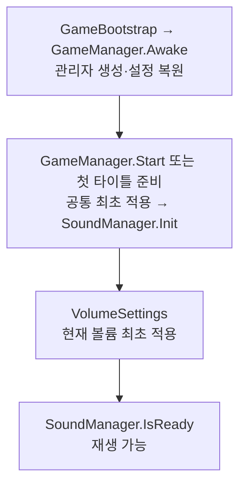
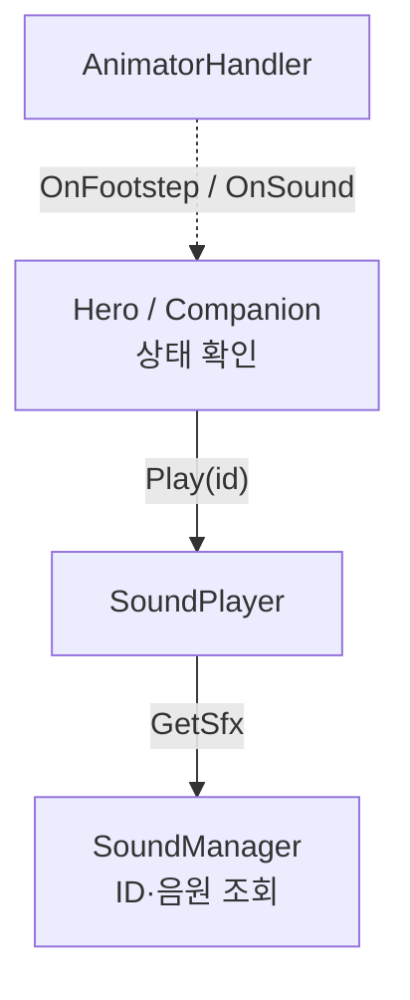
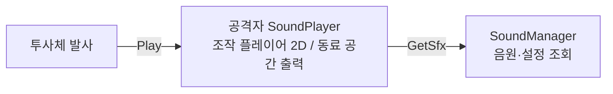
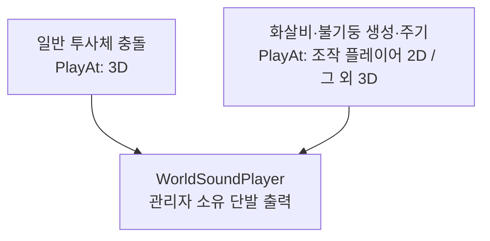
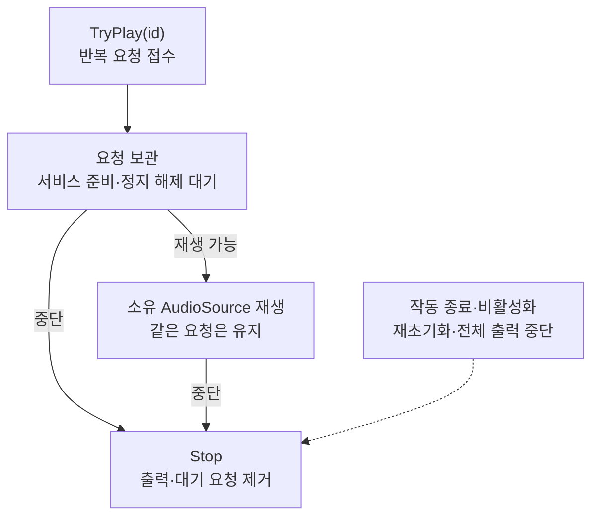

# SOUND_SYSTEM

LJ 담당 사운드의 구성, 재생 요청과 출력 수명 계약입니다. 선택 음원, 데이터 맵과 LJ 무기 이벤트를 적용했고 사용자 플레이 확인 범위는 마지막 절에 구분합니다. 적·UI·설치물의 호출 연결과 검증은 각 담당자가 진행합니다. 외부 연결 책임은 [연계 가이드](../LJ_INTEGRATION_GUIDE.md#공통-관리자와-사운드-연결)를 참조합니다.

## 구성과 출력

| 구성 | 책임 |
| --- | --- |
| GameManager | 사운드 초기화, 최초 볼륨 적용과 종료 조율 |
| SoundManager | ID 조회, BGM·UI·플레이 출력, 볼륨·일시정지와 전체 정리 |
| SoundId / SoundData / SoundDataMap | 식별자 / 출력 종류·음원 후보·개별 음량 / 설정 검사와 조회표 구성 |
| SoundPlayer | 캐릭터의 발소리와 행동음 출력. Hero·Companion 외의 캐릭터도 서비스 연결 후 사용 |
| WorldSoundPlayer | SoundManager가 소유하는 단발 출력 생성과 종료 후 정리. 기본 3D이며 플레이어 효과음은 2D 지정 가능 |
| SoundLoopPlayer | 소유 오브젝트의 반복 출력. 준비 대기·재생·중단과 전체 중단 알림 처리 |

캐릭터 출력은 최초 서비스 연결에서 준비합니다. 발소리와 그 밖의 행동음은 별도 AudioSource를 사용하며, 공격음과 피격음은 같은 행동음 출력에서 중첩 재생합니다. 위치 출력은 캐릭터·투사체가 제거돼도 음원 종료까지 유지합니다. 설정 저장은 SoundManager가 아닌 [VolumeSettings](SETTINGS_SYSTEM.md#볼륨-설정)가 담당합니다.

PlayScene은 현재 조작하는 Hero를 `SetSound(sound, isLocalPlayer: true)`로 연결합니다. 해당 플레이어의 행동음과 발사음은 2D, 동료는 기존 공간 설정을 사용합니다. 화살비·불기둥은 생성 시 시전자의 2D 여부를 보존하여 생성음과 주기음에 적용합니다. 일반 투사체 충돌음은 위치 출력입니다. 2D는 거리 감쇠를 없애며 음원 자체나 믹서 음량을 증폭하지 않습니다.

## 필요한 음원

아래는 LJ 기본 호출 ID입니다. 추가 UI·적·설치물 등의 식별자는 `SoundId`를 기준으로 하며, enum 정의와 맵의 음원 등록은 별개입니다. 실제 사용할 ID만 등록하고 같은 AudioClip을 여러 ID에 공유할 수 있습니다.

| 구분 | 필요한 소리 | 대응 ID |
| --- | --- | --- |
| BGM 2종 | 타이틀, 플레이 배경음 | TitleBgm, PlayBgm |
| UI 2종 | 선택, 뒤로가기 | UiClick, UiBack |
| 발소리 2종 | 플레이어, 동료 발소리 | HeroFootstep, CompanionFootstep |
| 이동 2종 | 점프, 회피 | HeroJump, HeroDodge |
| 피격 2종 | 플레이어, 동료 피격 | HeroHurt, CompanionHurt |
| 사망 2종 | 플레이어, 동료 사망 | HeroDeath, CompanionDeath |
| 검 3종 | 기본 휘두르기, 스킬, 궁극기 | SwordSwing, SwordSkill, SwordUltimate |
| 활 기본 공격 2종 | 화살 발사, 명중 | BowLaunch, BowImpact |
| 활 스킬·궁극기 3종 | 관통 화살 발사, 명중, 화살비 생성 | BowSkillLaunch, BowSkillImpact, BowUltimate |
| 지팡이 기본 공격 2종 | 마법탄 발사, 폭발 | StaffLaunch, StaffImpact |
| 지팡이 스킬·궁극기 3종 | 강화 마법탄 발사, 폭발, 불기둥 생성 | StaffSkillLaunch, StaffSkillImpact, StaffUltimate |
| 아이템 1종 | 아이템 사용 | ItemUse |
| 진행·결과 3종 | 웨이브 시작, 승리, 패배 | WaveStart, StageClear, StageFail |
| 궁극기 주기음 | 화살비, 불기둥 | BowUltimateTick, StaffUltimateTick |

- 플레이어·동료의 발소리·피격음·사망음은 각각 공유할 수 있습니다. 활·지팡이의 기본 공격과 스킬도 발사음·명중음을 우선 공유할 수 있습니다.
- BGM과 반복음(LoopSfx)은 ID별 음원 하나만 등록합니다. 단발 효과음·UI·발소리는 여러 후보를 등록하면 무작위로 선택합니다.
- 추가 UI ID는 UiNotice, UiReject, UiEquip, UiPage, ShopPurchase, UpgradeSuccess, MissionReward이며 Ui 종류를 사용합니다. 셋업의 JSON 가져오기와 검사는 같은 종류 기준을 사용합니다.
- UI 효과음의 호출 연결은 LHJ 후속입니다. 적·보스·설치물의 전용 ID 등록과 호출 연결은 KMB가 담당하며, enum에 있다는 이유로 모두 등록할 필요는 없습니다.

부분 임포트로 재생 구조를 변경할 필요는 없습니다. 실제 요청하는 ID에는 음원을 등록해야 하며, 선택적인 투사체·영역 사운드는 None으로 미사용할 수 있습니다.

## 초기화와 서비스 전달

초기화가 실패하면 최초 볼륨 적용을 건너뜁니다. 초기화 또는 최초 볼륨 적용 실패는 GameManager.InitialAudioError로 조회하며, 영구 진행 준비는 계속합니다. SoundManager.IsReady는 재생 가능 상태입니다.

SceneFlow.SetBgm은 선택 ID를 보관합니다. 이미 재생 가능하면 즉시 요청하고, 준비 전이면 OnReadyChanged 이후 요청합니다. 씬 도착과 사운드 초기화의 상대 순서는 가정하지 않습니다.

| 대상 | 호출 순서 |
| --- | --- |
| 플레이어 | PlayScene에서 Hero.SetSound → Hero.Init에서 무기별 실행자 SetSound → 행동 허용 |
| 동료 | 고용 관리자의 서비스 연결 → 동료 생성 → Companion.SetSound → PrepareHire → 고용 확정·행동 허용 |
| 투사체·지속 영역 | 실행자에 서비스 전달 → 객체 생성 → SetSound → Init |
| 일반 SoundPlayer | 생성·재사용 준비에서 Init(sound) → 행동 시 Play(id) → 비활성화에서 출력·구독 정리 |

투사체 Init에서는 즉시 발사음과 최초 충돌이 발생할 수 있으므로 서비스 연결을 Start로 미루지 않습니다. SoundManager 재활성화는 Init → 현재 볼륨 재적용 → 재생 순서이며 설정 파일을 다시 복원하지 않습니다.

SoundPlayer를 붙이는 것만으로 행동음은 연결되지 않습니다. 실제 사건과 재생 호출은 캐릭터 담당자가 연결합니다. 서비스 연결 후에도 IsReady 전 단발 요청은 거절되며 자동으로 재생 대기하지 않습니다. UI 최초 표시음을 반드시 내야 한다면 준비 알림 이후 현재 화면 상태를 확인하고 요청합니다. 준비 알림 구독은 해당 화면 수명에 맞춰 해제합니다.

## 재생 요청 흐름

**캐릭터 모션에서 재생 요청**

클립의 Animation Event를 AnimatorHandler가 받습니다. 실선은 직접 호출, 점선은 이벤트입니다.

SoundPlayer는 조회 결과를 반환받아 캐릭터 출력에서 재생합니다. 이벤트는 모션 시점을 전달하고 재생 자체는 직접 호출합니다.

**전투·게임 사건에서 직접 재생 요청**

발사음은 공격자의 출력을 사용하고, 충돌·영역음은 관리자 소유 출력을 사용합니다. 아래 실선은 직접 호출입니다.

영역은 생성 시 확정한 시전자의 출력 방식을 유지합니다. 위치 출력도 SoundManager를 통해 요청하며, 그림에서는 중간 조회 단계를 생략했습니다. 아이템·웨이브·결과는 SoundManager.Play로 공통 출력을 사용합니다.

**반복음의 요청과 중단**

먼저 Init(sound)으로 이전 요청·구독을 정리하고 서비스를 연결합니다. 재생 가능하면 대기 없이 시작하며, 미준비·일시정지 중에는 요청을 보관하고 갱신에서 시작합니다. 잘못된 ID·종류·음원 구성은 거절하며, 재생 중 일시정지는 기존 출력의 진행만 멈춥니다.

실선은 요청 상태의 진행, 점선은 대기·재생 어느 상태에서든 적용되는 중단 원인입니다. 전체 중단은 OnGameplayStopped 알림으로 전달합니다. 중단 뒤에는 이전 대기 요청이 자동 재생되지 않으며 새 요청이 필요합니다.

| 요청 시점 | 현재 처리 |
| --- | --- |
| 발 디딤 | AnimationFootstep → 실제 일반 이동 확인 후 발소리 요청. 플레이어는 접지도 확인 |
| 행동 모션 | AnimationSound → 유효한 공격·스킬·궁극기 상태 확인 후 ID 전달 |
| 점프·회피 | 실제 행동 시작 성공 후 캐릭터 출력 요청 |
| 피격·사망 | 생존 유효 피격은 캐릭터 출력, 사망은 로컬 출력 중단 후 관리자 소유 출력 요청 |
| 투사체·지속 영역 | 발사음은 공격자 출력, 충돌음은 위치 출력. 영역은 생성 시 확정한 2D 출력 여부 사용 |
| 아이템 | 수량 저장·사용 이력 반영·효과 적용 후 사용음 요청 |
| 웨이브·결과 | 전투 구간 전환 성공 / 도전 정산·정리 성공 후 요청 |

발사·충돌음은 실제 실행 코드가 요청하므로 같은 소리를 모션 이벤트에 중복 배치하지 않습니다. 화살비·불기둥은 지연된 피해 주기를 모두 처리하되 주기음 요청은 각 영역의 갱신당 한 번입니다. 재생 요청의 성공은 실제 청취 확인을 뜻하지 않으며 출력 실패가 이미 적용된 게임 동작을 취소하지 않습니다.

스태프 스킬은 전용 ProjectileData를 사용하며 실행자가 StaffSkillLaunch/StaffSkillImpact를 투사체 Init에 전달합니다. 스킬 사운드 ID를 모션 이벤트에 중복 배정하지 않습니다.

## 주요 API

| API | 계약 |
| --- | --- |
| SoundManager.Play(id) | BGM·UI·단발 플레이 출력 선택. 같은 BGM은 기본적으로 재생 위치 유지. LoopSfx는 거절 |
| SoundManager.PlayAt(id, position) | 지정 위치에서 단발 효과음 재생 |
| SoundManager.PlayAt(id, position, ignoreDistance) | true이면 관리자 소유 2D 출력. 기존 2인자 호출은 3D 유지 |
| SoundPlayer.Init(sound) / Init(sound, spatialBlend) | 저장된 공간 설정 / 지정한 설정으로 출력 연결. 재연결 시 기존 출력에도 반영 |
| SoundPlayer.Play(id) | 캐릭터의 발소리 또는 행동음 출력에서 재생 |
| TryPlayBgm / TryFadeBgm | 클립 직접 재생 / 감소 후 증가 전환. restart가 아니면 같은 곡의 재생 위치 유지 |
| TryPlayUiSfx / TryPlaySfx | 클립 직접 UI / 플레이 효과음 재생 |
| TryPrepareSfx(id, out data, out clip) | 로컬·위치 출력용 음원 준비. BGM·UI 종류는 거절 |
| GetSfx(id, out data, out reason) | 재생할 AudioClip 반환. 실패하면 null과 거절 사유 반환. 기존 TryPrepareSfx도 이 경로 사용 |
| SoundLoopPlayer.Init / TryPlay / Stop | 서비스 연결 / 반복음 요청 / 출력과 대기 요청 중단. TryPlay 성공은 준비 대기도 포함 |
| TrySetGameplayPaused(isPaused, out reason) | 플레이 오디오 정지 / 이 관리자가 적용하기 전 상태 복구 |
| StopSfx / SoundPlayer.StopAll | 모든 플레이 출력 정리 / 지정 캐릭터 출력 정리 |
| StopBgm / StopUiSfx / StopAll | 공통 BGM / UI / 전체 출력 중단. 일시정지 복구와 별개 |

음원 후보와 ID 중복은 맵 구성 시 검사합니다. 선택적인 투사체·영역 사운드의 None은 미사용이며, 실제 요청한 미등록 ID는 설정 오류입니다. 볼륨 적용·실패 복구와 저장 계약은 [설정 시스템](SETTINGS_SYSTEM.md)을 따릅니다.

## 취소와 종료 수명

| 상황 | 처리 순서와 유지 범위 |
| --- | --- |
| 일반 행동 취소 | 이전 모션의 후속 신호 차단. 이미 재생한 단발음·생성된 실행은 유지 |
| 캐릭터 사망 | 로컬 출력 중단 → 캐릭터 수명과 독립된 관리자 사망음 요청 |
| 캐릭터 비활성화 | 모션 신호 해제 → 실행 무효화 → 로컬 출력 중단 |
| 씬 이동 | 오디오 정지 복구 → 모든 플레이 출력 정리 → 로드 |
| 공통 관리자 종료 | SceneFlow·설정 연결 해제 → 사운드 준비 해제 → 전체 출력 정리 → 정지 상태 복구 |

기절·넉백의 행동 취소에 로컬 전체 중단을 추가하지 않습니다. 같은 타격에서 먼저 나온 피격음까지 끊을 수 있기 때문입니다. 회피 시작·사망·도전 행동 중단·비활성화의 기존 로컬 정리는 유지합니다. 생성된 공격 실행의 무효화는 [전투 수명](COMBAT_SYSTEM.md#모션과-실행-수명)을 따릅니다.

SoundPlayer는 Init에서 이전 서비스 구독을 해제하고 활성 상태에 맞춰 연결합니다. 비활성화에서 출력·구독을 정리하고 재활성화에서는 구독만 복구합니다. SoundManager의 StopSfx는 공통·위치 출력과 구독 중인 캐릭터 출력을 함께 정리합니다. 앱 종료 콜백에서 새 도전 정산이나 저장을 시작하지 않습니다.

플레이 오디오는 일시정지 중 새 요청을 거절하고 기존 재생을 보존합니다. BGM·UI 출력은 오디오 일시정지에서 제외합니다. Time.timeScale 변경만으로 오디오가 정지하지는 않습니다.

반복음은 LoopSfx ID와 클립 하나를 등록하고 SoundLoopPlayer.Init → TryPlay로 시작합니다. 일반 Play·PlayAt·SoundPlayer.Play 경로로 재생하지 않습니다. Init은 이전 요청을 정리하고 OnDisable은 Stop과 구독 해제를 수행합니다. StopSfx로 중단한 요청은 자동 재시작하지 않으며 소유 시스템이 새 요청을 보냅니다. FireTrapSound는 SetSound 이후 SetOperating으로 작동 시작·중단을 전달합니다.

## 툴 사용법

### 설정과 적용

1. 편집 모드에서 `Tools/Sound Setup`을 열고 기존 SoundSetupProfile을 지정하거나 새 프로필을 만듭니다. 새 프로필에는 프로젝트 내부 음원 폴더와 기존 데이터 맵을 지정합니다. 맵이 없으면 생성 경로를, 관리자 연결을 사용할 때는 GameManager 프리팹을 지정합니다.
2. 새 음원은 지정 폴더에 임포트한 뒤 JSON을 가져오거나 직접 배정합니다. `선택 JSON 가져오기 / 미싱 음원 복구`는 group·파일명 기준으로 기존 배정을 보존하고, 유일하게 찾은 누락 음원 참조만 복구합니다. 신규 행은 soundId로 배정하며 미지정 ID·동명 음원은 직접 지정합니다. 복구 자료는 [SoundSetupRecovery.json](../SoundSetupRecovery.json)을 사용합니다.
3. 이번에 반영할 행의 ID·종류·AudioClip·음량을 확인합니다. 신규 ID가 필요하면 담당자가 LJ와 식별자를 먼저 조율합니다.
4. `사운드 연결 자동 구성 / 기존 수동 연결 유지`는 LJ 무기와 동료의 투사체·영역 연결 초안용입니다. 적의 행동이나 UI 버튼을 자동 연결하지 않습니다.
5. `현재 설정 검사`를 실행합니다. 오류는 창 상단과 Console에 표시되며 오류 0개일 때 적용/저장이 활성화됩니다.
6. 적용 대상을 확인하고 `검사한 설정 적용 / 저장`을 실행합니다. 공용 맵의 기존 값 교체는 다른 사용처를 확인한 뒤 허용합니다. 체크 해제나 프로필 행 삭제로 기존 맵 항목은 삭제되지 않습니다.
7. 데이터 맵 변경 후에는 플레이를 다시 시작합니다. 런타임 조회표는 초기화 시 구성되며 에디터 조회 버튼으로 갱신되지 않습니다.

프로필 저장은 맵 적용과 별개입니다. 설정 툴의 저장은 실제 재생이나 청취 확인을 뜻하지 않습니다.

음원 정리 후에도 수동 ID·음량·클립 선택과 같은 음원의 복수 배정은 유지합니다. 누락 참조 복구 후 검사·적용으로 데이터 맵과 지정한 관리자 참조를 연결합니다.

### 사운드 디버그

플레이 중 SoundManager 하위의 SoundDebug 오브젝트를 선택합니다. 현재 부모 관리자 기준으로 전체 플레이어·동료·반복 출력과 적 등을 포함한 기타 SoundPlayer를 조회합니다. 다른 담당자가 쓰는 씬에도 같은 관리자의 하위 디버그를 사용하며 별도 플레이백 메뉴나 PlayDebugInspector에 사운드 기능을 추가하지 않습니다.

- 플레이어는 기존 행동 API를 요청하고, 동료·기타 출력은 기존 AI와 게임 동작으로 실행하면서 연결 상태를 조회합니다. 적 행동을 강제 실행하지 않습니다.
- `실제 사운드 요청 / 출력 상태`에서 선택 캐릭터의 출력 설정과 마지막 ID 요청, 공통 BGM/UI 요청, 월드 요청과 남아 있는 AudioSource를 확인합니다.
- 문제가 있으면 `요청/출력 기록 복사` 또는 `요청/출력 기록 콘솔 출력`으로 전달합니다. ID별 마지막 요청만 보관하며 서비스 재연결·초기화 시 지워집니다. 클립 직접 API와 반복음은 이 ID 기록 대상이 아닙니다.
- 요청 거절은 표시된 사유를, 접수됐지만 안 들리는 경우에는 음량·음소거·공간 출력과 청취 위치를 확인합니다. 기록 부재나 접수 여부만으로 청취 성공·실패를 단정하지 않습니다.

### 애니메이션 이벤트

`Tools/Sound Animation Events (One-shot)`은 LJ WeaponData의 실제 클립에 누락된 검 일반 공격·스킬·궁극기 이벤트를 추가하는 도구입니다. 선택 옵션으로 공통 Run 발소리도 추가합니다. 기존 이벤트와 조절한 시간은 유지하며 새 시간 조절은 Unity에서 합니다. 같은 클립을 쓰는 대상에 함께 반영되므로 적용 목록을 확인합니다.

발소리는 AnimationFootstep, 검 행동음은 AnimationSound와 해당 SoundId를 사용합니다. 피해 판정 이벤트는 별도입니다. 활·스태프의 발사·충돌·영역음은 실행 코드에서 요청합니다. 적의 애니메이션 이벤트 수신부는 KMB 코드에 따로 연결해야 하며 이 도구가 대신하지 않습니다.

## 담당자 테스트와 문제 전달

| 담당 | 확인할 내용 |
| --- | --- |
| UI / LHJ | 실제 버튼·화면 동작에서 1회 요청, Ui 종류, 일시정지 중 UI 재생과 플레이 오디오 정지, 복귀·화면 해제 시 복구, 씬 이동 전 출력 정리 |
| 적·설치물 / KMB | 생성·재사용 시 서비스 전달, 실제 공격·유효 피격·사망 시점, 중복 이벤트 없음, 거리별 음량, 비활성화·재사용·씬 이동 시 출력과 반복음 정리 |
| 공통 | 맵 등록 확인, 잘못된 종류의 검사 실패, SFX 볼륨·음소거, ID별 접수/거절 기록과 실제 청취의 일치 |

소유 오브젝트가 즉시 제거되는 사망음은 비활성화 전에 관리자 소유 출력으로 요청합니다. 같은 사건을 코드와 모션 이벤트 양쪽에서 재생하지 않습니다. 상세 책임과 화면 연결 순서는 [연계 가이드](../LJ_INTEGRATION_GUIDE.md#공통-관리자와-사운드-연결)를 따릅니다.

문제 전달에는 담당자, 씬/대상, 재현 순서, SoundId, 기대한 소리와 실제 결과, 요청/출력 기록, Console 오류를 포함합니다. 미등록 ID나 준비 전 요청을 임시 다른 소리로 대체하지 않습니다.

## 확인 범위와 후속

검·활·스태프의 공격과 궁극기, 발소리와 피격음, 동료 소환과 공격음을 사용자 확인했습니다. 동료 전체 행동과 사망음의 최종 청취, 적·UI·설치물 연결 및 공용 도구 보완 후의 추가 검증은 남아 있습니다.

추가 콘텐츠와 담당별 연결 후 다음을 확인합니다.

- ID·출력 종류·음량과 공간 출력, 실제 행동·모션의 재생 시점.
- 지연 프레임의 피해 횟수 유지와 주기음 중첩 제한.
- 사망·재고용·비활성화·재초기화 및 씬 이동의 출력 정리.
- BGM 전환, 볼륨·음소거와 플레이 일시정지·복귀.

남은 작업은 [공통 TODO](../TODO.md#로비씬설정사운드vfx-공통-기반)에서 관리합니다.
