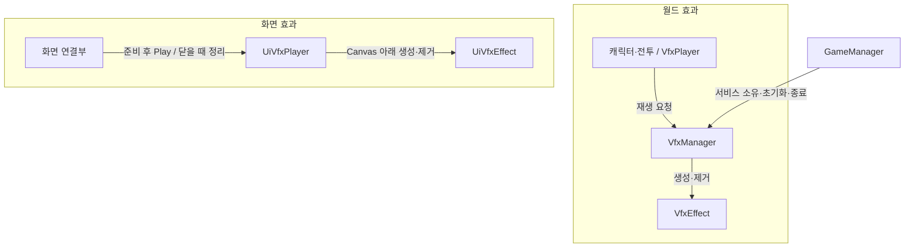
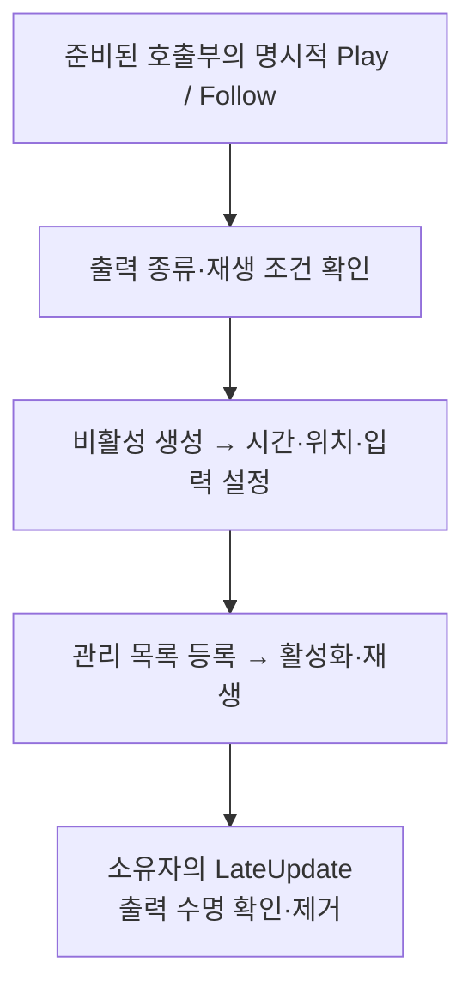

# VFX_SYSTEM

## 현재 범위

LJ 담당 월드 파티클·트레일·UGUI 재생과 셋업을 지원합니다. 기존 출력 확인에 이어 기절 공전과 스턴 중 동료 사망 시 즉시 제거를 사용자 확인했습니다. UI는 Graphic/Animator를 지원하며 일반 파티클의 Overlay UI 출력은 지원하지 않습니다. 잔여 표현·수명 검증과 적·보스·설치물·화면 연출 연결은 후속입니다.

사운드와 VFX는 필요한 서비스를 전달받아 직접 호출합니다. 캐릭터는 기존 피격·생명·상태 변경 핸들러에서 VFX를 요청하며, CharacterVfx가 같은 사건을 별도로 구독하지 않습니다. 별도 VFX Animation Event·ID 맵·풀링은 추가하지 않았습니다.

화살 트레일은 프리팹 부착, 스태프 비행은 ProjectileData.FlightVfx를 사용합니다. 남은 작업은 [VFX TODO](../TODO.md#vfx-남은-작업)에서 관리합니다.

## 사용처별 에셋 선정 현황

2026-11-04 기준입니다. 원본은 SelectedVfx에 통합했고 사용처는 [선택 JSON](../../Assets/12.%20Vfx/VfxSelections.json)에 기록했습니다. 배정 완료와 실제 출력 확인은 구분합니다.

| 사용처 | 실제 에셋·제작 대상 | 확보 상태·비고 |
| --- | --- | --- |
| 검 기본 공격 | Vfx_SwordSlash | 휘두르는 방향에 맞춰 슬래시 회전 보정. 검사 동료와 공유 |
| 검 기본 스킬 | Vfx_SwordSlash_Skill | 전용 효과 연결. 슬래시가 시전 전방으로 짧게 이동 |
| 검 궁극기 | Vfx_SwordSlash_Ultimate | 전용 효과 연결. 궁극기 효과가 비어 있으면 AreaAttackExecutor가 기본 효과를 사용 |
| 활 기본 공격·스킬 | ArrowTrail | 화살 프리팹 부착·출력 확인. 별도 충돌 효과는 생략 |
| 활 궁극기 | 중첩 화살의 ArrowTrail / Vfx_DeathSmoke | 화살 묶음 배치 조정과 지면 착지 효과 연결. 트레일과 착지 출력 사용자 확인 |
| 스태프 기본 투사체 | StaffProjectileTrail | FlightVfx 배정·출력 확인 |
| 스태프 스킬 비행·충돌 | StaffSkillFireball / StaffSkillImpact | 전용 데이터 배정·비행·충돌 출력 확인 |
| 스태프 궁극기 생성 | FirePillarBurst | 배정 완료. 실제 출력 확인 필요 |
| 스태프 궁극기 유지 | FirePillarStart | 기존 기둥 경로에 원본 연결·형태 조정과 기본 출력 확인 완료 |
| 플레이어·동료 피격 | HitEffect | 전용 기준점 분리·피격 출력 확인. 동료 전용 기준점은 필요 시 조정 |
| 플레이어·동료 사망 | DeathSmoke | 배정 완료. 실제 출력 확인 필요 |
| 플레이어 부활 | ReviveEffect | 배정 완료. 실제 출력 확인 필요 |
| 화상 | BurnEffect | 아군 디버그 출력·이동·만료 표현 확인. 실제 적·보스 연결 후속 |
| 감속 | SlowSnowflakes | 아군 디버그 출력·이동·만료 표현 확인. 실제 적·보스 연결 후속 |
| 기절 | StunOrbit | 공전·캐릭터별 기준점 연결, 기본 출력과 스턴 중 동료 사망 시 즉시 제거 확인. 적·보스 연결과 추가 수명 검증은 후속 |
| 체력 물약 | HealthPotion | 배정·사용자 출력 확인 완료 |
| 에너지 물약 | EnergyPotion | 배정·사용자 출력 확인 완료 |
| 동료 공격 | 검사: SwordSlash / 궁수: ArrowTrail / 마법사: StaffProjectileTrail | 플레이어 기본 공격 효과 공유·연결. 개별 출력 추가 확인 |
| 동료 고용·재고용 | CompanionHire | 기본 출력 확인 완료. 경로별 중복·재배치·재고용 예외는 추가 검증 |
| 회피·착지 | 기본 생략 | 후순위 선택 사항으로 연기·먼지 추가 가능 |
| 승패·보상 | 후광 등 | 추가 탐색, LHJ 화면·연출과 연계 |

Healing·Magic shield blue는 사용하지 않습니다. 스태프 발사 순간의 별도 효과도 배정하지 않습니다. 상태이상 효과의 실제 콘텐츠 대상은 일반 적·보스이며 담당 캐릭터 연결과 함께 적용합니다.

## 구성과 소유

| 모듈 | 책임 |
| --- | --- |
| GameManager | 하위 VfxManager 소유·초기화·종료와 공용 참조 제공 |
| VfxManager | 효과 생성·부착 효과 등록, 추적 갱신과 종료 객체 제거 |
| VfxEffect | 파티클·트레일 재생, 추적·방출 중단과 잔상 분리 |
| VfxOrbit | 공용 갱신에서 전달한 시간에 따라 자식 피벗 회전 |
| CharacterVfx | 피격·사망·부활 단발 요청과 화상·감속·기절 유지 효과 동기화 |
| VfxOptions / VfxScope | 월드 효과의 시간 기준과 전투·연출 일괄 정리 범위 |
| VfxPlayer | 서비스 연결 후 월드 연출 요청, 자신이 생성한 효과 정리 |
| UiVfxPlayer / UiVfxEffect | 화면이 소유하는 Canvas 출력 / Animator 설정과 단발 완료 시간 관리 |
| VFX Setup | 임포트된 원본으로 공용 효과 구성과 프리팹·데이터 참조 배정 |

GameManager.Awake에서 초기화한 GameManager.Vfx를 PlayScene이 캐릭터·고용 관리자와 PlaySession에 전달합니다. 씬·테스트에서 별도 매니저를 생성하거나 재초기화하지 않습니다. CharacterVfx의 피격·기절은 각각 전용 기준점을 사용하고, 미지정 시 공통 기준점을 사용합니다. 화상·감속·물약·사망·부활은 공통 기준점을 유지하며 미지정 시 캐릭터 루트를 사용합니다.

매니저는 씬 간 유지되지만 월드 효과는 별도로 영속화하지 않습니다. 생성 효과는 부모 없이, 부착 효과는 소유자 아래에서 재생하고 정상 종료 시 분리해 잔상을 유지합니다. 씬에서 먼저 제거된 효과의 관리 목록은 VfxManager가 정리합니다. UI 효과는 화면의 UiVfxPlayer가 소유합니다.

## 주요 API와 프리팹 계약

| API | 계약 |
| --- | --- |
| VfxManager.Init() | 이전 효과·프리팹 검사 캐시 정리 후 요청 준비 |
| Play(prefab, position, rotation) | 위치 고정 단발 효과 생성. 유지 효과는 거절 |
| Follow(prefab, anchor) | 기준점을 추적하는 유지 효과 생성. 반복 파티클 또는 트레일 필요 |
| PlayFollow(prefab, anchor, options = default) | 기준점을 추적하는 단발 효과 생성 |
| Play(prefab, point, follow, options) | 단발/반복은 프리팹에 따르고 기준점 추적 여부는 별도 지정 |
| PlayAttached(owner) | 자식 VfxEffect를 복제 없이 초기화·등록·재생하고 참조 목록 반환 |
| StopMaintained(scope) / StopAll(scope) | 지정 범위의 반복 방출 중단 / 해당 범위의 효과 즉시 정리 |
| StopMaintained() | 범위 구분 없이 반복 효과의 방출·추적 중단. 단발과 잔여 파티클 유지 |
| StopAll() / Shutdown() | 모든 효과 즉시 정리 / 새 요청 차단 후 전체 정리 |
| VfxEffect.Stop() / Clear() | 방출·공전·추적 중단과 부모 분리 후 잔상 유지 / 공전과 출력 즉시 정리 |
| VfxEffect.StopEmission() | 방출·공전 중단. 잔여 출력이 사라질 때까지 기존 추적 유지 |
| CharacterVfx.Init(manager) | 이전 유지 효과 정리 후 서비스 연결 |
| PlayHit() / PlayDeath() / PlayRevive() / Play(prefab) | 피격 전용 / 공통 기준점에서 단발 요청 |
| RefreshEffects(status) / Clear() | 현재 상태에 맞춰 유지 효과 반영 / 현재 유지 효과와 자연 종료 중인 잔여 출력 즉시 정리 |

월드 효과 프리팹 루트에는 VfxEffect와 ParticleSystem을 둡니다. VfxManager가 복제하는 효과는 프리팹 루트의 저장 상태와 관계없이 비활성 상태에서 초기화한 뒤 재생합니다. PlayAttached로 재생하는 부착 효과는 요청 전에 비활성 상태로 둡니다. 반복 파티클 또는 트레일이 있으면 유지 효과로 판정합니다. 초기화 시 파티클 자동 재생·자체 제거와 트레일 자동 파괴를 해제합니다. Play·Follow의 기본값은 전투 범위·게임 시간이며 트레일은 비배율 시간을 지원하지 않습니다. 단발/유지, 위치 고정/추적, 정리 범위는 별도 설정입니다.

화살에는 비활성 Vfx_ArrowTrail을 부착하고 ProjectileData.FlightVfx는 비웁니다. Projectile·ArrowRainArea가 위치 확정 후 PlayAttached를 호출하며 정상 종료는 Stop, 실행 무효화·비활성화는 Clear로 정리합니다. 트레일은 방출 중이거나 선이 남아 있으면 유지하며 잔상 길이는 원본의 Time으로 조정합니다.

UI 효과는 비활성 RectTransform 루트에 UiVfxEffect를 두고 자식 Graphic과 필요한 Animator로 구성합니다. 효과 자체에는 Canvas·월드 렌더러·파티클·구형 Animation·입력 모듈을 넣지 않습니다. 단발 완료 시간은 클립에서 자동 계산하지 않고 지정하며 반복 효과는 소유 화면에서 정리합니다. 재생 준비 시 Graphic·CanvasGroup의 입력 차단을 해제합니다.

기절 공전은 VfxEffect가 기준점을 추적한 뒤 VfxOrbit을 갱신합니다. 캐릭터별 머리 위 기준점을 CharacterVfx의 Stun Point에 연결하고, 공용 효과의 피벗 높이는 0으로 두며 자식 위치로 반지름을 조정합니다. 기준점의 회전도 추적하므로 수평 공전은 캐릭터 루트 아래 회전이 없는 기준점을 사용합니다.

## 초기화와 호출 순서

GameManager.Awake의 VfxManager.Init → PlayScene의 서비스 전달 → Hero.Init 또는 동료 PrepareHire → 동료 ConfirmHire 순서입니다.

Hero는 초기화 성공 후 현재 상태를 표현에 반영합니다. 동료는 준비만 된 상태에서 유지 효과를 시작하지 않으며 고용 확정 후 동기화합니다. 생성·준비 실패는 기존 객체 제거 경로로 정리합니다. 단독 CompanionTest도 GameManager.Vfx를 PrepareHire 전에 전달하며 테스트 해제에서 공용 전체 정리를 요청하지 않습니다.

고용 효과는 준비 중 최초 배치, 첫 전투의 자동 생성, 전투 중 고용·재고용 성공 후 요청합니다. 기록만 있는 고용·준비 실패·기존 동료 재배치에서는 재생하지 않습니다. 전체 자동 생성이 실패하면 고용 효과도 요청하지 않습니다.

공격 실행자는 생성할 투사체·영역에 **SetSound·SetVfx → Init** 순서로 서비스를 전달합니다. 투사체 Init 중 최초 차폐에 즉시 충돌할 수 있으므로 연결을 뒤로 미루지 않습니다.

월드 연출은 VfxPlayer.Init(manager) 후 Play()를 호출합니다. 기본값은 연출 범위·비배율 시간이며 기준점·추적 여부를 설정할 수 있습니다. UI는 화면 구성·활성 Canvas 준비 후 UiVfxPlayer.Play()를 호출하고 기본적으로 비배율 시간을 사용합니다. 두 모듈 모두 OnEnable 자동 재생을 하지 않으며 비활성화 시 자신의 출력만 정리합니다. 승리 연출 시점은 [공통 종료 계약](PLAY_FLOW.md#최종-종료와-완료-통지)을 따릅니다.

| 호출 위치 | 현재 처리 |
| --- | --- |
| 범위 기본 공격·검 스킬·검 궁극기 | 승인된 ExecuteAttack에서 단발 요청 후 기존 피해 탐색 |
| 투사체 | Init에서 부착 효과와 데이터의 발사·비행 효과를 준비한 뒤 최초 차폐 검사. 충돌 효과는 ImpactVfx 사용 |
| 직격·폭발·관통 충돌 | 피해 요청 전 충돌 효과 요청. 관통은 피해 수신자별 한 번 재생하고 지형 충돌에서도 재생 |
| 화살비·불기둥 | 영역 생성 단발 효과와 기존 주기 피해 유지. 화살비는 중첩 화살의 부착 트레일을 재생하고, 지면에 정상 착지하면 묶음당 착지 효과를 한 번 재생 |
| 캐릭터 피격·사망·부활 | 생존 양수 피해는 피격, 사망은 유지 효과 정리 후 사망 효과. 부활은 위치·HP 복구와 기존 모션 복귀 요청 후 효과 요청 |
| 상태 변경 | 현재 상태를 조회해 없는 유지 효과만 생성. 재적용으로 같은 효과를 중복 생성·재시작하지 않음 |
| 아이템 | 저장·사용 이력 확정 → 효과 적용 → UseVfx → 사용음 → 인벤토리 알림 |

발사·충돌·범위 효과는 실제 실행 코드가 요청합니다. 같은 효과를 모션이나 외부 이벤트 구독으로 중복 요청하지 않습니다. VFX 요청 결과가 피해·사용·저장 결과를 되돌리지는 않습니다.

플레이어·동료의 상태 이상 표현 지원은 공통 수신·테스트 기능입니다. 실제 화상·감속·기절의 콘텐츠 적용 대상은 일반 적·보스라는 기존 범위를 유지하며, 적·보스의 표현 연결은 별도입니다.

## 종료와 일시정지

| 상황 | 처리와 유지 범위 |
| --- | --- |
| 일반 모션 완료·행동 취소·캐릭터 사망 | 이미 승인된 투사체·영역의 실행 수명 유지. 캐릭터 사망은 자신의 현재 유지 효과와 자연 종료 중인 잔여 출력 즉시 정리 |
| 상태 만료 | StopEmission으로 방출·공전 중단 후 잔여 출력의 기준점 추적 유지. CharacterVfx는 잔여 참조를 보관하고 모두 소멸하면 매니저가 제거 |
| 투사체 정상 충돌·거리 종료·화살비 착지 | 비행 효과의 방출·추적 중단, 부착 효과 분리 후 잔상 유지 |
| 실행 무효화·투사체 외부 비활성화 | 비행 효과 즉시 정리 |
| 캐릭터 비활성화·StopStageActions | 자신의 현재 유지 효과와 자연 종료 중인 잔여 출력 정리. 재활성화는 초기화된 생존 캐릭터의 현재 상태 재조회, 동료는 배치 확정 상태도 확인 |
| 마지막 스테이지 사건 전달 완료 | Hero·고용 관리자의 StopStageActions로 실행 무효화·캐릭터 유지/잔여 출력 정리 → StopMaintained(Gameplay). 마지막 사망·충돌 단발과 그 밖의 잔여 출력은 유지 |
| 새 스테이지 시작 | 무기 조회 성공 후 Hero.Init 전에 StopAll(Gameplay)로 이전 전투 효과 제거 |
| 씬 재초기화·초기화 실패·파괴 | 연결했던 경우 세션 구독 해제 → 플레이어·동료 실행 중단 → StopAll(Gameplay) → 씬 참조 반환. 공용 서비스 유지 |
| 연출 주체·화면 비활성화 | VfxPlayer는 자신의 월드 출력을 Clear, UiVfxPlayer는 자신의 UI 출력을 제거. 다른 소유자의 효과는 유지 |
| 앱 종료 | GameManager가 공통 연결을 해제한 뒤 Shutdown |
| VfxManager 비활성화·파괴 | Shutdown. 다시 활성화하는 것만으로 복구되지 않으며 Init과 캐릭터 상태 재연결 필요 |

PlayScene 컴포넌트만 비활성화하면 기존 도전 수명과 공용 VfxManager는 유지됩니다. 플레이 씬 오브젝트를 비활성화해도 GameManager 하위 매니저가 함께 꺼지지는 않으며, 캐릭터·웨이브의 자체 정리와 자동 재개 범위는 [공통 흐름](PLAY_FLOW.md#비활성화재초기화파괴)을 따릅니다. GameManager 하위 VfxManager 자체를 껐다 켜는 것은 별개이며 명시적 Init과 캐릭터 상태 재연결이 필요합니다.

몸에 붙는 상태 효과는 원본의 Local 공간 설정을 사용합니다. 만료 후 추적 중인 대상이 파괴·비활성화되면 추적을 중단하고 남은 파티클은 자연 종료합니다. 공용 코드에서 모든 파티클의 공간 설정을 강제하지는 않습니다.

전투 기본 출력은 timeScale 0에서 멈추고 비배율 시간을 지정한 파티클·추적·UI Animator와 완료 시간은 계속 진행합니다. 임의의 Tween·셰이더 시간과 월드 Animator는 이 옵션으로 바뀌지 않습니다. 월드 연출 범위도 씬 언로드를 넘어 유지되지 않으며 VfxManager 전체 종료에서는 함께 정리합니다. 별도의 정지 요청이 필요한 오디오는 [사운드 수명](SOUND_SYSTEM.md#취소와-종료-수명)을 따릅니다.

## 공용 셋업 사용법

1. Tools/VFX Setup에서 배정 파일·선별 원본 폴더·공용 생성 폴더를 지정합니다. 툴은 외부 패키지를 선별·임포트하지 않습니다.
2. 담당 범위를 선택하고 `선택 JSON 가져오기 / 일괄 배정`으로 가져옵니다. 빈 사용처는 수동 연결 항목이며 해당 효과의 범위 내 이전 자동 배정을 제거합니다. 수동 배정은 보존하고 오타·미등록 사용처는 오류로 알립니다.
3. 선택 항목을 검사해 신규 생성·기존 갱신·연결 변경과 공유 사용처를 확인합니다. 기존 참조 교체는 명시적으로 허용하며 베리언트의 기존 오버라이드는 유지합니다.
4. 생성/연결/저장을 적용합니다. 원본은 보존하고 공용 루트 아래 넣은 `Vfx_원본파일명` 프리팹을 생성합니다. 같은 경로·원본·설정은 재사용하고, 설정 변경 시 확인된 기존 생성본을 갱신합니다. 다른 동명 파일은 덮어쓰지 않습니다. 검사 후 대상이나 설정이 바뀌면 재검사합니다.

검사 오류가 있는 생성·갱신과 관련 연결은 적용 목록에서 제외합니다. 통과한 변경이 남아 있으면 `검사 통과 항목만 적용`으로 저장할 수 있습니다. 적용 직전 재검사에서 계획이나 제외 사유가 달라지면 다시 검사합니다.

현재 원본 폴더는 SelectedVfx, 공용 생성 폴더는 12. Vfx입니다. 파티클·트레일·혼합 원본을 지원하며 생성·갱신본의 내장 AudioSource는 비활성화합니다. 프로필 저장과 실제 적용은 별개입니다. 화살의 자식 부착과 이전 FlightVfx 참조 해제는 Inspector에서 수행합니다. 단발 UI는 완료 시간을 지정하며 사용자 스크립트가 있는 원본은 수동 구성합니다.

일부만 적용하려면 담당 범위 전체 제외 후 필요한 사용처만 체크합니다. 수동 조정한 기절 생성본은 원본으로 생성/갱신을 끄고 프로필을 저장해 보존합니다. 생성·연결 변경이 0건이면 적용 버튼은 비활성이며 별도 프로필 저장은 가능합니다.

담당 범위는 탐색·가져오기·검사·적용에 공통으로 반영하며 화면 분류·검색은 별도입니다. 무기·아이템·플레이어·동료는 LJ, 적·보스·설치물은 KMB, UI·연출은 LHJ로 구분합니다. 공유 데이터의 변경은 범위 밖 사용처에도 영향을 줄 수 있으므로 검사 결과를 확인합니다.

적은 EnemyCombat 기반 프리팹, 설치물은 실제 VFX 필드·투사체 참조를 탐색합니다. 독립 보스 타입은 직접 지정하며 없는 필드나 호출을 자동 생성하지 않습니다. JSON 메모는 갱신하고 수동 메모는 보존하며 `JSON 메모 사용`으로 교체할 수 있습니다.

프로필 저장·참조 배정·런타임 호출 연결·출력 확인은 서로 다른 단계입니다. 다른 담당자의 행동·화면 이벤트는 담당자가 연결합니다. 불기둥 유지 표현은 기존 기둥 경로에 원본을 수동 연결했으며 JSON 자동 사용처와 구분합니다.

## 확인 범위와 후속

위 사용처 표의 기본 출력 확인과 사망·재고용·씬 전환 등 전체 수명 검증은 구분합니다. 에이전트는 코드·참조를 정적으로 확인했으며 Unity 실행·빌드는 수행하지 않았습니다.

남은 작업과 검증 항목은 [TODO](../TODO.md#로비씬설정사운드vfx-공통-기반), 외부 담당 연결은 [연계 가이드](../LJ_INTEGRATION_GUIDE.md#공용-vfx-연결)에서 관리합니다.
