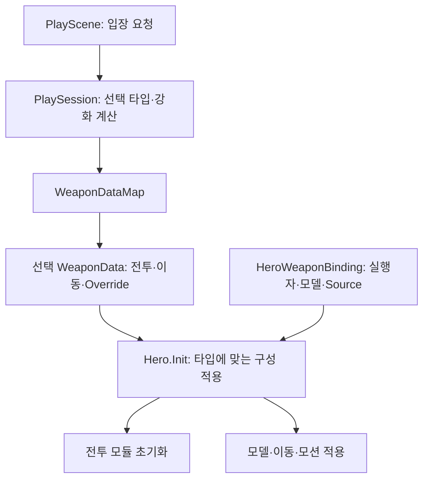

# WEAPON_SYSTEM

## 문서 역할과 상태

LJ 담당 무기의 선택/장착, 능력치 초기화와 기본 공격 실행을 관리합니다. 공통 전투는 [COMBAT_SYSTEM.md](COMBAT_SYSTEM.md), 스킬은 [SKILL_SYSTEM.md](SKILL_SYSTEM.md), 작업 목록은 [COMBAT_TODO.md](Todo/COMBAT_TODO.md)를 참조합니다.

검·활·스태프 전투와 무기별 초기화·Override 적용을 구현했습니다. 구현/검증 이력은 [DONE.md](../DONE.md), 남은 작업은 [COMBAT_TODO.md](Todo/COMBAT_TODO.md)에서 관리합니다.

## 확정 규칙과 초기 콘텐츠

- 여러 무기를 소유하며 입장 전에 1개를 선택합니다. 스테이지 중 교체하지 않습니다.
- 선택 무기에 따라 HP/피해 감소율/이동속도/기본 공격/스킬/궁극기를 구성합니다.
- 최초 무기 1종은 무료로 선택하며 이후 무기는 구매해 해금합니다. 입장은 저장된 선택 또는 명시적으로 전달한 보유 무기를 사용하며, 직접 전달한 무기는 저장된 선택을 바꾸지 않습니다. 상품 계약은 [SHOP_SYSTEM.md](SHOP_SYSTEM.md), 무기별 강화는 [UPGRADE_SYSTEM.md](UPGRADE_SYSTEM.md)를 참조합니다.

| 무기 | 기본 공격 방향 | 상태 |
| --- | --- | --- |
| 검 | 전방 근접 범위 피해 | 전투 구현, 무기 데이터·기본 클립 유지 Override 연결 |
| 활 | 원거리 단일 투사체 | 기본 공격·스킬·궁극기 로직과 모션·이벤트 연결, 추가 회귀 확인 남음 |
| 스태프 | 마법탄 최초 충돌 위치의 폭발 피해와 화상 | 스킬은 데이터 분리·프리팹 공유. 비행·충돌·불기둥 유지 기본 출력 확인 완료 |

콘텐츠 수치는 [PROJECT_CONTEXT.md](../PROJECT_CONTEXT.md)의 초기값과 팀 기획을 참조하며 확정 밸런스로 취급하지 않습니다.

## 현재 코드와 실행 흐름

```text
공격 승인 → 애니메이션 타격/발사 이벤트 → 자식 실행자
→ 범위 피해 또는 투사체 비행·충돌 → 실제 피해 보고 → 기본 공격 에너지 충전
```

CompleteAttack은 타격과 별도로 공격 동작을 종료합니다. Attacker는 회차당 실행 한 번을 승인하며 HitDetector는 탐색 한 번에서 동일 피해 수신자의 다중 Collider를 제거합니다.

AttackExecutor는 공통 실행 계약을 두고 실제 공격은 AreaAttackExecutor, SwordSkillExecutor, ProjectileAttackExecutor에 위임합니다. AttackContext는 공격 시작 시 피해량·진영·회차 등을 보존하고, 원거리 위치·방향·비행 설정은 발사 시 확정합니다. 공개 API는 [COMBAT_SYSTEM.md](COMBAT_SYSTEM.md)를 참조합니다.

PlayScene의 입장 요청을 받은 PlaySession이 선택 WeaponType으로 WeaponDataMap을 조회하고 확정한 HeroUpgradeStats와 함께 Hero.Init(WeaponData, upgrades)에 전달합니다. TestScene의 기존 요청은 PlayScene 상속으로 유지하며 Hero.Init(WeaponData)는 미강화 호출을 유지합니다.

## 무기 데이터와 초기화 — 현재 구현

WeaponData는 타입, CombatStatsData/AttackData/스킬/궁극기 참조, 이동속도·조준 회전, AnimatorOverrideController를 묶습니다. HeroWeaponBinding은 캐릭터의 타입별 실행자·모델·Source를 보관합니다. 공유 에셋과 씬 참조를 분리하며 수치를 중복 저장하지 않습니다.

Hero.Init은 일반 C# 클래스인 HeroWeaponSetup에 구성 조회·검사와 실행자 연결, 모델·이동 설정·Override 적용을 위임합니다. 전투 모듈 초기화 순서와 최종 성공 판정은 Hero가 유지하며 외부의 Hero.Init(WeaponData) 계약은 같습니다.

### 데이터와 캐릭터 연결

화살표는 선택 데이터와 캐릭터 연결의 전달·적용 관계입니다. 맵은 공유 설정을 조회하며 씬의 실행자를 보관하지 않습니다.



무기 조회와 강화 계산은 PlaySession의 입장 준비에서 수행하며 매 공격마다 반복하지 않습니다.

초기화 순서는 **이전 모션·실행 정리 → 실행자와 전투 설정 연결 → 모델·이동·Override 적용 및 모션 초기화 → 현재 무기 반영 → 체력 초기화**입니다. 진행 중 행동은 초기화를 거절하고, 초기화에 진입한 뒤 실패하면 행동 제한을 유지합니다.

무기 조회·적용은 초기화 때만 수행하며 매 공격에서는 기존 모듈을 호출합니다. 모델은 표시 전용 루트로 두고 실행자·발사점은 활성 계층에 유지합니다. 도전 조율부가 무기 초기화 성공 후 자원·부활 횟수를 초기화합니다. HeroWeaponSetup은 Override·모션 초기화 후 AnimatorHandler.SetBasicAttackSpeed(1 + 증가율)를 호출하며, Animator의 AttackSpeed 파라미터와 기본 공격 상태 속도 배율을 연결해야 합니다.

### Hero Editor의 무기 조회

`Tools > Hero Editor`에서 개요·전투·사용 방법 탭을 제공합니다. 대상 고정과 참조 펼치기는 기존 컴포넌트 배치를 유지하면서 원본 설정을 탐색·편집합니다.

- 편집 모드: 같은 Hero를 참조하는 단일 TestScene의 선택 WeaponType과 WeaponDataMap에서 데이터를 조회합니다. 실행자는 Hero의 해당 HeroWeaponBinding을 편집합니다.
- 플레이 모드: Hero.WeaponData와 관리 모듈에 실제 적용된 실행자를 읽기 전용으로 표시합니다.
- 초기화 주체나 무기 연결이 없거나 중복되면 임의로 선택하지 않습니다. 독립 프리팹이나 다른 초기화 경로는 자동 추정하지 않습니다.

## 원거리 공통 기반 — 현재 구현

스크립트는 `Assets/02. Scripts/Combat/Ranged/`에 있습니다. Inspector 연결은 [COMBAT_TEST.md](Test/COMBAT_TEST.md), 남은 검증은 [COMBAT_TODO.md](Todo/COMBAT_TODO.md)를 참조합니다.

| 모듈 | 책임 |
| --- | --- |
| AimProvider / CameraAimProvider | 조준 조회 계약과 실제 Camera 화면 중앙의 적·지형 조준점 계산 |
| ProjectileAttackExecutor / ProjectileData | 발사 정보 확정·생성과 비행 설정 |
| Projectile / DirectHitProjectile | 공통 직선 비행·충돌·종료와 자식의 단발 직격 피해 |
| PiercingProjectile | 동일 수신자 중복 제거와 관통 피해 |
| ExplosionProjectile | 최초 충돌 위치의 폭발 피해와 실제 피해 대상의 화상 요청 |

Hero.Init은 선택 무기의 실행자에 사운드·VFX 서비스를 전달합니다. 실행자는 투사체 생성 → SetSound·SetVfx → Init 순서로 연결합니다. 발사음은 공격자의 SoundPlayer를 사용하며 현재 조작하는 Hero는 2D, 동료는 공간 출력을 사용합니다. SoundPlayer가 없는 다른 공격 주체는 발사 위치에서 재생하고, 충돌음은 충돌 위치에서 재생합니다. ProjectileData의 LaunchSound/ImpactSound가 기본 ID이며 스태프 스킬은 전용 데이터와 별개로 스킬 ID를 Init에 전달합니다.

LaunchVfx/FlightVfx/ImpactVfx는 발사 단발·비행 추적·충돌 단발 효과입니다. 사운드의 None과 미지정 VFX는 미사용입니다. Init 중 즉시 발사·충돌할 수 있으므로 서비스 연결을 뒤로 미루지 않습니다. 출력 수명과 확인 범위는 [사운드](SOUND_SYSTEM.md)·[VFX](VFX_SYSTEM.md) 시스템을 참조합니다.

- 몸 회전은 Mover에서 이동/조준 모드를 선택하며, 조준 모드에서는 CameraFocus의 수평 방향을 사용합니다. 이동과 기존 행동 제한은 유지합니다.
- 발사 승인 시 실제 Camera의 중앙 조준점을 조회합니다. 적·지형이 없으면 최대 조준 거리 앞을 사용하고, 발사점에서 조준점으로 방향을 확정합니다.
- 투사체는 일정 속도로 직선 이동하며 이동 구간의 충돌을 거리순으로 처리합니다. 일반 화살은 첫 충돌, 관통 화살은 지형 충돌·최대 유효 적중 수에서 종료하며 최대 비행 거리도 적용합니다. 중력·유도·풀링은 미구현입니다.
- 몸에서 발사점까지의 차폐도 같은 규칙으로 검사합니다. 아군 통과는 탐색 마스크로 설정합니다. 일반 화살은 피해 거절에도 종료하고, 관통 화살은 이미 처리한 대상을 다시 타격하지 않으며 양수 피해만 관통 수에 반영합니다.

DamageInfo.Attacker는 원래 발사 주체, Source는 실제 투사체입니다. 실제 피해를 원래 실행에 보고하며 기본 공격당 최초 양수 피해에서 한 번만 에너지를 충전합니다. 조준 거리와 발사 후 최대 이동 거리는 구분하고 AttackData.Radius를 사거리로 사용하지 않습니다.

## 활 기본 공격과 후속 작업

직격 투사체·데이터와 활 모션·발사/완료 이벤트를 연결했습니다. 이동 모션 보완과 모션 교체 후 전체 전투 회귀는 후속입니다. 관통 화살과 화살비 계약은 [SKILL_SYSTEM.md](SKILL_SYSTEM.md)를 참조합니다.

## 스태프 기본 공격 — 현재 구현

ProjectileAttackExecutor에서 ExplosionProjectile을 발사하는 구성입니다. 마법탄이 적/지형에 처음 충돌한 위치에서 한 번 폭발하며 별도 직격 피해는 없습니다. 최대 비행 거리 도달 시에는 폭발 없이 종료합니다. 전용 데이터·프리팹·무기와 애니메이션을 연결했으며 폭발·화상·에너지 충전의 기본 동작을 사용자 확인했습니다.

Projectile.Init은 실행·비행 정보를 보존한 뒤 PrepareHit을 호출하고 최초 차폐를 검사합니다. ExplosionProjectile은 PrepareHit에서 화상 정보를 보존하므로 몸에서 발사점까지의 즉시 충돌에도 같은 화상을 적용합니다. 기존 투사체는 기본 빈 구현을 사용합니다.

HitDetector에 충돌 위치/공격 반경/360도를 전달해 구형 범위를 탐색하고 동일 수신자의 다중 Collider를 제거합니다. 비행은 벽에 막히지만 폭발 범위에 별도 벽 차폐는 적용하지 않습니다.

폭발의 실제 피해를 합산하여 기본 공격 유효 적중은 한 번만 알립니다. 양수 피해를 받은 대상에 상태이상 모듈이 있으면 화상을 요청하며 수신 모듈이 사망·면역 등 적용 조건을 판단합니다. 이미 부여한 화상은 대상이 수명을 관리하고 이후 화상 피해로 기본 공격 에너지를 다시 충전하지 않습니다.

## 실행별 결과와 수명 — 현재 구현

AttackExecution은 원래 Context, IsActive, 최초 유효 적중 보고 여부를 보관합니다. 실행자는 실제 피해를 ReportAppliedDamage로 보고하고 종료 시 Complete를 호출합니다. 기본 공격은 최초 양수 피해에서 한 번 충전하며 스킬/궁극기는 충전 콜백을 연결하지 않습니다.

_hasCommittedHit는 실행/발사 승인 중복을 막고, AttackExecution은 결과 알림 중복을 막습니다. 관통 화살은 실행별 피해 수신자 기록으로 중복 요청을 막습니다. 여러 발사의 결과를 최신 CurrentAttackId나 현재 IsAttacking으로 거절하지 않습니다.

모션 완료/일반 취소/사망은 이미 승인된 실행의 종료와 별개입니다. Hero/Attacker/SkillCaster 비활성화, 재초기화와 새 스테이지 자원 초기화에서는 남은 실행을 정리합니다. 범위 실행은 유효성을 확인하며 무효화 이후 추가 피해/후속 넉백/결과 보고를 중단합니다.

투사체는 발사 당시 실행과 비행 정보·충돌 VFX 참조를 보관합니다. 모션 완료·일반 취소·사망 뒤에도 비행을 유지하며, 실행 무효화 시 다음 갱신에서 제거합니다. 화살 트레일은 프리팹에 부착하고 스태프 비행 효과는 FlightVfx로 생성합니다. 정상 종료는 방출 중단·부착 효과 분리 후 잔상을 유지하고, 실행 무효화·외부 비활성화는 즉시 정리합니다. 현재 배정·출력 확인은 [VFX 시스템](VFX_SYSTEM.md), 추가 실행 수명 검증은 [COMBAT_TODO.md](Todo/COMBAT_TODO.md)에서 관리합니다.

## 동료/연출 연결과 미결정 사항

궁수/마법사 동료는 AI 조준을 사용하는 CompanionProjectileAttackExecutor와 CompanionAimProvider로 기존 투사체 실행을 재사용합니다. 투사체 설정은 플레이어와 공유하므로 변경 시 양쪽 영향을 확인해야 합니다. 동료의 대상 선택·타격 연결은 [동료 시스템](COMPANION_SYSTEM.md#탐색과-이동공격)에 둡니다.

무기별 모션은 공통 Controller의 상태·파라미터를 유지하고 Override로 클립을 교체합니다. 검은 기본 클립을 유지하며 활·스태프는 전용 클립과 이벤트를 연결했습니다. 플레이어·동료 애니메이션과 일부 공용 VFX 실행은 LJ, 적·보스 캐릭터 연결은 KMB, 리소스·UI·화면 연출은 LHJ 담당입니다. 실제 연결 대상은 테스트 타이머를 비활성화합니다.

이동 모션·상하체 조합과 추가 전투 검증은 후속입니다. 화살비 표현·궁극기 범위 지정의 현재 계약은 [SKILL_SYSTEM.md](SKILL_SYSTEM.md)를 참조합니다.
