# 🛡️ (팀)던전 홀드 · Dungeon Hold (26.11.09 업데이트)

> 플레이어가 직접 전투하고 동료·설치물을 운용해 몬스터의 던전 탈출을 저지하는 **3인칭 3D 액션 디펜스 게임**

- **장르**: 3D Action / Defense
- **엔진**: Unity 6 6000.0.68f1
- **언어**: C#
- **개발 형태**: 팀 프로젝트 / 싱글플레이
- **담당 역할**: 팀장 / 클라이언트 개발
- **담당 분야**: 플레이어·무기·동료 전투, 성장·경제·저장, 로비·씬 이동·도감, 설정·사운드·공용 VFX 및 개발 도구
- **개발 기간**: 약 1.5개월 (2026.10.07 \~ 2026.11.19 종료 예정)
- **참여 인원**: 5명
- **개발 상태**: 실제 맵·UI 연결과 전투 표현 보완 진행 중

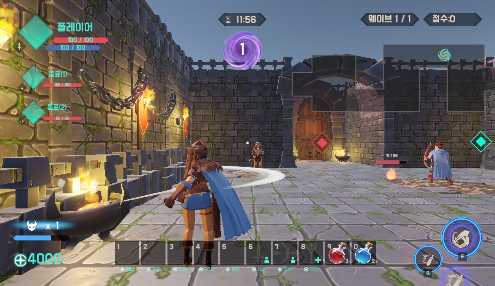

콤보 처치 표시와 스킬·궁극기 준비 상태, 동료 2명과 소모품 보유 상태가 함께 보이는 Stage1 전투 화면

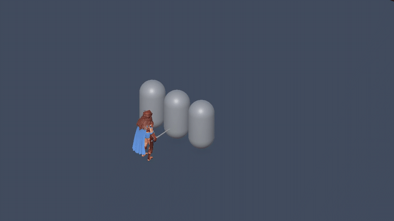

검 궁극기의 범위 타격

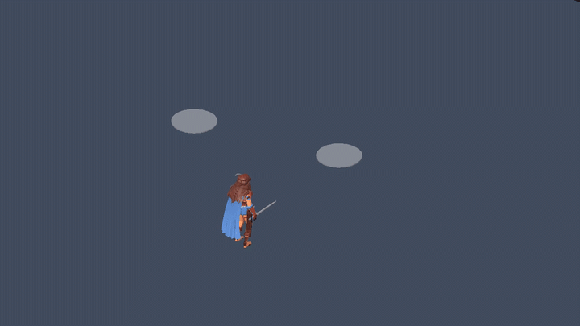

방어 포인트 배치·플레이어 추종·재배치

**기능 시연 영상**

[기능 시연 영상 열기 (MP4)](Docs/PortfolioMedia/dungeon-hold-reel.mp4)

검·활·스태프의 기본 공격·스킬·궁극기와 동료 운용 시연 · 약 33초 · 무음

**스태프 궁극기**

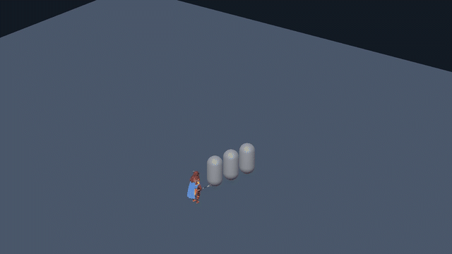

지정 위치에 불기둥을 생성하고 범위 안의 대상에 주기 피해

**플레이 영상**

[플레이 영상 열기 (MP4)](Docs/PortfolioMedia/dungeon-hold-play.mp4)

동료 배치 → 웨이브 시작 → 기본 공격·스킬·궁극기 사용 · 약 35초 · 게임 사운드 포함

[**\[GitHub 저장소\]**](https://github.com/jlfff0233-boop/DungeonHold)

---

## 1. 프로젝트 개요

### 게임 소개

**던전 홀드 · Dungeon Hold**는 플레이어가 직접 전투하고 동료·설치물을 운용해 몬스터의 던전 탈출을 막는 3D 액션 디펜스 게임입니다. 웨이브를 방어해 스테이지를 클리어하며, 적 통과 한도나 방어 목표 HP에 따라 실패할 수 있습니다.

처치로 얻은 스테이지 재화는 해당 도전의 동료·설치물 운용에, 영구 재화는 다음 도전을 위한 구매·강화에 사용합니다.

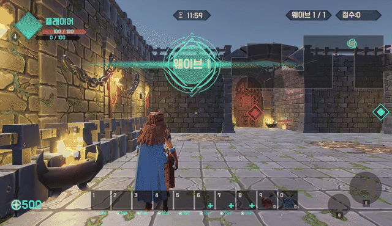

Stage1에서 적이 생성되고, 플레이어가 검 기본 공격을 실행하는 모습.

### 전체 플레이 흐름

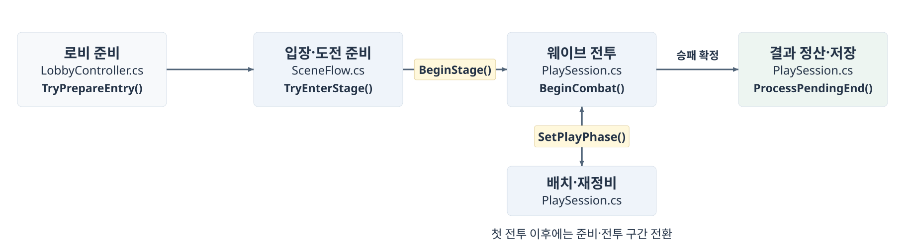

로비 준비·입장, 첫 전투 이후의 준비·전투 구간 전환, 도전 종료 정산의 주요 흐름

### 주요 구현

- 무기별 전투 구성 및 공통 피해 처리
- 동료 고용·배치·재고용 시스템
- 스테이지 정산·진행 저장 및 Firebase 백업·복원
- 공용 VFX 수명 관리 및 프리팹 배정 도구
- 입력 키 재지정 및 저장

### 전체 게임 아키텍처

`GameManager`가 씬 간 유지되는 공통 시스템을 관리하고, `PlayScene`과 `PlaySession`이 전투 준비부터 도전 종료·정산까지 조율합니다. `LobbyController`는 입장 정보를 준비하며, `SceneFlow`·`SceneMove`가 입장·재도전·로비 복귀의 씬 전환을 담당합니다.

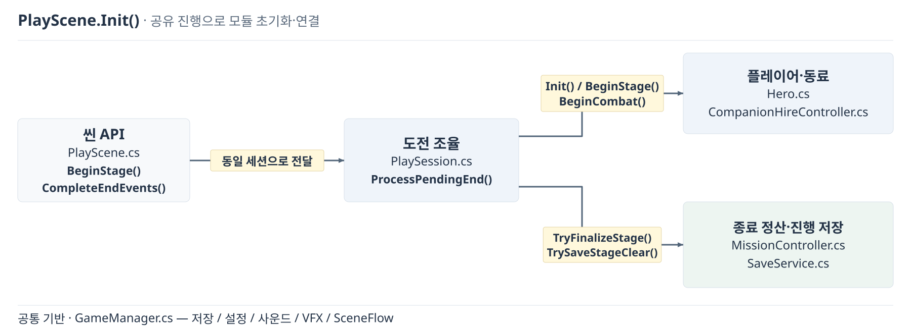

PlayScene의 외부 요청 전달과 PlaySession의 플레이어·동료 준비 및 종료 정산 조율

---

## 팀장 역할과 협업 조율

개발 초반에 기획서와 시스템 문서를 정리하고, 팀원의 경험과 희망 역할을 고려해 담당을 나눴습니다.

### 담당 범위

| 구분 | 담당 범위 |
| --- | --- |
| 본인 | **기존** · 플레이어·무기·동료, 공통 피해·상태 효과, 성장·경제·저장, 로비·도감 로직, 씬 이동<br />**추가** · 설정 로직·사운드 재생과 볼륨 제어, VFX 공용 재생·정리 코드, VFX 프리팹 검사·생성·배정 에디터 도구 |
| 팀원 A — 적·스테이지 | 적 AI·설치물·웨이브·스테이지·승패/별/점수 판정 |
| 팀원 B — UI·연출 | 로비·HUD·결과 등 화면 UI, 화면 전환, 웨이브·보스·승패 관련 화면 연출 |
| 팀원 C — UI 리소스 제작 | 공통 · 공통 UI, 입력 안내<br />인게임 · 플레이어, 동료, 보스, 웨이브, 월드 UI, 연속 처치<br />로비 · 도감, 스테이지, 난이도, 맵 설명, 탐험 미션<br />알림 · 튜토리얼 |
| 팀원 D — UI 리소스 제작 | 공통 · 상태이상, 재화<br />인게임 · 스킬, 아이템, 설치, 전투 보조, 추가 전투<br />로비 · 상점, 강화, 클리어, 실패<br />알림 · 알림 UI, 시스템 UI |
| 팀원 C·D — 공동 작업 | 연출용 UI 리소스 제작 |

### 기획 제안과 개발 방향 결정

팀원들이 구체적인 안을 놓고 논의할 수 있도록 초반에 여러 기획안을 정리해 공유했습니다. 함께 검토하면서 6주 안에 멀티플레이를 구현할 수 있는지, UI와 리소스 담당자가 맡을 제작 범위가 충분한지를 살폈습니다. 초기 후보를 검토한 뒤에는 새 레퍼런스를 찾아 *Orcs Must Die! 3*를 바탕으로 3인칭 액션 디펜스를 제안했습니다.

팀에서 이 방향을 채택한 뒤, 플레이어가 직접 전투하면서 동료와 설치물을 운용하는 흐름을 시스템 기획서로 정리하고 UI 제작에 필요한 항목도 함께 공유했습니다.

[26.10.07(초기 기획안 모음 (A\~E))](https://app.notion.com/p/3f2c6a9b1cf98060af5ef74c2fdcbe23) · [팀 프로젝트 A안 26.10.06 — 협동, 관리, 운반](https://app.notion.com/p/3f1c6a9b1cf981ec90b5c0867926dc03) · [던전 홀드 · Dungeon Hold — 시스템 기획 정리(26.11.08 갱신)](https://app.notion.com/p/3f2c6a9b1cf9811b80d4db22fb15b2b7)

### 파트 간 공통 데이터 규약

#### 공통 피해 처리

플레이어와 동료, 적과 설치물이 같은 방식으로 피해를 주고받을 수 있도록 공통 피해 처리 구조를 구현했습니다. 공격을 만든 쪽에서 공격 주체·진영·원본 피해를 `DamageInfo`로 넘기고, 피해를 받는 쪽에서 이를 처리합니다. 팀원이 구현한 적 공격과 가시 함정도 이 규약을 사용합니다.

```cs
float TakeDamage ( DamageInfo damageInfo );
```

[피해 수신 인터페이스](https://github.com/jlfff0233-boop/DungeonHold/blob/main/Assets/02.%20Scripts/Combat/IDamageable.cs#L11) · [가시 함정 호출부](https://github.com/jlfff0233-boop/DungeonHold/blob/main/Assets/02.%20Scripts/KMB/Installation/SpikeTrap.cs#L165-L196)

#### 미니맵 역할 분담

기획서에 미니맵은 있었지만 위치와 표시 여부를 누가 제공할지는 정해지지 않았습니다. 팀원과 논의해 맵 담당은 공용 대상 코드와 적 연결·맵 기준 좌표를, UI 담당은 지도 좌표 변환과 아이콘 표시를 맡기로 했습니다. 저는 공용 코드에서 플레이어 위치를 읽을 수 있게 연결하고, 사망하면 표시를 끄고 부활하면 다시 켜도록 구현했습니다.

PlayerTest에서 사망·부활에 따라 플레이어의 미니맵 표시 상태가 바뀌는 것을 확인했습니다. 실제 화면 표시는 UI 연결 단계에 남겨 두었습니다.

[공용 대상 코드](https://github.com/jlfff0233-boop/DungeonHold/blob/main/Assets/02.%20Scripts/KMB/Minimap/MinimapTarget.cs#L22-L34) · [적 미니맵 표시 조건](https://github.com/jlfff0233-boop/DungeonHold/blob/main/Assets/02.%20Scripts/KMB/Minimap/EnemyMinimapTarget.cs#L21-L31) · [플레이어 사망·부활 연결](https://github.com/jlfff0233-boop/DungeonHold/blob/main/Assets/02.%20Scripts/Hero/Hero.cs#L776-L807)

### 연계 작업 우선순위와 인계

다른 팀원이 제 기능을 받아 작업할 수 있도록 연계되는 부분을 우선했습니다. 한 판의 흐름을 연결해야 할 때는 저장 작업보다 입장·전투·종료·재시도의 공통 연결부를 먼저 정리했습니다. 로비와 플레이 씬의 기반을 병합한 뒤에는 스테이지 담당이 연결할 맵 준비·종료 처리와 UI 담당이 연결할 결과 화면·재도전·복귀를 나눠 공유했습니다.

각자 담당 브랜치에서 작업하고 PR로 `main`에 병합했습니다. 공용 씬은 한 번에 한 명이 수정하고, 저장·커밋·푸시를 마친 뒤 다음 담당자에게 넘기기로 했습니다. 기능 간 연결이 바뀌면 연계 가이드에 요청 방법과 확인 범위를 갱신했습니다.

### 전투 HUD 시안 검토와 방향 합의

UI 리소스 담당자가 장비와 아이템이 화면 양쪽에 나뉘면 사용하기 불편할 수 있다고 보고, 무기·설치물·소비 아이템을 중앙에 모으고 스킬을 우측 하단에 배치하는 시안을 제안했습니다. 저는 전투 중 필요한 정보를 찾고 조작하기에 더 편하다고 판단해 그 시안을 UI 기획서의 기준으로 삼기로 했습니다.

UI 구현 담당은 공유된 배치를 바탕으로 임시 화면 작업을 시작했습니다. 리소스 제작 담당자 두 명에게는 1920×1080을 공통 작업 기준으로 전달했습니다.

UI 세부 작업이 남았을 때는 UI 담당이 화면과 연출에 집중할 수 있도록 제가 설정·사운드·공용 VFX 로직을 추가로 맡았습니다.

---

## 2. 핵심 구현

### 2-1. Firebase 수동 백업·복원

플레이 진행은 로컬에 저장합니다. 사용자가 요청하면 익명 인증을 거쳐 Firestore에 백업하거나 기존 백업을 불러옵니다.

Firestore는 사용자별 백업을 문서 하나로 관리하고 저장 항목을 확장하기 쉽도록 선택했습니다. 백업 교체에는 이 문서의 갱신 시각을 사용하고, 복원 전에는 현재 로컬 진행을 별도로 보관합니다.

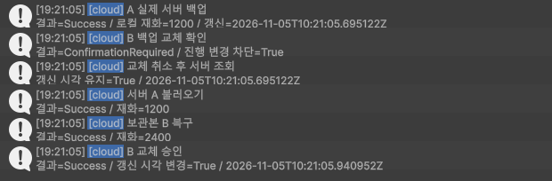

서버 백업의 재화 1,200을 불러온 뒤 보관본으로 재화 2,400을 복구합니다. 백업 교체를 취소하면 서버 갱신 시각이 유지되고, 승인한 뒤에만 바뀝니다.

#### 백업할 데이터를 준비하고 교체 확인

백업을 요청하면 현재 저장된 진행을 JSON으로 준비한 뒤 서버에 기존 백업이 있는지 조회합니다. 백업이 없으면 바로 전송하고, 있으면 교체 여부를 확인받습니다.

교체를 승인하면 확인을 받기 전에 준비해 둔 데이터를 전송합니다. 진행 데이터를 사용하는 로비·플레이 중에는 백업과 불러오기를 제한하고, 교체 확인을 기다리는 동안에는 진행 변경도 막습니다.

#### 조회한 백업이 바뀌지 않았을 때만 교체

백업은 사용자별로 `users/{uid}/saves/0` 문서에 저장합니다. 처음 백업할 때는 문서가 없는 경우에만 생성하고, 기존 백업을 교체할 때는 조회했던 `updateTime`이 같은 경우에만 저장하도록 요청합니다.

**실제 코드 — FirebaseBackupStorage.cs의 교체 조건 구성**

```cs
string condition = expectedUpdatedAt == null
    ? "?currentDocument.exists=false"
    : "?currentDocument.updateTime="
        + UnityWebRequest.EscapeURL ( expectedUpdatedAt );
```

조회 뒤 다른 요청이 백업을 갱신했다면 교체를 거절합니다. 서버가 저장한 뒤 응답이 끊길 수도 있으므로, 저장 여부를 알 수 없을 때는 `UploadUnconfirmed`를 반환하고 자동 재전송을 멈춥니다.

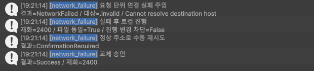

백업 요청의 연결 실패 후에도 로컬 파일과 재화를 유지합니다. 정상 주소로 다시 요청하고 교체를 승인하면 백업을 완료합니다.

#### 불러오기 전 로컬 파일 보관

백업을 내려받으면 파일의 구조·버전과 현재 게임 설정에 맞는 데이터인지 검사합니다. 검사가 끝나면 현재 로컬 파일을 보관한 뒤 백업의 진행을 반영합니다. 검사·보관·저장 중 어느 단계에서 실패해도 기존 진행을 유지하며, 이미 복원한 뒤에도 보관본으로 되돌릴 수 있습니다. 보관본 복구는 로컬에서 처리합니다.

<details>
<summary>복원 후 보관본으로 되돌리기</summary>

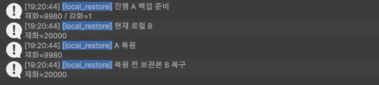

로컬 재화 20,000 → 백업의 9,980 복원 → 복원 전 보관본의 20,000 복구.

</details>

재실행 후 같은 백업에 접근할 수 있도록 익명 UID와 갱신 토큰을 Windows 자격 증명 저장소에 보관했습니다. 인증 정보를 읽거나 갱신하지 못하면 오류를 반환합니다.

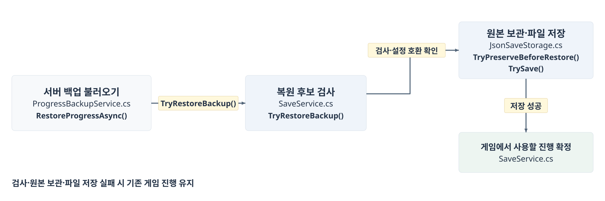

복원 후보 검사와 원본 보관·파일 저장을 마친 뒤 게임에서 사용할 진행을 확정합니다.

**코드**: [백업 조율](https://github.com/jlfff0233-boop/DungeonHold/blob/main/Assets/02.%20Scripts/Save/Backup/ProgressBackupService.cs) · [조건부 쓰기](https://github.com/jlfff0233-boop/DungeonHold/blob/main/Assets/02.%20Scripts/Save/Backup/FirebaseBackupStorage.cs) · [복원·복구](https://github.com/jlfff0233-boop/DungeonHold/blob/main/Assets/02.%20Scripts/Save/SaveService.cs)

---

### 2-2. VFX 공용 재생·수명 관리와 프리팹 배정 도구

화상 효과는 상태가 끝난 뒤에도 캐릭터를 따라가며 사라져야 하지만, 화살의 잔상은 화살이 멈춘 위치에 남아야 합니다. 캐릭터가 사망하거나 비활성화됐을 때는 남은 상태 효과도 정리해야 합니다.

이 차이에 맞춰 **방출 중단·추적 종료·즉시 제거**를 구분했습니다. 상태 효과가 만료되는 경우와 캐릭터가 사망하는 경우에 서로 다른 종료 방식을 사용합니다.

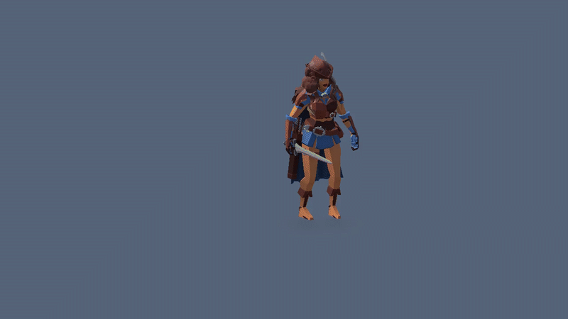

화상 만료 후 새 방출을 멈추고, 남은 효과는 이동하는 캐릭터를 따라가며 사라집니다.

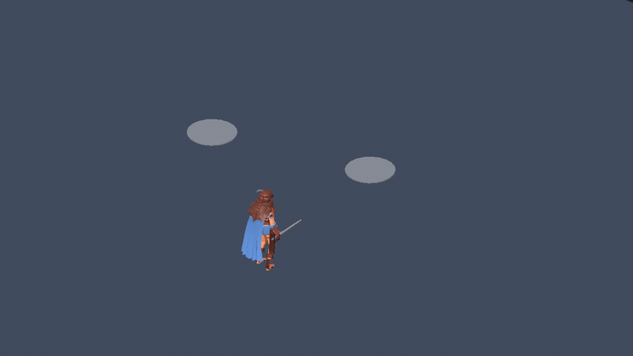

기절 중 동료가 사망하면 남은 상태 VFX를 정리합니다.

#### 상태 만료·투사체 종료·사망에 따른 정리

| 요청 | 방출 | 기준점 추적 | 잔여 출력 |
| --- | --- | --- | --- |
| StopEmission | 중단 | 유지 | 자연 소멸 |
| Stop | 중단 | 중단·분리 | 마지막 월드 위치에 유지 |
| Clear | 중단 | 중단 | 파티클·트레일 즉시 제거 |

상태 만료에는 `StopEmission`, 투사체 정상 종료에는 `Stop`, 소유자 제거 등 즉시 정리에는 `Clear`를 사용합니다.

`VfxManager`가 효과를 생성하고 매 프레임 위치와 재생 상태를 갱신한 뒤, 출력이 끝나면 제거합니다. 화상·감속·기절의 시각 효과는 `CharacterVfx`가 관리합니다.

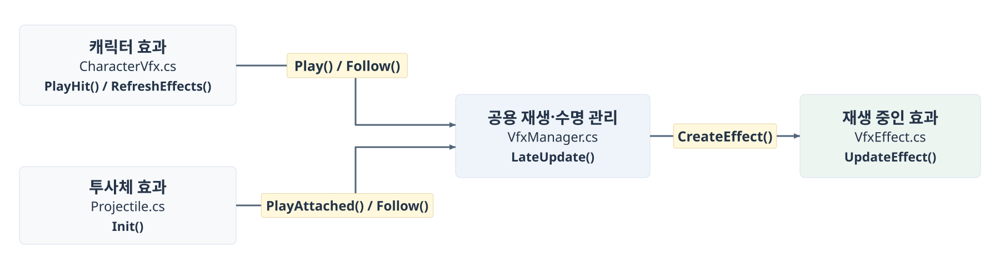

캐릭터와 투사체의 재생 요청을 공용 매니저에 모으고, 효과 생성과 수명 갱신을 관리합니다.

**실제 코드 — CharacterVfx.cs의 상태 만료 처리 일부**

```cs
VfxEffect effect = instance;
instance = null;
//방출은 끝내되 사망 시 정리할 참조는 보관
effect.StopEmission ( );
_tails.Add( effect );
```

만료 후 남은 효과의 참조도 보관해, 캐릭터가 사망하거나 비활성화되면 함께 제거합니다.

효과마다 전투 종료 때 정리할지, 연출로 유지할지 지정할 수 있습니다. 일시정지 중 재생이 필요한 효과에는 비배율 시간을 사용합니다.

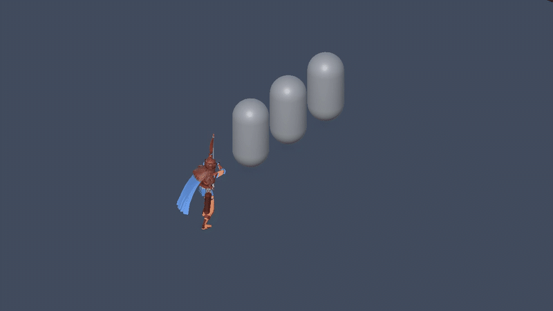

화살 비행 → 충돌·투사체 제거 → 마지막 월드 위치에서 잔상 소멸 · 0.25배속

#### VFX Setup — 검사 후 생성·배정

여러 캐릭터와 공격에 효과를 붙일 때 원본을 찾아 프리팹을 만들고 사용처에 연결하는 작업이 반복됐습니다. VFX Setup에서 효과 원본과 사용처를 선택하면 기존 연결과 배정 충돌을 검사하고, 변경 목록을 확인한 뒤 프리팹 생성·갱신과 참조 배정을 한 번에 적용할 수 있습니다.

- 사용처에 필요한 단발/유지 방식과 월드/UI 출력 종류가 맞는지 검사합니다.
- 기존에 연결된 효과는 유지하고, 교체를 허용한 항목만 바꿉니다.
- 프리팹의 상속 관계와 오버라이드를 확인해 수정할 대상을 찾습니다.
- 여러 배정이 같은 필드를 서로 다른 효과로 바꾸려고 하면 충돌을 표시합니다.
- 검사 후 설정이나 대상이 바뀌면 다시 확인하도록, 적용 직전 변경 목록을 대조합니다.

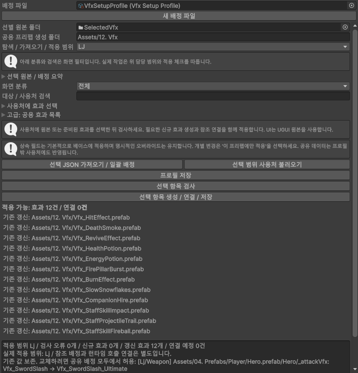

VFX Setup에서 사용처를 검사하고, 기존 연결의 보존 여부와 효과 생성·갱신 계획을 확인합니다.

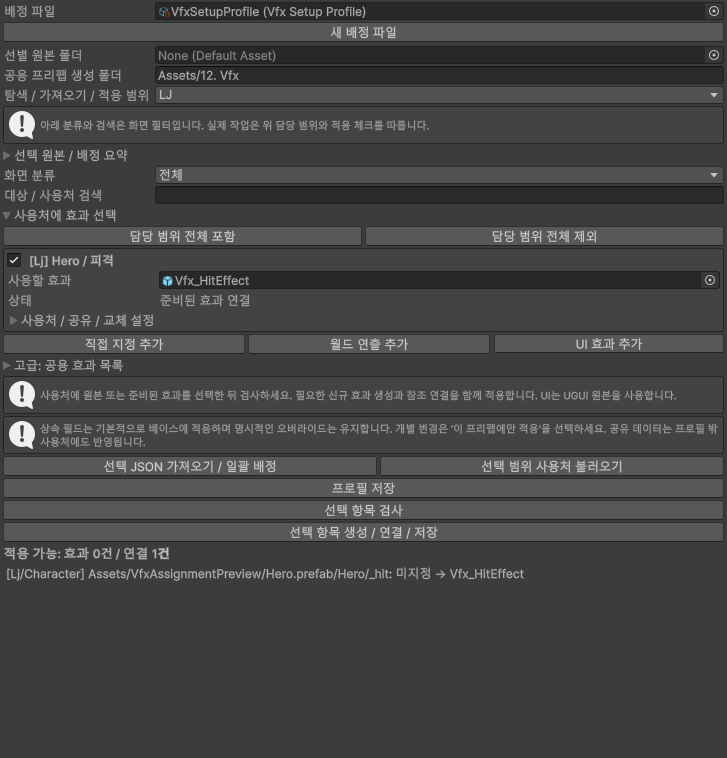

적용 전 · 플레이어 피격 효과의 배정 대상 확인

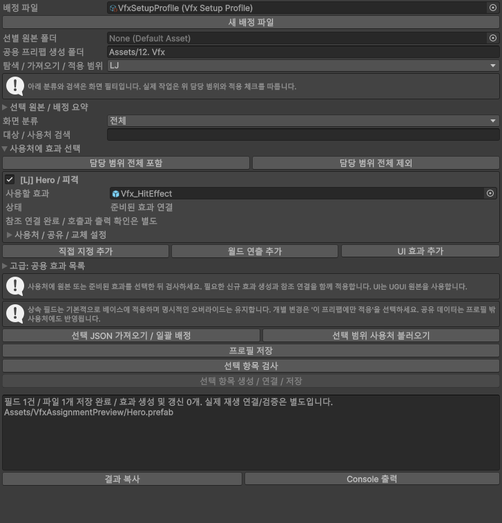

적용 후 · 플레이어 피격 효과에 Vfx\_HitEffect 참조 연결

파티클·트레일과 UGUI 원본은 지원하는 구성에 맞춰 생성합니다. 스크립트나 별도 애니메이션이 포함된 효과는 수동으로 구성한 프리팹을 지정할 수 있습니다. 도구는 효과의 생성·설정·배정을 담당하고, 실제 재생 시점은 각 기능의 호출부에서 결정합니다.

UI 효과는 **Graphic/Animator로 구성한 프리팹을 화면별로 생성**하도록 구현했습니다. 단발 효과는 지정한 시간이 지나면 제거하고, 화면을 닫으면 해당 화면에서 생성한 효과를 함께 정리합니다.

공용 재생 코드와 배정 도구를 만들고, 무기 공격·피격에 쓰는 월드 효과를 설정해 연결했습니다.

**코드**: [출력 수명](https://github.com/jlfff0233-boop/DungeonHold/blob/main/Assets/02.%20Scripts/Vfx/VfxEffect.cs) · [캐릭터 소유](https://github.com/jlfff0233-boop/DungeonHold/blob/main/Assets/02.%20Scripts/Vfx/CharacterVfx.cs) · [셋업 검사·적용](https://github.com/jlfff0233-boop/DungeonHold/blob/main/Assets/10.%20Editor/VfxSetupUtility.cs)

---

### 2-3. 무기 선택에 따른 전투 구성과 공격 실행

플레이어는 스테이지에 들어가기 전에 검·활·스태프 중 하나를 선택합니다. 무기에 따라 이동 속도·모델·모션과 공격 방식이 달라지며, 피해 처리는 공통 규칙을 사용합니다. 예를 들어 활은 공격 모션이 끝난 뒤 화살이 적중해도 발사 당시의 정보로 피해를 처리합니다.

| 무기 | 기본 공격 | 기본 스킬 | 궁극기 |
| --- | --- | --- | --- |
| 검 | 근접 범위 타격 | 전방 피해·넉백 | 범위 공격 |
| 활 | 직격 화살 | 여러 대상을 통과하는 관통 화살 | 위치 지정 화살비 |
| 스태프 | 폭발·화상 투사체 | 강화 폭발 투사체 | 위치 지정 불기둥 |

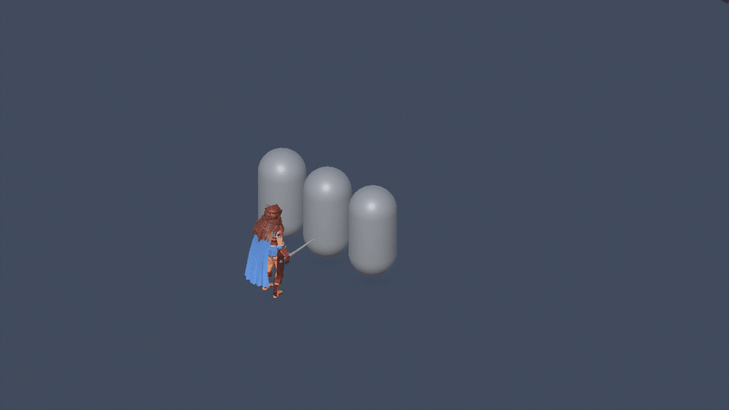

검 기본 공격: 전방의 여러 표적에 범위 피해

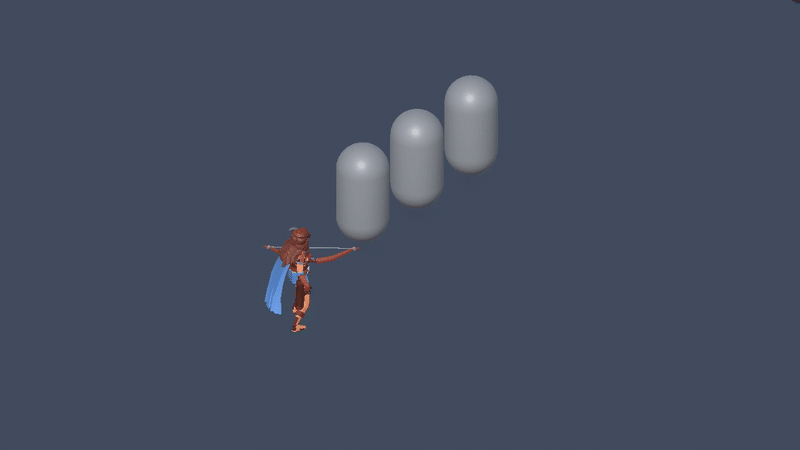

활 스킬: 화살 하나가 세 표적을 관통하며 각 표적에 한 번씩 피해

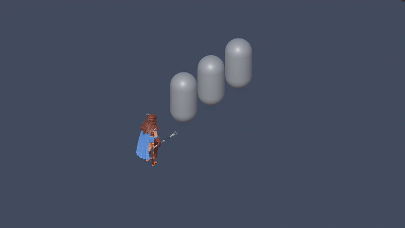

스태프 기본 공격: 폭발 피해 이후 화상 틱 피해

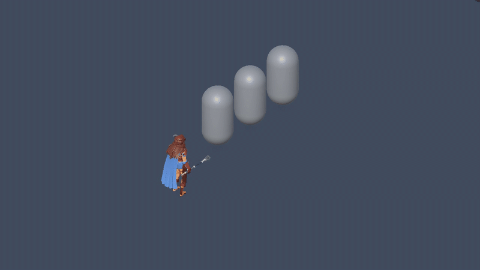

스태프 스킬: 강화 폭발 투사체

#### 선택한 무기에 맞춰 캐릭터 설정

무기마다 필요한 능력치와 이동 속도, 스킬·궁극기, Animator Override를 `WeaponData`에 설정했습니다. 캐릭터에는 `HeroWeaponBinding`으로 각 무기의 공격 실행자·모델·피해 발생원을 연결합니다.

입장 시 필수 설정을 검사하고 선택한 무기의 공격·스킬·모델·모션을 적용합니다. HP 변경 알림에서도 선택 무기를 조회할 수 있도록 무기 설정을 먼저 반영한 뒤 HP를 초기화합니다.

#### 공통 피해 수신과 체력 처리

`DamageReceiver`는 무기와 관계없이 같은 피해 규칙을 적용합니다. 자신이나 같은 진영을 향한 공격, 무적 상태의 대상에 대한 공격은 거절합니다. 받을 수 있는 피해는 감소율을 적용한 뒤 `Health`에서 HP와 사망 여부에 반영합니다.

공격을 실행한 쪽에는 실제로 줄어든 HP와 이번 공격으로 대상이 쓰러졌는지를 돌려줍니다. 이 결과를 기준으로 궁극기 에너지를 충전하거나 검 스킬의 후속 넉백을 처리합니다.

#### 모션이 끝난 뒤에도 남는 공격 처리

화살은 공격 모션이 끝난 뒤에도 날아가 적에게 맞을 수 있고, 화살비·불기둥은 여러 번에 걸쳐 피해를 줍니다. 모션이 끝나도 생성된 공격이 원래 정보로 동작하도록 `AttackExecution`에 공격 정보와 실행 상태를 보관했습니다.

일반 행동 취소나 플레이어 사망 이후에도 이미 생성된 공격은 유지합니다. 캐릭터 비활성화·재초기화·도전 정리에서는 남은 실행을 무효화하고, 투사체와 지속 영역이 이를 확인해 이후 피해 처리를 중단합니다.

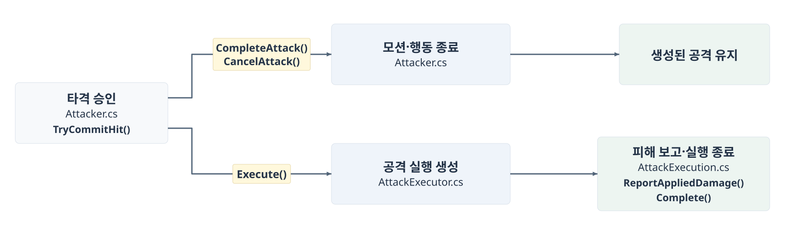

모션·행동 종료와 생성된 공격 실행은 별도 수명으로 관리합니다. 도전 정리에서는 남은 실행을 무효화합니다.

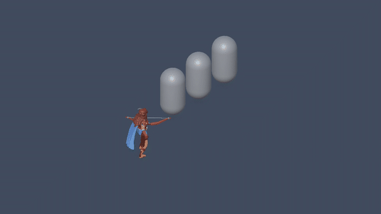

지정 위치에 화살비를 생성하고 낙하·착지 효과와 주기 피해를 처리합니다.

#### 실제 적중을 기준으로 에너지 충전

기본 스킬과 궁극기에 쓰는 에너지는 기본 공격으로 적에게 실제 피해를 줬을 때 충전됩니다. 한 번의 공격으로 여러 적을 맞혀도 처음 피해가 적용된 시점에만 충전합니다.

**실제 코드 — AttackExecution.cs**

```cs
public void ReportAppliedDamage ( float appliedDamage )
{
    if ( _isActive == false
        || _hasValidHit == true
        || appliedDamage <= 0f )
        return;

    //알림보다 먼저 기록하여 같은 실행의 중복 충전 방지
    _hasValidHit = true;
    _onFirstValidHit?.Invoke ( Context );
}
```

충전 알림은 기본 공격에 연결했습니다. 빗나간 공격이나 스킬·화상 틱에서는 기본 공격 에너지가 추가되지 않습니다.

#### 궁극기 조준·확정·취소

활·스태프 궁극기는 지면의 시전 위치를 조준하고, 사용할 수 있는 위치인지 표시합니다. 확정 입력이 들어오면 위치를 다시 확인한 뒤 궁극기 사용 조건을 검사하고 에너지를 소비합니다. 조준을 취소하면 선택 중이던 위치를 해제합니다.

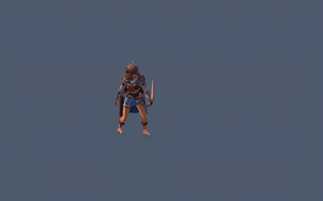

활 궁극기의 지면 조준 취소와 시전 확정.

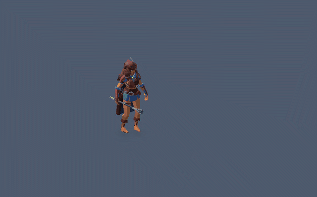

스태프 궁극기의 지면 조준 취소와 시전 확정.

**코드**: [무기 구성](https://github.com/jlfff0233-boop/DungeonHold/blob/main/Assets/02.%20Scripts/Hero/HeroWeaponSetup.cs) · [공격 실행](https://github.com/jlfff0233-boop/DungeonHold/blob/main/Assets/02.%20Scripts/Combat/AttackExecution.cs) · [궁극기 조준](https://github.com/jlfff0233-boop/DungeonHold/blob/main/Assets/02.%20Scripts/Hero/HeroUltimateAim.cs)

#### 플레이어 애니메이터 — 방향별 이동과 전투 모션

이동과 구르기는 전신을 담당하는 Base Layer에서 처리하고, 이동 중 무기 자세는 UpperStance에, 일반 공격·피격·궁극기 준비 자세는 상체 마스크를 적용한 Attack 레이어에 배치했습니다. 검·활·스태프는 같은 상태 구조를 사용하며, 무기에 따라 필요한 클립을 Animator Override Controller로 교체합니다.

- **방향별 이동** · 매 프레임 실제 수평 이동량을 캐릭터 기준 방향으로 바꿔 `MoveX`·`MoveZ`에 전달합니다. 2D Blend Tree에서 전진·후진·좌우 이동 클립을 섞습니다.
- **구르기** · 회피가 승인되면 상체 자세와 공격 표현을 정리하고 전신 Dodge 상태로 전환합니다. 구르기가 끝날 때 이동 계산의 기준 위치를 갱신해 마지막 구르기 이동량이 일반 이동 속도로 남지 않게 했습니다.
- **피격** · 접지 상태에서 행동 가능한 경우 일반 피격을 상체에서 재생합니다. 전신 넉백 중에는 일반 피격 요청을 걸러 두 표현이 겹치지 않도록 했습니다.
- **궁극기 준비** · 활·스태프로 지면 조준을 시작하면 상체 준비 자세를 요청합니다. 취소하면 준비 자세를 해제하고, 시전이 승인되면 상체 레이어를 정리한 뒤 전신 궁극기 모션으로 전환합니다.
- **활 조준 보정** · 앞뒤로 걸을 때도 조준 자세를 유지하고 공격으로 부드럽게 전환합니다. 발사 순간에는 활과 상체를 실제 화살 방향에 맞췄습니다.

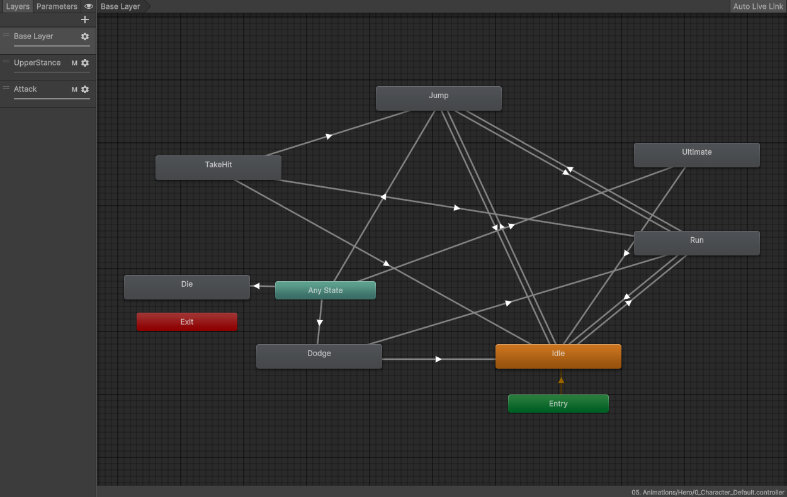

Base Layer에서 전신 이동과 구르기를 전환합니다.

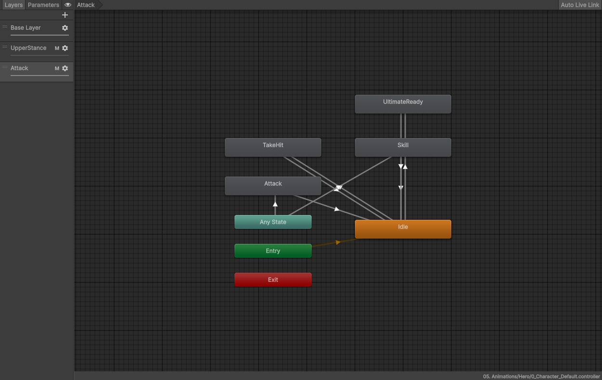

Attack 레이어에서 상체 공격·스킬·피격·궁극기 준비 모션을 전환합니다.

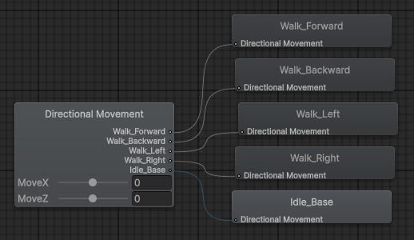

MoveX·MoveZ 값에 따라 제자리와 앞뒤좌우 이동 클립을 섞는 2D Blend Tree.

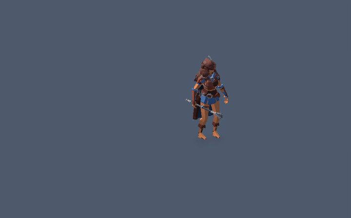

스태프 장착 상태에서 앞뒤좌우 이동 → 구르기 → 이동 복귀.

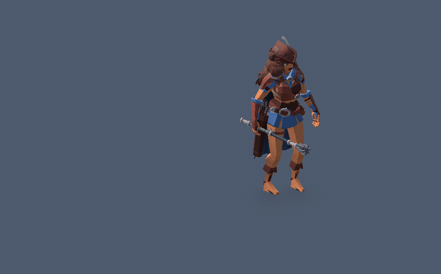

일반 피격은 상체에, 넉백은 전신에 재생됩니다.

[AnimatorHandler](https://github.com/jlfff0233-boop/DungeonHold/blob/main/Assets/02.%20Scripts/Animation/AnimatorHandler.cs) · [기본 Animator Controller](https://github.com/jlfff0233-boop/DungeonHold/blob/main/Assets/05.%20Animations/Hero/0_Character_Default.controller)

---

### 2-4. 동료 고용·배치·재고용

재화로 동료를 고용하면 방어 지점을 맡기거나 플레이어를 따라 싸우게 할 수 있습니다. 같은 종류의 동료를 둘 고용했을 때 한 명이 사망하면, 살아 있는 동료는 계속 싸우고 사망한 동료만 대기 후 재고용할 수 있습니다.

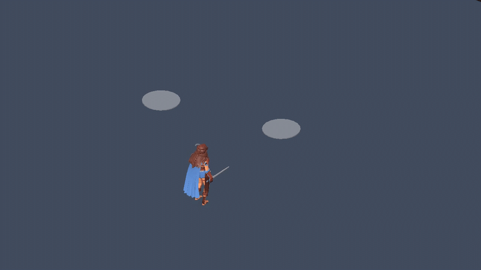

같은 타입 두 명 고용 → 한 명 사망 → 생존 동료 유지 → 대기 후 같은 고용 번호로 재고용

#### 준비 배치와 첫 전투 진입

전투 준비 중 동료를 고용하면 비용을 차감하고 고용 기록을 만듭니다. 맵의 방어 포인트에 배치한 동료는 그 지점을 지킵니다. 배치하지 않은 동료는 첫 전투가 시작될 때 플레이어를 따라가는 추종형으로 생성합니다.

모든 동료의 준비가 끝나야 전투를 시작합니다. 추종형을 일부 생성하지 못하면 이번에 자동으로 만든 동료만 제거해 배치 대기로 돌립니다. 이미 방어 포인트에 배치한 동료는 그대로 유지합니다.

동료를 다시 배치할 때는 새 위치에 놓을 수 있는지 확인한 뒤 현재 동료를 옮깁니다. 같은 동료가 이동하므로 HP·공격 쿨타임·강화 효과가 유지됩니다.

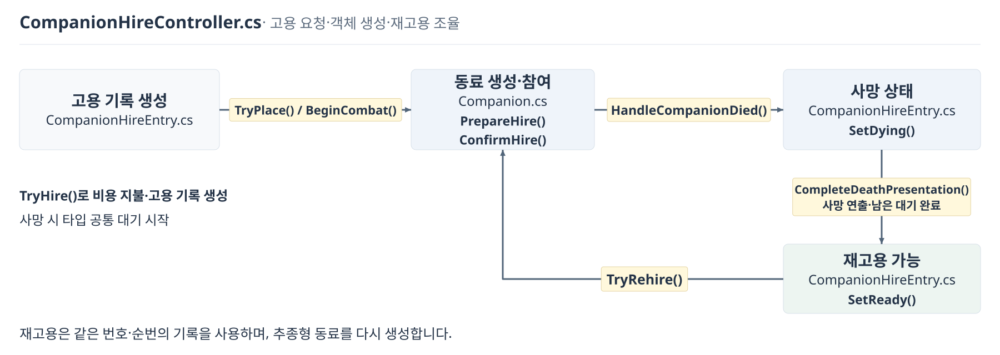

고용 기록을 유지하면서 동료 객체를 생성·제거합니다. 사망 시 같은 종류 동료의 재고용 대기를 시작하고, 연출과 대기 완료 후 같은 기록으로 재고용합니다.


포인트 방어와 플레이어 추종을 비교하고, 같은 동료 객체의 HP를 유지한 채 다른 포인트로 재배치합니다.

#### 개별 사망과 같은 종류의 재고용 대기

동료는 기본 설정에서 최대 2명까지 고용할 수 있고, 같은 타입도 중복 고용할 수 있습니다. 사망 후 재고용을 기다리는 기록도 인원 제한에 포함합니다.

동료가 사망하면 해당 종류의 재고용 대기가 시작됩니다. 대기 중 같은 종류의 동료가 또 사망하면 그 종류의 대기가 처음부터 다시 시작됩니다. 사망 연출과 대기가 모두 끝나고 스테이지 재화가 충분하면, 웨이브 중에도 다시 고용할 수 있습니다.

재고용한 동료는 이전 고용 번호와 순번을 이어받습니다. 미션은 고용 번호로 참여를 기록하기 때문에, 재고용하거나 다음 웨이브에 들어와도 같은 동료를 새 참여 인원으로 세지 않습니다.

#### 공격 목표와 가까운 위협의 구분

공격 대상은 활동 범위 안에서 찾되, 전달받은 방어 목표에 가까운 적을 우선합니다. 원거리 동료가 후퇴해야 하는지는 별도로 찾은 **자신에게 가장 가까운 적**을 기준으로 판단합니다.

근접형의 접근과 원거리형의 후퇴·복귀는 동료 행동에서 판단하고, 실제 이동·탐색은 해당 모듈에 요청합니다. HP·피해 수신·공격은 공통 전투 모듈을 사용합니다.

**코드**: [고용·배치·대기](https://github.com/jlfff0233-boop/DungeonHold/blob/main/Assets/02.%20Scripts/Companion/Hire/CompanionHireController.cs) · [고용 기록](https://github.com/jlfff0233-boop/DungeonHold/blob/main/Assets/02.%20Scripts/Companion/Hire/CompanionHireEntry.cs) · [공격 대상·위협 탐색](https://github.com/jlfff0233-boop/DungeonHold/blob/main/Assets/02.%20Scripts/Companion/Attack/CompanionTargetDetector.cs)

---

### 2-5. 키 재지정·저장·복원

키 변경 창에서 누른 버튼이나 새 키가 이동·공격으로 전달되지 않도록, 입력을 놓는 프레임까지 게임 조작을 차단합니다. 이동·공격·스킬·슬롯 선택 등 22개 액션의 30개 키 배정을 키보드와 마우스로 바꿀 수 있습니다.

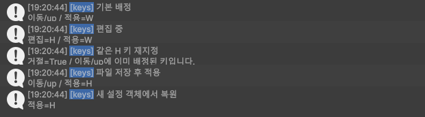

편집 중에는 H로 바꿔도 적용값 W를 유지하고, 저장 후 H를 적용합니다. 중복 배정을 거절하고 새 설정 객체에서도 저장값을 복원합니다.

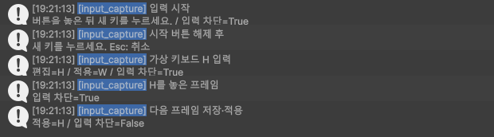

입력 대기 → H 입력 포착 → 키를 놓은 프레임까지 게임 입력 차단 → 다음 프레임 저장·적용.

키 변경 버튼을 누른 클릭이 새 단축키로 등록되지 않도록, 버튼을 놓은 뒤부터 입력을 받습니다. 입력을 받으면 예약된 키나 다른 배정과 겹치는지 검사하고, 게임 입력과 분리해 둔 편집용 액션에 반영합니다.

저장에 성공한 뒤 실제 입력을 바꿉니다. 저장이 실패하면 기존 키와 편집값을 모두 유지해 다시 시도할 수 있습니다. 재실행할 때는 바인딩 ID로 저장값을 복원한 뒤 전체 배정의 중복을 검사합니다. 기존 입력 액션의 참조는 유지합니다.

단축키는 영구 진행과 별도 파일에 저장하므로 진행 데이터를 삭제하거나 Firebase 백업을 불러와도 설정 파일은 유지합니다.

**코드**: [입력 편집·적용](https://github.com/jlfff0233-boop/DungeonHold/blob/main/Assets/02.%20Scripts/Settings/KeyBindingSettings.cs) · [입력 전달 차단](https://github.com/jlfff0233-boop/DungeonHold/blob/main/Assets/02.%20Scripts/InputHandler/InputHandler.cs)

---

## 3. 트러블슈팅

### 3-1. 필수 JSON 목록 누락이 정상 빈 목록으로 처리되는 문제

#### 문제·원인

저장 파일에서 필수 배열이 빠졌는데도 JsonUtility가 빈 목록으로 보완해, 손상된 파일을 정상 데이터처럼 읽는 문제가 있었습니다. 변환된 목록만 검사하면 필드가 누락된 경우와 정상적으로 빈 배열을 저장한 경우를 구분할 수 없었습니다.

#### 해결

`SaveJsonReader`에 Newtonsoft JObject 기반의 JSON 원문 검사를 추가했습니다.

| 수정 전 | 수정 후 |
| --- | --- |
| 변환된 목록만 검사 | 원문의 필수 배열 존재·타입을 먼저 검사 |
| 누락과 정상 빈 배열을 구분하기 어려움 | 누락/null/타입 오류는 거절하고 정상 빈 배열은 허용 |
| 손상을 기본값으로 받아들일 수 있음 | 실패 반환 후 원본 파일 유지 |

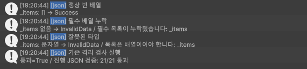

정상 빈 배열은 허용하고, 필수 배열 누락과 타입 오류는 거절합니다. 진행 JSON 검사 21/21 통과.

#### 결과

격리 검사에서 필수 배열이 누락되거나 타입이 잘못된 파일을 거절했고, 실패한 경우에도 기존 저장 파일을 유지했습니다.

**코드**: [JSON 원문 검사](https://github.com/jlfff0233-boop/DungeonHold/blob/main/Assets/02.%20Scripts/Save/SaveJsonReader.cs) · [오류 기록](https://github.com/jlfff0233-boop/DungeonHold/blob/main/Docs/ERROR.md)

### 3-2. 대상을 처치한 검 스킬에서 넉백이 거절되는 문제

#### 문제·원인

검 스킬로 대상을 처치하면 피해 처리 뒤의 넉백 요청이 생존 검사에서 거절됐습니다. 넉백을 먼저 적용하는 순서 변경만으로도 해결되지 않았습니다. 사망 알림과 갱신 조건이 진행 중인 넉백을 중단하기 때문이었습니다.

#### 해결

피해 처리에서 실제 피해량과 이번 타격으로 사망했는지를 `killedTarget`으로 받아 넉백에 전달했습니다. 대상이 살아 있으면 기존 수신 조건을 사용하고, 이번 공격으로 처치됐다면 사망 후에도 넉백 이동을 이어가도록 변경했습니다.

부활·비활성화·재초기화에서는 이전 넉백을 정리합니다.

**실제 코드 — SwordSkillExecutor.cs의 후속 효과 요청**

```cs
knockback.TryApplyFromHit ( knockbackInfo, appliedDamage, killedTarget );
```


왼쪽 표적은 이 타격으로 HP가 0이 되고 나머지 표적은 생존합니다. 처치 여부와 관계없이 같은 5m 넉백이 진행됩니다.

#### 결과

더미 시연에서는 살아 있는 표적과 이번 공격으로 쓰러진 표적이 모두 5m 이동을 마쳤습니다. 실제 적이 제거되거나 풀로 돌아가는 시점과 넉백이 겹치는 경우는 추가 검증이 남아 있습니다.

**코드**: [검 스킬](https://github.com/jlfff0233-boop/DungeonHold/blob/main/Assets/02.%20Scripts/Hero/Skill/SwordSkillExecutor.cs) · [피해 결과 기반 넉백](https://github.com/jlfff0233-boop/DungeonHold/blob/main/Assets/02.%20Scripts/Combat/Effects/KnockbackController.cs)

---

## 4. 기타 구현

### 플레이어 이동·회피·사망과 부활

- **이동·점프**: 이동과 접지 상태를 관리하고, 지상에서 점프를 시작해 실제 접지 상태를 애니메이션에 전달합니다.
- **회피**: 시작 방향으로 정해진 거리와 시간 동안 이동하고, 설정한 구간에 피해 무적을 적용합니다. 회피 진행 시간과 쿨타임을 별도로 관리하며, 취소 시 진행 중인 회피와 무적을 정리합니다.
- **피격·사망·부활**: 유효 피해에 피격음·VFX와 행동 상태에 따른 피격 모션을 연결하고, 사망하면 이동·공격을 제한합니다. 사망 연출 이후 대기와 HP 복구, 부활 표현 완료를 나눠 처리하며 대기 시간·회복 비율·부활 횟수는 데이터로 설정합니다.

### 공통 상태 효과

감속·기절·화상과 강제 이동인 넉백을 구현했습니다. 감속은 여러 효과 중 가장 강한 값을 적용하고, 기절은 행동을 제한하며 진행 중인 공격·스킬을 취소합니다. 화상은 정해진 간격으로 공통 피해 수신 모듈에 피해를 요청합니다.

효과별로 재적용·만료·사망 시 정리 규칙을 두고 상태 변경을 알립니다. 플레이어·동료의 상태 VFX 시연은 공용 모듈의 재생·정리 동작을 보여주며, 실제 콘텐츠에서는 스태프 공격의 화상 등에 연결합니다.

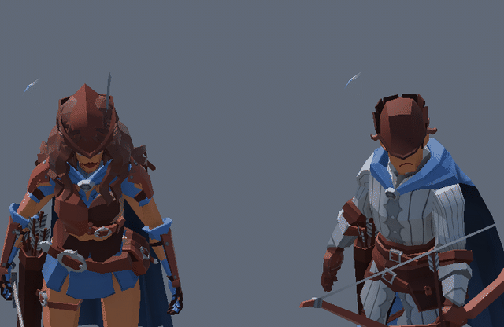

같은 기절 효과가 플레이어와 동료의 머리 기준점을 중심으로 공전합니다. 머리 위 파란 궤적에서 공전을 볼 수 있습니다.

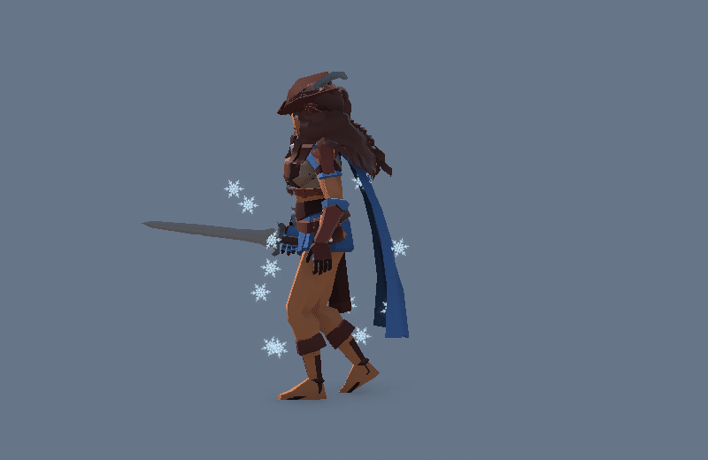

감속 상태의 눈송이 효과가 이동하는 플레이어를 따라갑니다.

### 구매·강화·재화와 영구 저장

- **구매·강화**: 아이템 구매와 능력치 강화 시 보유 수량·강화 단계·잔액을 함께 저장합니다.
- **성장 적용**: 영구 강화 기록을 플레이어·동료의 이번 스테이지 능력치에 반영하고, 설치물 담당자에게도 계산 결과를 전달합니다. 원본 ScriptableObject(SO)의 기본 수치는 유지합니다.
- **재화·연속 처치**: 적 처치와 연속 처치에 보상을 지급합니다. 재사용된 적도 이번 등장 회차로 구분해 같은 처치가 중복 집계되지 않도록 했습니다.

재화·수량·진행도는 저장 성공 후 반영하고, 실패 시 재시도해도 보상이 중복 지급되지 않도록 처리했습니다.

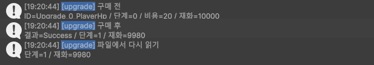

HP 강화 0→1단계와 비용 20 차감을 함께 저장합니다. 저장 파일을 다시 읽어 강화 단계 1과 잔액 9,980을 확인합니다.

### 미션 진행과 보상

적 처치 수를 채우거나 동료 없이 플레이하는 등 미션 조건을 달성하면 보상을 지급합니다. 미션 진행도와 보상 지급 여부는 함께 저장합니다. 처치 수는 적이 등장한 회차별로 집계해, 같은 처치가 다시 전달돼도 한 번만 반영합니다.

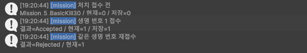

처치 미션의 현재 진행과 저장값을 함께 갱신합니다. 같은 적의 같은 등장 회차를 다시 접수하면 거절해 중복 집계를 막습니다.

### 도감 해금·최초 보상·열람 상태 저장

스테이지를 클리어하면 적 정보를 해금하고 최초 보상 지급 이력을 저장합니다. 이미 처리한 도전의 종료 결과가 다시 전달돼도 같은 보상은 한 번만 지급합니다. 도감 화면에는 저장된 해금·신규·열람 상태를 제공했습니다.

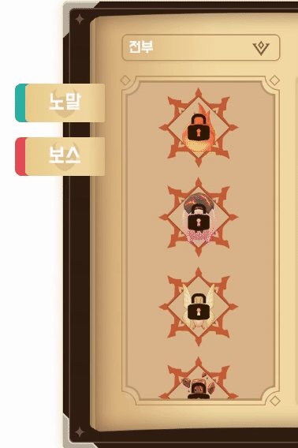

해금·열람 상태를 팀원이 구현한 도감 UI에 연결한 모습

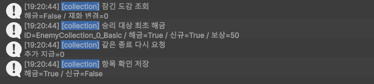

해금·최초 보상·열람 상태 저장 로그. 같은 종료를 재요청해도 보상은 중복 지급하지 않습니다.

### 로비 선택·공용 슬롯·스테이지 종료

- **로비 선택과 입장 준비** · 스테이지·난이도·무기를 선택하고 최고 기록과 등장 적을 조회합니다. 입장할 때 선택한 무기와 저장 결과를 확인한 뒤 맵과 난이도, 무기 정보를 플레이 씬에 전달합니다.
- **공용 슬롯** · 설치물 5종·동료 3종·소모품 2종을 단축키로 사용하는 10칸입니다. 슬롯 데이터와 실행 요청을 연결하고, 설치 여부는 팀원 로직에서 판정하도록 했습니다.
- **스테이지 종료** · 종료 보상과 잔액을 저장하고, 승리 시 최고 기록과 별 보상 지급 이력을 갱신합니다.

동료 슬롯에는 고용 가능 여부와 불가 사유, 재고용 대기 시간을 조회하는 기능을 제공했습니다. 팀원이 만든 화면에서 슬롯 입력을 받아 고용 요청을 처리합니다.

#### 결과 UI와 정산 연계

스테이지 담당이 판정한 승패와 점수를 받아 제가 구현한 종료 처리에서 보상과 기록을 저장합니다. 승리 화면이 열린 뒤에도 저장이 실패할 수 있어, 종료·정산의 성공 여부를 따로 전달하고 팀원이 만든 결과 UI에 표시하도록 연결했습니다.

Stage1 테스트에서는 승리 후 정산이 완료되고 결과 화면에 반영됐습니다.

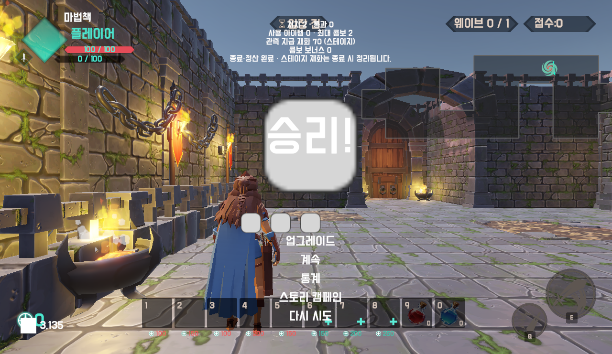

팀원이 구현한 결과 UI에 Stage1 정산 내용을 표시한 모습 (연동 테스트 당시)

### 사운드·환경설정

캐릭터 행동음과 위치 기반 단발·반복음을 관리합니다. 공격 모션의 사운드 이벤트와 실제 발사·충돌 시점의 재생 요청을 나눠 연결하고, 객체 비활성화나 도전 종료에 맞춰 필요한 출력을 정리합니다.

화면 모드·해상도·마스터/BGM/SFX 볼륨 설정은 게임 진행과 별도로 저장하고 다시 실행했을 때 복원합니다. 키 설정의 편집·저장·복원은 2-5에서 설명했습니다.

---

## 5. 개발 도구

설정값을 바꾸거나 기능을 시험할 때 쓰는 검사·적용·실행 기능을 에디터 창과 Inspector에 모았습니다. 설정 도구에서는 적용 전 바뀔 값을 확인하고, 검증 도구에서는 실행 결과와 요청이 거절된 이유를 확인할 수 있습니다. VFX 프리팹을 검사하고 연결하는 과정은 공용 VFX 절에서 설명했습니다.

### CSV 임포터 — 표 작성부터 변경 확인·적용까지

프로젝트에서는 설정 데이터를 주로 CSV로 작성하고 임포터로 가져왔습니다. 첫 단계 강화 비용을 바꿀 때는 CSV에서 값을 수정하고, 임포터에서 변경 전후를 비교한 뒤 적용하는 방식입니다.

입력 오류는 적용 전에 표시합니다. 같은 ID의 ScriptableObject와 기존 참조를 재사용하므로, 수치를 수정할 때 연결을 다시 잡는 작업을 줄일 수 있었습니다.

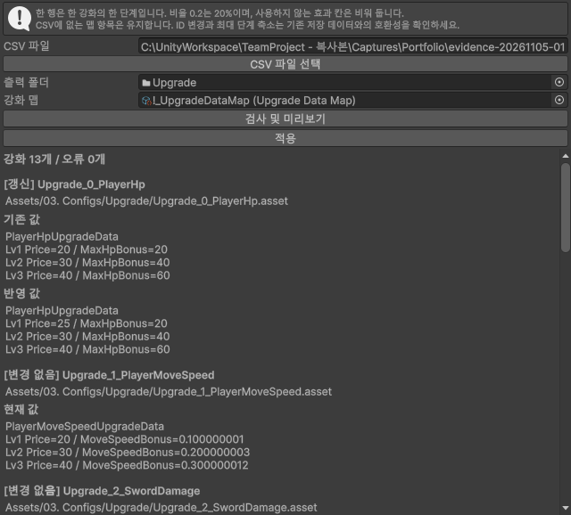

강화 CSV 사본의 첫 단계 비용을 20→25로 변경한 미리보기입니다. 변경 항목과 기존 값 유지 항목을 나눠 표시하며, 에셋에는 적용하지 않았습니다.

### Sound Setup — 음원 배정·검사와 연결

캐릭터와 무기마다 나뉜 행동음 설정을 Sound Setup 한 창에서 배정하고 검사합니다. 음원 폴더와 적용할 데이터 맵은 프로필로 지정합니다.

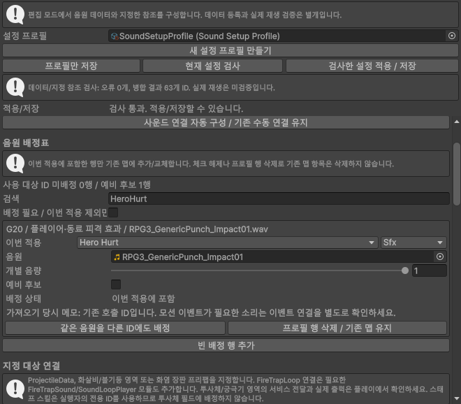

행동별 사운드 ID에 음원·음량·출력 종류를 배정하고 검사 결과를 확인합니다.

- **설정 검사·적용** · ID와 음원 설정을 검사하고, 오류가 0개일 때 적용·저장할 수 있습니다.
- **기존 연결 보존**: 무기·동료의 투사체와 영역 사운드 연결을 자동 구성할 때 기존 수동 연결을 유지합니다.
- **누락 음원 복구** · 설정 JSON의 그룹과 파일명을 음원 폴더와 대조해 끊긴 참조를 찾습니다.
- **애니메이션 이벤트 설정** · 별도 도구에서 검 공격·스킬·궁극기와 발소리에 빠진 사운드 이벤트를 추가합니다. 기존 타격·종료 이벤트와 조정한 사운드 시점은 유지합니다.

설정을 적용한 뒤 소리가 들리지 않으면 SoundManager에서 마지막 재생 요청을 확인할 수 있습니다. 요청이 거절됐다면 거절 사유를, 요청이 접수됐다면 음량·공간 출력·청취 위치를 확인합니다.

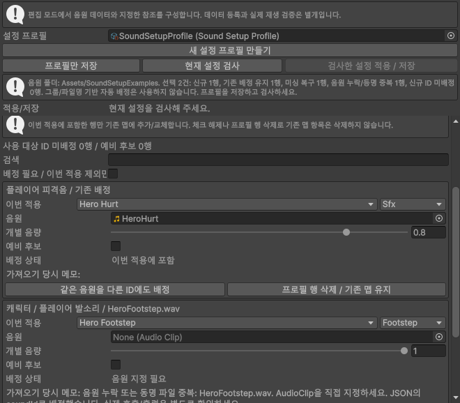

일치하는 음원을 찾은 누락 참조는 복구하고, 동명 후보가 여러 개면 수동 선택 대상으로 남깁니다.

### Play Debug와 설정·저장 Inspector

Play Debug에서는 승패와 점수를 지정해 실제 정산 로직을 실행하고, 재화와 지급 이력이 어떻게 바뀌는지 비교할 수 있습니다. 아래 두 실행은 같은 조건의 첫 3성 클리어와 재도전입니다. 클리어 보상은 두 번 모두 지급됐고, 최초 별 보상은 첫 클리어에만 지급됐습니다.


최초 3성 클리어 · 클리어 보상 450 + 최초 별 보상 300.

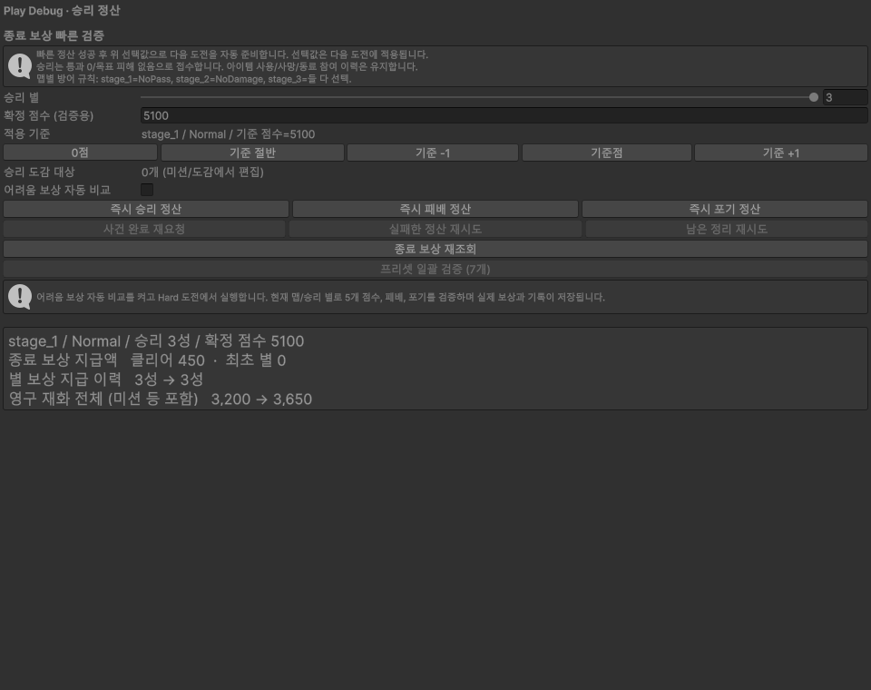

같은 조건으로 재도전 · 클리어 보상 450 + 최초 별 보상 0.

GameManager Inspector에서는 키 배정의 편집·적용·저장과 입력 포착 상태를 확인합니다. SaveManager Inspector에서는 **백업 준비 → 기존 백업 교체 승인 또는 취소 → 불러오기 → 복원 전 보관본 복구**를 요청할 수 있습니다. 현재 처리 단계와 결과를 표시해 요청이 어느 단계에 있는지 구분합니다.

### 저장 검사 도구

별도 임시 폴더와 시험용 저장·입력 액션으로 손상 데이터, 쓰기 실패와 재시도를 검사합니다. 정상 진행 파일을 바꾸지 않고 오류 조건을 반복해서 만들 수 있도록 했습니다.

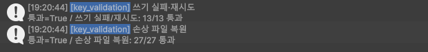

키 저장·쓰기 실패 후 재시도 13/13, 손상 파일 복원 검사 27/27 통과.

---

## 6. 개발 회고

### 잘한 점

개인 프로젝트에서는 모델과 애니메이션을 준비하는 데 예상보다 시간이 많이 들었습니다. 이번에는 쓸 에셋부터 정하고 개발을 시작해, 기능을 만들 때 어떤 모델과 모션을 연결할지도 미리 알 수 있었습니다.

### 힘들었던 점

VFX와 애니메이션은 에셋을 연결한 뒤에도 플레이 화면에서 보이는 모습을 확인하며 조정해야 했습니다. 특히 활은 상체 오버라이드를 적용한 뒤 이동·공격 방향과 상체 모션이 어긋나는 구간이 있어 VFX보다 보정에 시간이 더 걸렸습니다. 직접 플레이하면서 어색한 구간을 찾고, Codex에 상체 각도와 전환 구간의 보간을 조정하도록 요청했습니다. 수정할 때마다 같은 동작을 다시 재생해 방향과 전환을 확인했습니다.

### 아쉬운 점

개발 기간이 짧아 팀에서는 싱글플레이의 핵심 흐름을 우선했습니다. 제가 맡은 플레이어 전투도 회피를 중심으로 구성했고, 가드·패링처럼 방어 선택지를 넓히는 기능은 초기 범위에서 제외했습니다. 시간이 더 있었다면 전투에서 선택할 수 있는 행동을 늘리고, 프로젝트에 멀티플레이도 구현해 보고 싶었습니다.

### 팀 작업에서 배운 점

제가 맡은 로직을 끝내도 팀이 함께 플레이해 보려면 연결할 기능과 화면이 준비돼야 했습니다. 그러려면 팀원마다 작업하는 속도, 기능을 연결하는 순서, UI·아트 리소스에 드는 작업량까지 같이 봐야 했습니다.

다음에는 각자 맡은 기능의 마감과 팀이 처음 함께 플레이해 볼 날짜를 같이 잡겠습니다. 그 날짜에 맞춰 필요한 리소스와 연결 작업이 준비되도록 순서도 정해 두겠습니다.

---

## 7. 남은 폴리싱과 최종 검증

3개 스테이지를 난이도별로 반복 플레이하며 전투 감각과 재화·강화 수치를 조정할 예정입니다. 실제 맵에서 미니맵 아이콘 위치와 전투 사운드·VFX도 함께 점검합니다.

최종 검증은 도전 종료 → 정산·결과 표시 → 로비 복귀 → 다음 도전 순으로 진행합니다. 새로 시작하거나 기존 저장을 불러온 경우에도 보상·강화·해금 기록이 이어지는지 확인합니다.

---

## 8. 리소스 출처 및 제작 범위

| 구분 | 출처·제작 범위 |
| --- | --- |
| 캐릭터·무기 | [POLYGON – Modular Fantasy Hero Characters](https://syntystore.com/products/polygon-modular-fantasy-hero-characters) — Synty Studios. [Low-Poly Medieval Fantasy Heroes – Basic Pack](https://assetstore.unity.com/packages/3d/characters/humanoids/fantasy/low-poly-medieval-fantasy-heroes-basic-pack-288957) — Polysplit Games. 캐릭터·무기 모델과 프리팹을 활용했습니다. |
| 몬스터·애니메이션 | [Monsters Fire Pack](https://assetstore.unity.com/packages/3d/characters/creatures/monsters-fire-pack-175328) — SURIYUN. Fire Gazer·Golem 모델과 애니메이션을 활용했습니다. |
| 던전 환경·텍스처 | [FANTASTIC – Dungeon Pack](https://www.tidalflask.com/projects/186Vrq) — Tidal Flask Studios. [Hand Painted Seamless Lava Texture](https://assetstore.unity.com/packages/2d/textures-materials/floors/hand-painted-seamless-lava-texture-158352) — Innovana Games. 던전 구조·소품·환경 효과와 용암 텍스처를 활용했습니다. |
| 캐릭터 애니메이션 | [Human Melee Animations](https://assetstore.unity.com/packages/3d/animations/human-melee-animations-151650)·[Human Archer Animations FREE](https://assetstore.unity.com/packages/3d/animations/human-archer-animations-free-335880) — Kevin Iglesias. [RPG\_Animations\_Pack\_FREE](https://assetstore.unity.com/packages/3d/animations/rpg-animations-pack-free-288783) — DoubleL. 추가로 Mixamo의 Jumping·Stabbing 계열 애니메이션을 사용했습니다. |
| VFX 원본 아트 | [Magic Effects FREE](https://assetstore.unity.com/packages/vfx/particles/spells/magic-effects-free-247933) — Hovl Studio. [Trails VFX – URP](https://assetstore.unity.com/packages/slug/242574) — Vefects. [Particle Pack](https://assetstore.unity.com/packages/slug/127325) — Unity Technologies. |
| VFX 제작·수정 범위 | 본인 작업 · 외부 에셋 재조합·파티클 조정, 눈송이 셰이더·기절 공전·공용 재생 및 셋업 도구 구현. |
| 오디오 | [Medieval Fantasy SFX Bundle](https://assetstore.unity.com/packages/audio/sound-fx/medieval-fantasy-sfx-bundle-238870) — Magic Sound Effects. [RPG Magic Sound Effect Pack 3 \[Elemental\] (AAA)](https://assetstore.unity.com/packages/audio/sound-fx/rpg-magic-sound-effect-pack-3-elemental-aaa-191784) — WOW Sound. 두 에셋의 효과음을 사용했습니다. |
| 발소리 | [Sound Effects Pack](https://opengameart.org/content/sound-effects-pack) — OwlishMedia. Footsteps/step1.wav를 사용했습니다. CC0. |
| UI 리소스 | 팀원 C·D가 제작한 HUD·인벤토리·아이콘·프레임 등의 UI 이미지를 사용했습니다. 팀원별 제작 범위는 프로젝트 개요의 담당 범위 표에 정리했습니다. |
| 글꼴 | [배달의민족 도현](https://www.woowahan.com/fonts) — 우아한형제들. TextMesh Pro용 SDF로 사용했습니다. 기본·대체 글꼴로 Liberation Sans를 참조하며, 동봉된 라이선스는 SIL Open Font License 1.1입니다. |
| 외부 패키지·도구 | [DOTween](https://dotween.demigiant.com/) — Demigiant. Newtonsoft.Json, Unity Input System·AI Navigation·URP·TextMesh Pro/uGUI를 사용했으며, Firebase REST API로 인증·백업을 연동했습니다. |
| AI 활용 | 코드 구현에 AI 활용. Gemini 이미지는 UI 담당 개발자가 생성·적용했습니다. |

### 검증 범위

- **실제 맵** · Stage1에서 승리 후 정산 완료와 결과 UI 표시를 확인했습니다.
- **시연과 디버그 실행** · 이동·피격·조준 전환을 시연했고, 조준에는 시험용 클립을 사용했습니다. 치명타 뒤 넉백은 더미에서, 첫 클리어와 재도전의 별 보상 차이는 Play Debug에서 확인했습니다.
- **격리 검사** · 별도 저장 파일로 진행 JSON 검사 21개를 실행해 모두 통과했습니다.

### 관련 코드·문서

- [저장·백업 계약](https://github.com/jlfff0233-boop/DungeonHold/blob/main/Docs/Systems/SAVE_SYSTEM.md) · [저장 확인 이력](https://github.com/jlfff0233-boop/DungeonHold/blob/main/Docs/Systems/Test/SAVE_TEST.md)
- [VFX 계약](https://github.com/jlfff0233-boop/DungeonHold/blob/main/Docs/Systems/VFX_SYSTEM.md) · [무기 계약](https://github.com/jlfff0233-boop/DungeonHold/blob/main/Docs/Systems/WEAPON_SYSTEM.md) · [동료 계약](https://github.com/jlfff0233-boop/DungeonHold/blob/main/Docs/Systems/COMPANION_SYSTEM.md)
- [입력 계약](https://github.com/jlfff0233-boop/DungeonHold/blob/main/Docs/Systems/INPUT_SYSTEM.md) · [담당·구조](https://github.com/jlfff0233-boop/DungeonHold/blob/main/Docs/ARCHITECTURE.md)
- [실제 오류 기록](https://github.com/jlfff0233-boop/DungeonHold/blob/main/Docs/ERROR.md) · [과거 확인 이력](https://github.com/jlfff0233-boop/DungeonHold/blob/main/Docs/DONE.md) · [남은 연결·검증](https://github.com/jlfff0233-boop/DungeonHold/blob/main/Docs/TODO.md)
